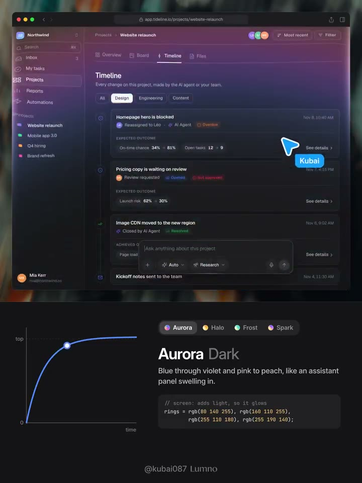
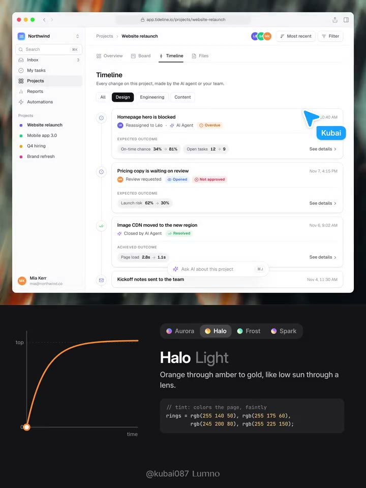
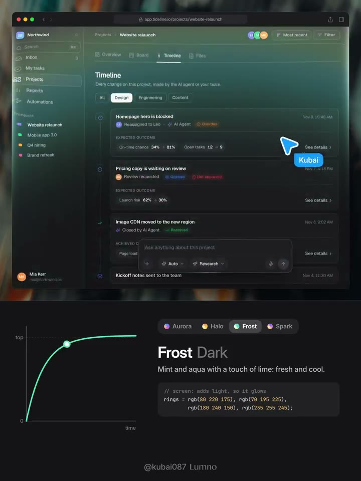
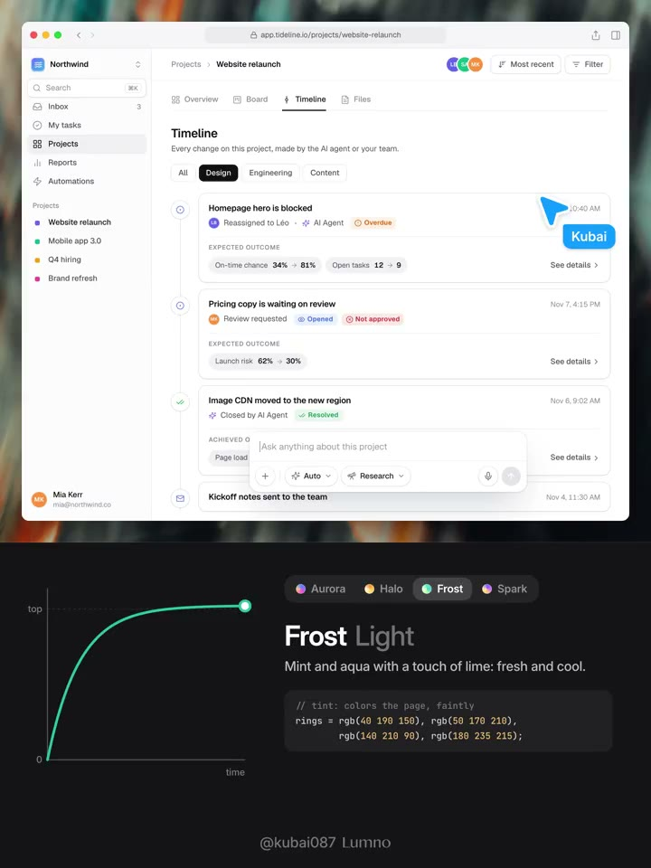
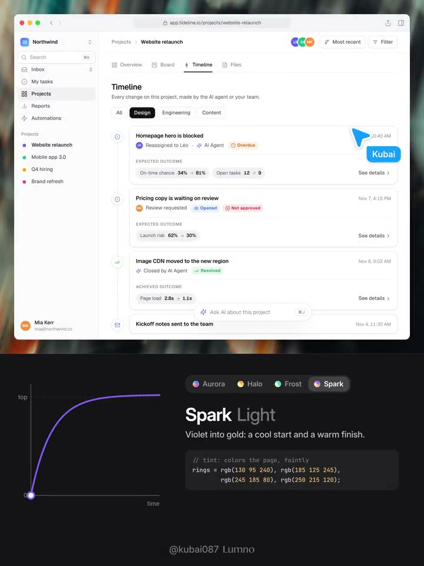

## 問題

如何讓啟動或主動觸發的光環效果與頁面內容產生互動，避免只有一張獨立的發光貼圖覆蓋在畫面上？

## 做法

- 作者以頁面快照作為計算底圖，讓向外擴散的環形區域產生透鏡扭曲：外側拉伸、內側壓縮，表現內容被推開的感覺。
- 紅、藍通道相對綠色分別多、少位移 8%，形成輕微色散；四道漸變色環隨擴散淡出。淺色模式偏染色，深色模式使用 screen 加光。
- 效果限制在內容區，到達邊緣時只輕微拉伸內容，維持窗框穩定；波經過分隔線與描邊時短暫提亮，讓既有結構一起回應。
- 原帖另提供藍紫粉桃、橙黃、薄荷綠、紫金四組配色。這是作者的效果拆解，沒有提供跨瀏覽器或效能驗證。

本篇確實使用同系列名稱，但沒有明寫 013。保留未標號狀態，避免用發表先後推定正式編號。

[原帖示範影片](01-source.mp4)。

*1.067 秒：深色介面展示 Aurora 配色，下方並列擴散曲線。*

*5.333 秒：同一配色在淺色頁面上的呈現。*

*9.600 秒：橙黃色 Halo 與另一組色環參數。*

*13.867 秒：深色頁面搭配綠色系 Frost。*

*18.133 秒：淺色頁面的綠色系效果。*

*22.400 秒：紫金色 Spark 的示例。完整扭曲與擴散過程需對照影片，靜態幀不能還原節奏。*

## 為什麼有效（推論）

光環、文字扭曲與邊線反射共享同一次擴散，可令回饋與頁面結構連貫。此效果也可能分散注意力或引起動態不適；其價值取決於觸發頻率與使用情境。

## 借鑑要點

- **適合**：使用者主動觸發、低頻率的展示或完成回饋。
- **不適合**：頻繁切換、長時間閱讀或要求視覺穩定的操作。
- **移植時注意**：驗證快照取得方式、文字清晰度與低效能裝置；尊重 reduced-motion，保留無扭曲的替代回饋。原帖提及的系統版本與瀏覽器能力只視為作者當時的靈感陳述。
