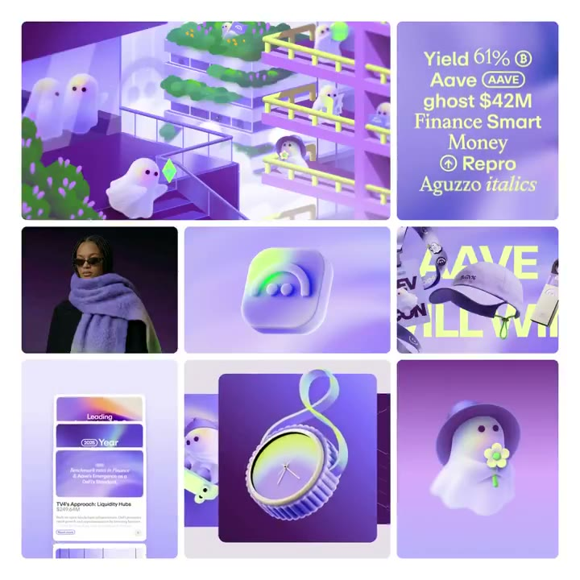
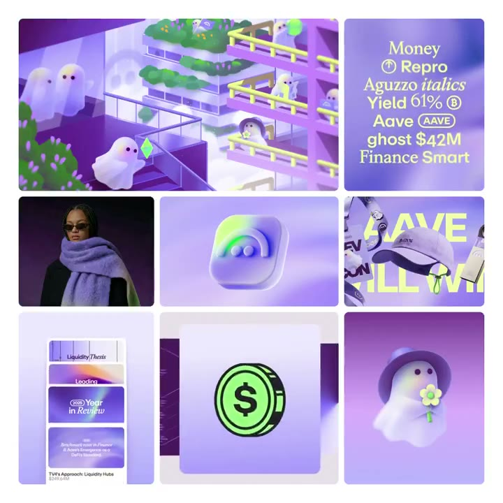

## 問題

軟體品牌的識別會出現在圖標、排版、插畫和宣傳畫面中。這些載體的形態不同，需要共同線索把它們連成一套，也要保留各素材表達內容的空間。

## 做法

@rebrandgallery 於 2026-10-27 刊登 Aave 視覺識別，明確署名 @iamlirona（@buck_tv）。Kubai 當日轉發，未補充設計說明；作品歸屬原設計者，不能因分享而算作 Kubai 原創。來源沒有交代正式採用範圍，按作品參考收錄。

畫面觀察：短片將多個品牌素材排成不同大小的方格，包括角色、字體、立體物件、圖標及頁面片段；多數以紫色為底，搭配亮綠色點綴，同一角色在不同場景中重複出現。

*2.083 秒：紫色方格中並置字體、角色、立體物件與小型頁面。*

*7.083 秒：中央方格顯示綠色圓形符號，周圍保留紫色角色與排版素材。*

[@rebrandgallery 刊登的本地影片](01-source.mp4)（10 秒）。

## 為什麼有效（推論）

收錄者推論：共同底色、點綴色與角色，可以讓不同媒材維持關聯；並列展示也便於檢查識別是否只能依賴單一標誌。來源沒有品牌辨識或轉換成效數據。

## 借鑑要點

- **適合**：檢查軟體品牌在圖標、插畫與宣傳素材中的一致性。
- **不適合**：由展示影片推定產品介面、功能或正式品牌規範。
- **移植時注意**：先選少量可重複的色彩與形狀，再用不同尺寸和載體驗證；原作角色與標誌須保留歸屬，另確認使用授權。

原帖：[作品刊登與設計署名](https://x.com/rebrandgallery/status/2115043533736342006)、[Kubai 轉發](https://x.com/Kubai087/status/2115121955393478696)。
