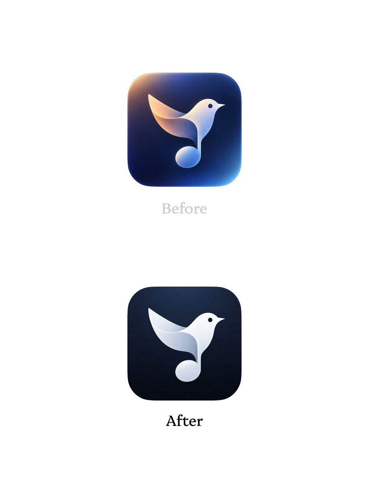
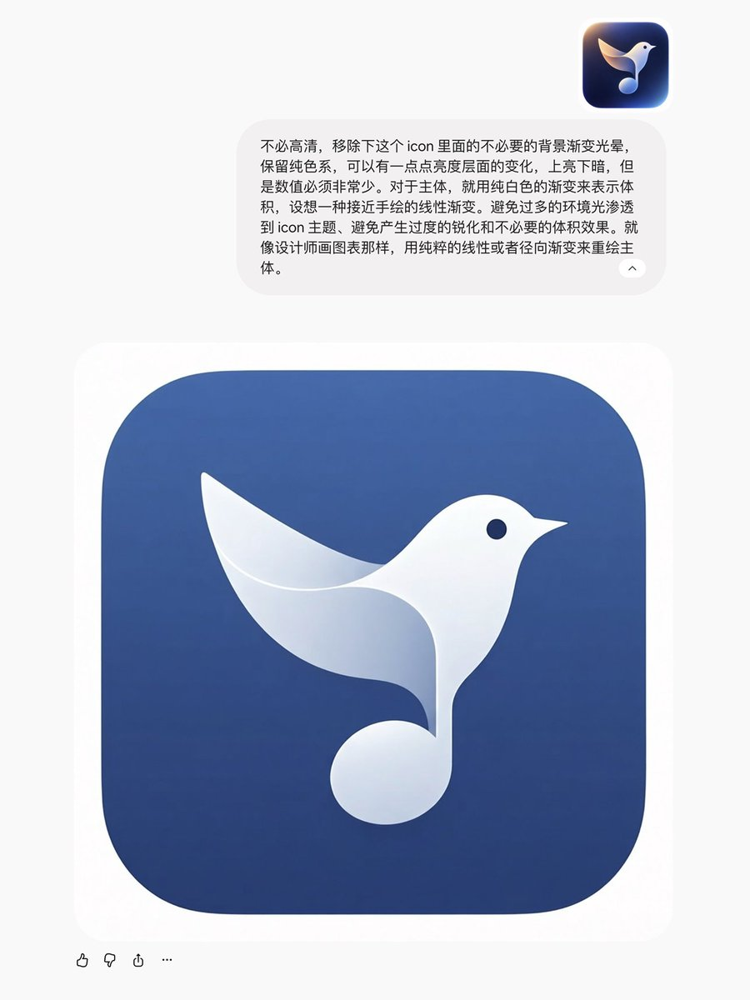

## 問題

AI 圖標可能把簡單符號畫成厚重實體，加入多處光暈、反光與陰影，讓輪廓被材質蓋住。若輸出只有合成圖，後續調整背景或裁切也不方便。

## 做法

Kubai 於 2026-10-29 展示以網頁版 Gemini 修改圖標的結果，主張減少非必要體積感：主體以簡單線性或徑向漸變塑形，背景減少光暈和多餘材質，陰影用鄰近色相的深色。附圖操作文字另要求避免環境光過度滲入主體。作者建議輸出分層 PNG 與背景參數，再交給 Icon Composer；這是當時工作流描述，未驗證目前適配能力。

11-01 是同文自轉發，不是新版本。另篇回應 @hodu382759「減法較耐看」的觀點，追問簡約符號是否必然適合 App 圖標，沒有給出通則。原帖致謝 @H_Stepania_ 的案例，但封包未附其原帖，原始圖標作者仍未完全核明。

*Before 的背景帶明顯彩色光暈；After 收斂為深底與較簡單的白色主體層次。*

*補圖保留作者操作文字與另一個藍底結果，鳥形音符仍是主要輪廓。*

## 為什麼有效（推論）

收錄者推論：減少相互競爭的光影，可讓符號輪廓更突出；分層則保留後續調整空間。這不證明所有圖標都該扁平化，也沒有小尺寸辨識測量。

## 借鑑要點

- **適合**：輪廓已成立、只是材質過滿的 AI 圖標。
- **不適合**：必須靠立體結構表意的符號，或尚未確定主體的草稿。
- **移植時注意**：先比較去光暈與去體積的不同效果；保留原版，檢查多種尺寸與裁切。分層輸出仍須核對透明邊緣和圖層重組結果。

來源：[改作原帖](https://x.com/Kubai087/status/2115674219602452656)、[同文轉發](https://x.com/Kubai087/status/2116831087947346291)、[延伸討論](https://x.com/Kubai087/status/2115813977511075942)、[@hodu382759 原回覆](https://x.com/hodu382759/status/2115809125779091967)。
