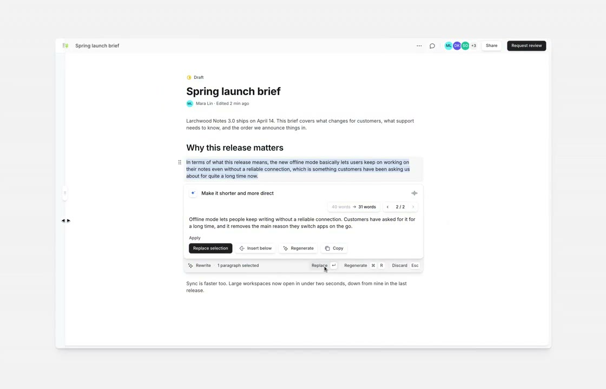

## 問題

AI 改寫面板需要讓使用者對照原文與建議，並區分取代、插入和重試；若操作分散，容易不確定下一步會改到哪裡。

## 做法

*選取文字下方顯示改寫結果，面板內按鈕與底部工具列各有採用、重試等操作。*

*紫色選取範圍與浮動面板對應，輸入、建議、字數版本及採用操作集中排列。*

原作者陳述：ianneo_ai 分享由 Claude Opus 5.5 輔助製作的 Before → After 示範，由 Kubai 轉發。對照後的面板加入明確標題、獨立指令輸入與淡紫建議區，將字數變化和版本標記放在結果附近；底部以實心主按鈕強調取代，插入、重試與複製採次要樣式。畫面字數是示例資訊，未驗證計算或編輯功能；可見[本地對照影片](01-source.mp4)。

## 為什麼有效（推論）

收錄者推論：原文與面板共用強調色，可能幫助辨識改寫範圍；結果與操作集中，則可減少重複入口造成的猶豫。這只是視覺與流程示範，沒有實測證明新版操作更快。

## 借鑑要點

- **適合**：選取一段內容後進行 AI 編修的編輯器。
- **不適合**：需要同時比較多段差異的長文審閱。
- **移植時注意**：保留明確的插入位置、取消與復原；另驗證長建議、鍵盤焦點及面板遮擋。

原帖：[ianneo_ai 的對照示範](https://x.com/ianneo_ai/status/2120409204943114510)、[Kubai 分享](https://x.com/Kubai087/status/2120413488850067696)。
