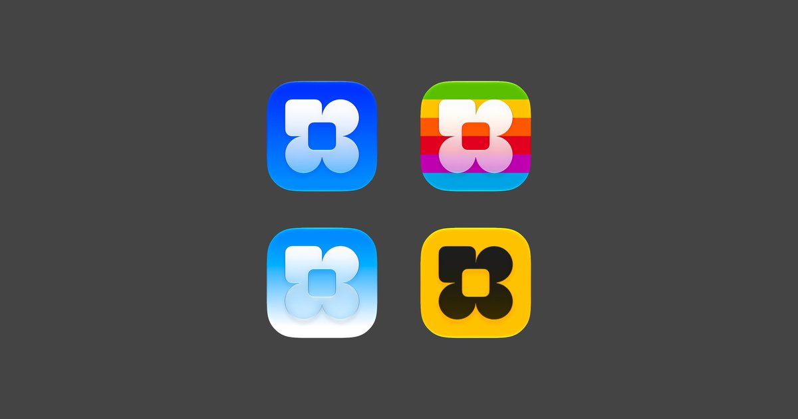

## 問題

同一個 App 符號換上透明或高光材質後，可能出現不同氣質。比較時需要保留相同輪廓，才能看出顏色、明暗與材質各自造成的差異。

## 做法

Kubai 於 2026-10-24 稱這是液態玻璃的合適用法；這是他的審美評價。作品圖片出自被引用的 @airbuild 原帖，原帖僅以「ICONS」介紹，沒有提供材質參數、個別設計者署名或上架資訊。

畫面觀察：四個圓角方形圖標以二乘二排列，共用四瓣符號與中央圓角方孔；配色分別包含藍底、彩虹條紋、淺藍白底和黑黃組合。部分符號帶漸變、亮邊與陰影，各版本保留相近的主體比例。

*圖片來自 @airbuild：相同四瓣符號分別置於四種配色與材質處理中。*

## 為什麼有效（推論）

收錄者推論：固定外形後比較材質，較容易辨別哪些差異來自輪廓，哪些來自透明度或背景。它可作視覺探索參考，不能據此判定任何系統的材質規範已通過。

## 借鑑要點

- **適合**：比較同一標誌的色彩及材質變體。
- **不適合**：直接將「正確用法」當成可套用所有圖標的規則。
- **移植時注意**：先檢查單色輪廓，再以小尺寸、明暗桌布比較中央孔洞與瓣形的辨識；保留原作署名，另核對實際使用授權。

原帖：[Kubai 評論](https://x.com/Kubai087/status/2113996771991171491)、[AirBuild 圖片原帖](https://x.com/airbuild/status/2113963302338674898)。
