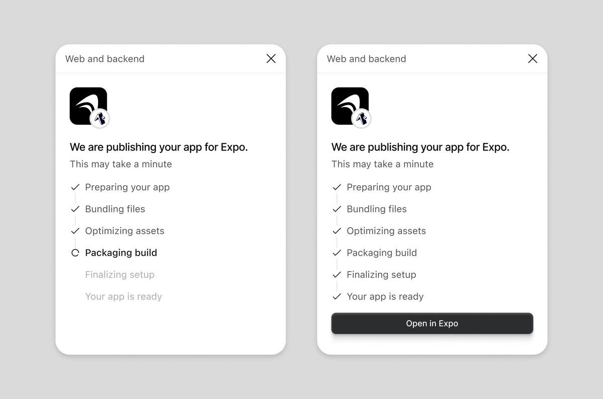

## 問題

AI 介面的標題、說明與步驟各自看似合理，放在一起卻可能沒有共同基準。遇到這種散亂感，持續換配色或加裝飾，未必碰到真正的排版問題。

## 做法

Kubai 於 2026-10-28 的建議很集中：同一資訊層級盡量採同一種對齊，再找標竿產品查看預設字級體系，文中以 12、14、16px 為例。這些數字是例子，不是跨產品通用規格。

被引用的 @jaydwivedi_ 原帖強調排版的重要，附圖呈現同一發布流程的進行中與完成狀態。標題、說明及步驟文字共用左側基準；左圖用當前步驟與淡化後續步驟區分進度，右圖全部勾選並出現底部按鈕。這是狀態對照，不是字級修改前後，也沒有可直接取用的字級標註。

*@jaydwivedi_ 引用圖把進行中與完成並排，兩邊維持相同文字起點與步驟排列。*

## 為什麼有效（推論）

收錄者推論：共同基準可減少視線在欄位間來回尋找；有限字級則讓層級更容易重複。圖中的成功狀態不能用來證明排版調整改善了完成率。

## 借鑑要點

- **適合**：資訊已齊全，但標題、列表與說明缺乏一致秩序的畫面。
- **不適合**：直接把參考產品的像素值當作自身閱讀規格。
- **移植時注意**：按語義層級盤點文字，先統一起點，再調字級與行高；用真實長文、數字、翻譯及文字放大檢查，保留有意義的縮排差異。

來源：[Kubai 建議](https://x.com/Kubai087/status/2115384977227661661)、[@jaydwivedi_ 原帖](https://x.com/jaydwivedi_/status/2115379248013717822)。
