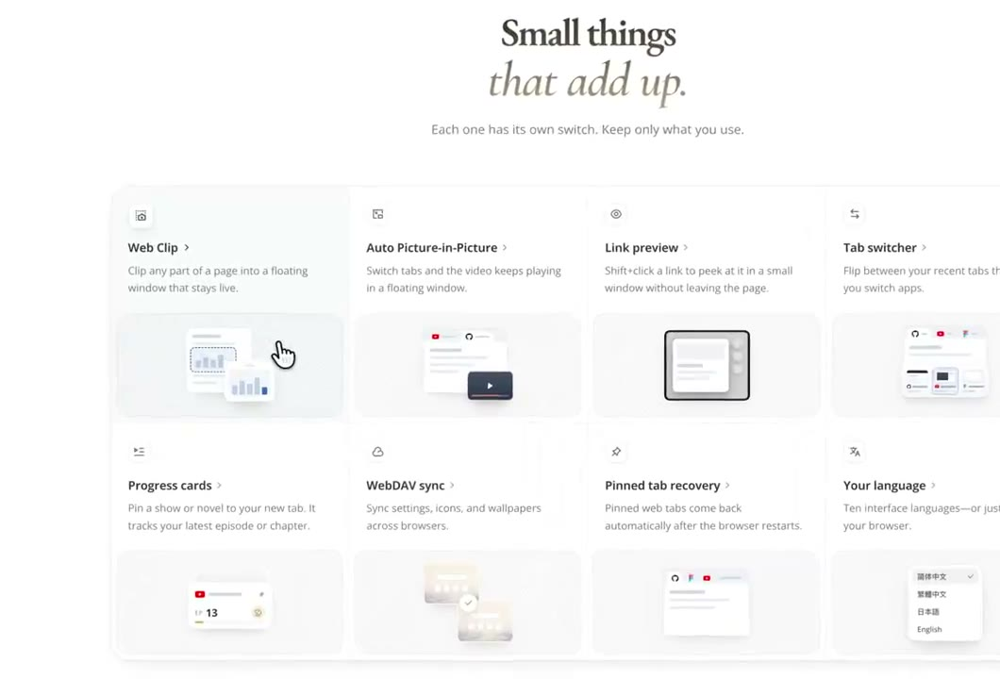
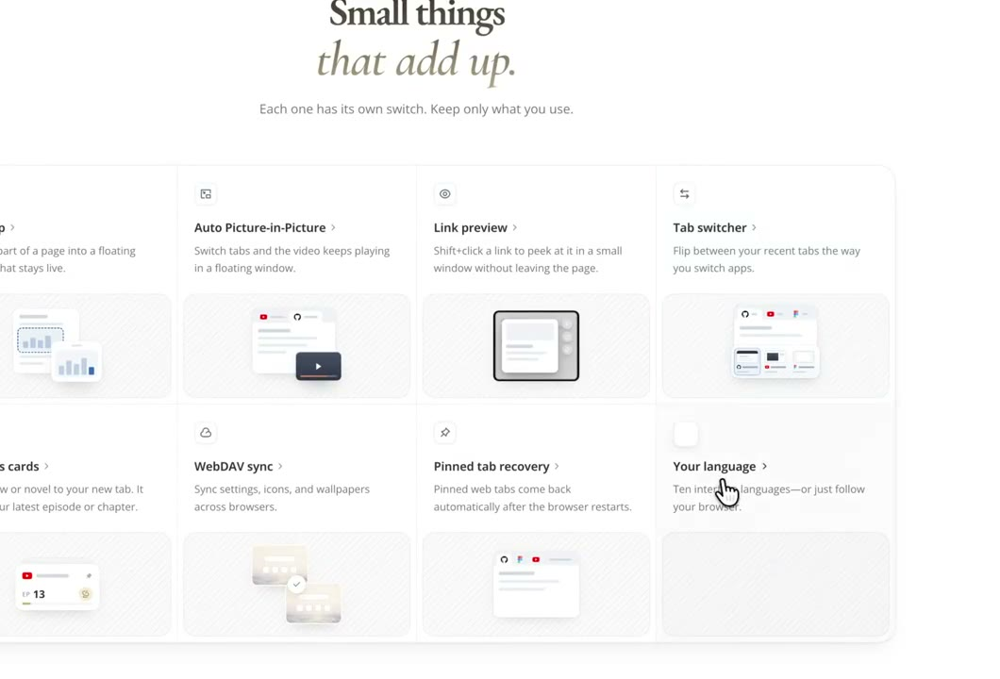
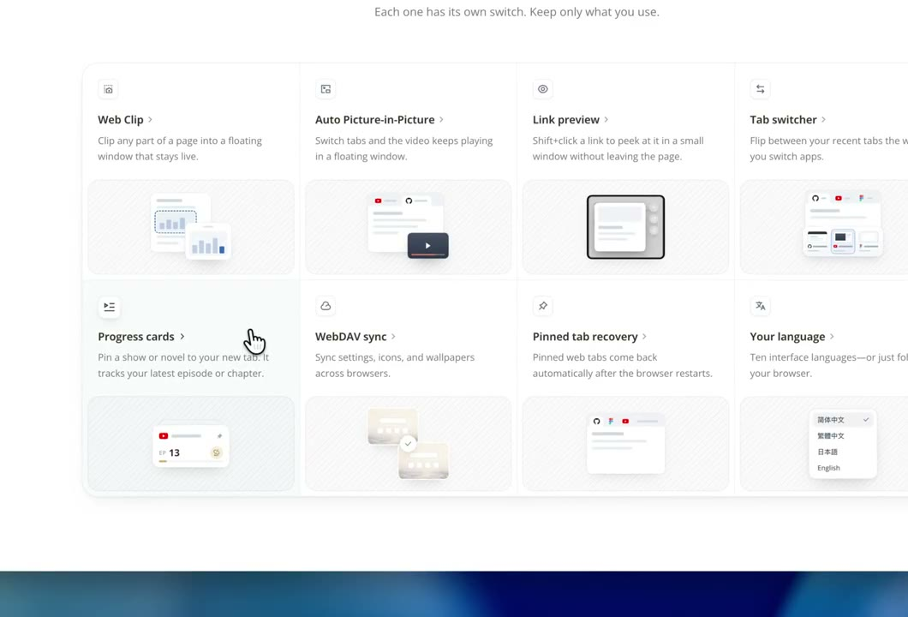

## 問題

官網功能愈放愈多，只增加頁數會拉長閱讀路徑；只堆功能名稱，又難交代每項功能到底做了什麼。這組示範把說明壓縮到一組小場景中。

## 做法

Kubai 於 2026-10-28 展示四欄兩列功能網格，每格有圖標、標題、短說明與微型介面。原帖規格要求一格只講一件事，用 2–4 個動作串起「操作→結果」，例如開小窗或同步內容；場景以抽象線框代替整張產品截圖。

作者給的節奏是單步 250–600ms、整段約 3 秒，進入視窗後播放一次並停在結果；滑鼠懸停或鍵盤焦點可重播，減少動態效果時直接顯示結果。這些是規格值，並非本卡逐項執行的測量。

10-29 是同文自轉發；11-01 轉發的是 @Stv_Lynn 對規範整理的致謝，其[原始回覆](https://x.com/Stv_Lynn/status/2116925748720406961)已核對。回饋中的實作歸屬該回覆作者。

*0.838 秒：功能區以四欄兩列排列，每格下方都有小型介面場景。*

*7.544 秒：畫中畫、小窗預覽及其他功能同處一組網格，說明文字保留在圖外。*

*17.602 秒：下排可見進度卡片、同步與語言清單等不同形式的示意。*

[本地示範影片](01-source.mp4)

## 為什麼有效（推論）

收錄者推論：一格一個因果關係，可在有限空間交代功能；停在結果幀，也讓未看完動效的人保有線索。這不證明所有功能都能一頁說完。

## 借鑑要點

- **適合**：有明確操作與結果、可拆成短場景的功能介紹。
- **不適合**：需要長時間推理或多分支流程才能理解的能力。
- **移植時注意**：以真實功能決定場景，沿用品牌元件；確保手機點按可直接導航，動畫不藏必要文字，也別同時循環全部圖格。

來源：[原始示範](https://x.com/Kubai087/status/2115393082472681875)、[同文轉發](https://x.com/Kubai087/status/2115733832163000580)、[轉發 @Stv_Lynn 的回饋](https://x.com/Kubai087/status/2116926100215578906)。
