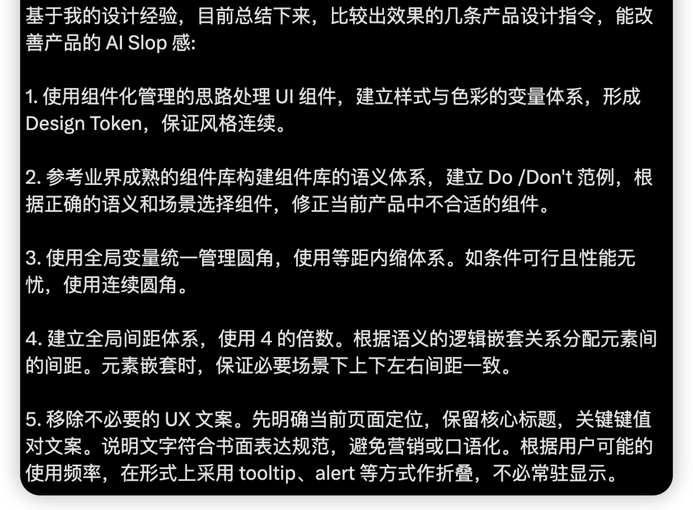

## 問題

AI 生成或 Vibe Coding 做出的產品，常見問題是元件風格各自為政、圓角與間距隨手取值、說明文字堆滿畫面，整體顯得廉價、雜亂。只說「去掉 AI 味」無法執行，需要能直接交給 Agent 或團隊照做的指令。

## 做法

*原帖正文截圖（已裁去頭像與帳號列）：開頭說明這是作者依經驗總結、較有效的產品設計指令，下接五條編號建議。*

作者陳述的五條指令，依原文整理：

1. **元件化與 Design Token**：用元件化方式管理 UI，建立樣式與色彩的變數體系，形成 Design Token，讓風格保持連續。
2. **元件語義與 Do／Don't**：參考業界成熟元件庫，建立自己的元件語義體系與 Do／Don't 範例；依正確語義與場景選元件，修正產品中用錯的元件。
3. **圓角**：用全域變數統一管理圓角，採「等距內縮」體系（內層圓角隨內距遞減）；條件允許且效能無虞時使用連續圓角。
4. **間距**：建立全域間距體系，使用 4 的倍數；依語義的嵌套邏輯分配元素間距；元素嵌套時，在必要場景保持上下左右間距一致。
5. **UX 文案減法**：先確定頁面定位，只保留核心標題和關鍵的鍵值對文案；說明文字採書面語，避免行銷腔或口語；依使用頻率改用 tooltip、alert 等方式收合，不必常駐顯示。

原帖只有文字，沒有前後對照圖、具體 token 數值或成效數據。

## 為什麼有效（推論）

- 前四條把「隨手取值」換成「從有限集合取值」。AI 生成畫面的不協調感，很大一部分來自同一屬性出現太多相近但不同的值；收斂成變數後，一致性由系統保證，而不是靠逐畫面檢查。
- 第 2 條處理的是比外觀更深一層的問題：AI 常用錯元件（例如該用 Toast 的地方用 Modal），外觀再統一也會顯得不對勁。Do／Don't 範例讓 Agent 有判斷依據。
- 第 5 條對應 AI 產出的常見症狀：每個區塊都附說明、語氣像行銷頁。刪減後，視覺層次才有空間顯現。
- 以上是收錄者推論；作者只稱這些指令「比較有效」，沒有附測試或數據。

## 借鑑要點

- **適合**：
  - 給 Coding Agent 的設計系統型提示詞，或寫進專案的 `AGENTS.md`／`CLAUDE.md`。
  - 審查 AI 生成介面時當作檢查清單：顏色、圓角、間距是否都來自 token？元件語義對不對？說明文字能不能收合？
- **不適合**：
  - 品牌官網、行銷頁或敘事型頁面。這類頁面需要的文案量和表現力，與第 5 條相反。
  - 一次性原型。先建完整 token 體系的成本可能高於收益。
- **移植時注意**：
  - 4 的倍數是常見起點，不是唯一解；密集資料介面可能需要 2px 級的微調。
  - 連續圓角（superellipse）在 Web 上的支援與效能依瀏覽器而異，作者也加了「條件可行且性能無憂」的前提。
  - 文案收進 tooltip 會降低觸控裝置與鍵盤使用者的可發現性。關鍵資訊不要只放在 hover 內，見 `accessibility` 相關檢查。
  - Do／Don't 範例要寫進 Agent 讀得到的文件，否則 Agent 仍會依訓練資料的平均習慣選元件。

## 相關卡片

- 第 3 條圓角的細節：[遞進圓角與連續曲率](../kubai-999-004-nested-continuous-corners/case.md)
- 第 2 條元件語義的實例：[依觸發來源與是否需後續處理區分 Toast 與 Notification](../kubai-999-016-toast-vs-notification/case.md)、[依資訊、風險與任務長度選擇浮層](../kubai-999-009-overlay-selection/case.md)
- 同主題的其他做法：[把設計問題清單反過來用於審稿](../kubai-anti-slop-review/case.md)、[修整 AI 介面：先統一對齊，再建立字級層次](../kubai-alignment-type-hierarchy/case.md)
