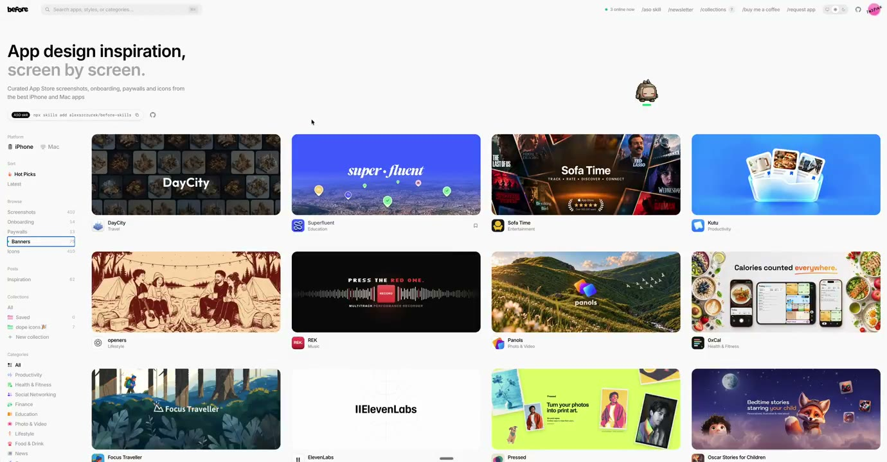
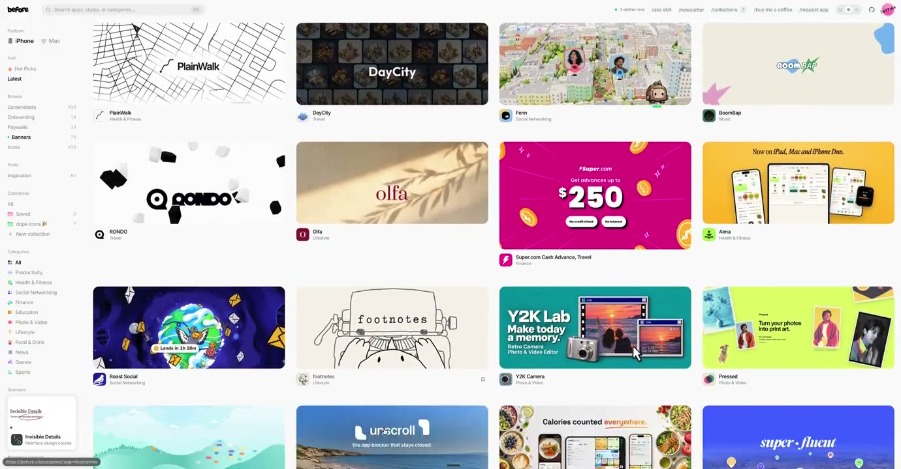
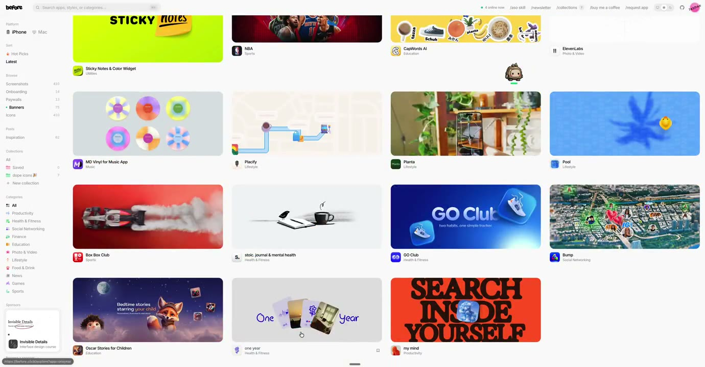

## 問題

製作 App 橫幅時，需要比較主圖、標題與產品畫面如何分配有限空間。逐一找單張作品較難看出變體，圖庫可先提供一組構圖參考。

## 做法

@aliszu 原帖宣布圖庫中的 App Store banners 上線，影片展示側邊導覽與多欄橫幅網格。本卡按原作者的公開上線介紹收錄；其官方原帖網址資料已核對出入口 [before.click](https://before.click)，本次未另外審查網站全部內容。

Kubai 於 2026-10-29 分享時，另稱 App Store 已全量開放 Banner 圖。這是當時的作者說法，不能由圖庫上線反推 Apple 的開放範圍，也不是目前規範的驗證。影片中的橫幅分屬不同產品，不能把所有圖像的創作都歸給 @aliszu 或 Kubai。

*0.942 秒：主區以多欄網格排列橫幅，側邊保留導覽，圖下帶小型產品標記。*

*8.481 秒：同一網格中並列大字、插畫、產品畫面與留白較多的橫幅。*

*16.020 秒：瀏覽到另一組圖片，仍以相近卡片尺寸呈現不同色彩和主圖比例。*

[@aliszu 本地圖庫示範](01-source.mp4)

## 為什麼有效（推論）

收錄者推論：統一展示尺寸可讓構圖差異更容易比較，但圖庫只提供視覺樣本，沒有證明某種排版能提高下載率或符合所有投放位置。

## 借鑑要點

- **適合**：橫幅概念探索與主圖、文字比例的比較。
- **不適合**：把參考圖當可直接使用的素材，或當作當前平台尺寸與資格規範。
- **移植時注意**：回查個別產品與創作者，提取布局關係後改用自有內容；交付前另核對實際展示位置、裁切及最新平台要求。

來源：[Kubai 分享](https://x.com/Kubai087/status/2115667328017051906)、[@aliszu 原帖](https://x.com/aliszu/status/2115486437156016566)。
