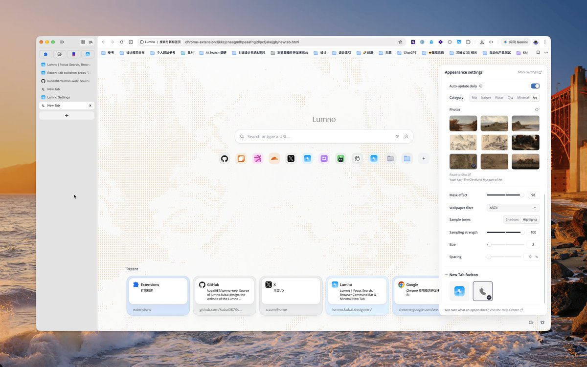

## 問題

新標籤頁每天出現多次，使用者需要熟悉的搜尋與常用入口，也可能希望背景有些變化。若連主要版面一起改動，視覺驚喜就可能干擾原本的查找習慣。

## 做法

Kubai 於 2026-10-25 描述一個每日由不同壁紙重繪 ASCII 圖案的新標籤頁：保留同樣的簡潔頁面，讓底下的圖片帶來小變化，並連到 Lumno 網站。

本帖附圖可見 Lumno 名稱、中央搜尋框、常用圖示與底部最近項目；右側外觀面板開啟 Auto-update daily，提供圖片分類與縮圖，Wallpaper filter 選為 ASCII，另有明暗取樣、強度、大小和間距控制。這張靜態截圖沒有證明跨日刷新結果或排程條件，原文也未交代更新失敗時的處理。

*搜尋及常用入口置於淡色字元背景前，右側面板顯示每日更新開關與 ASCII 參數。*

## 為什麼有效（推論）

收錄者推論：保留入口位置、只替換背景來源，可能兼顧熟悉感與新鮮感；取樣和間距控制則讓使用者有機會調整圖案密度。來源沒有可讀性或留存效果數據。

## 借鑑要點

- **適合**：高頻使用、主要操作區域固定的個人化首頁。
- **不適合**：把高密度字元直接鋪在密集文字與小型控制項後方。
- **移植時注意**：以明暗不同的圖片檢查文字對比，保留關閉濾鏡與恢復預設的方式；定義跨日、離線和圖片載入失敗時的結果，再驗證每日更新是否如預期運作。
