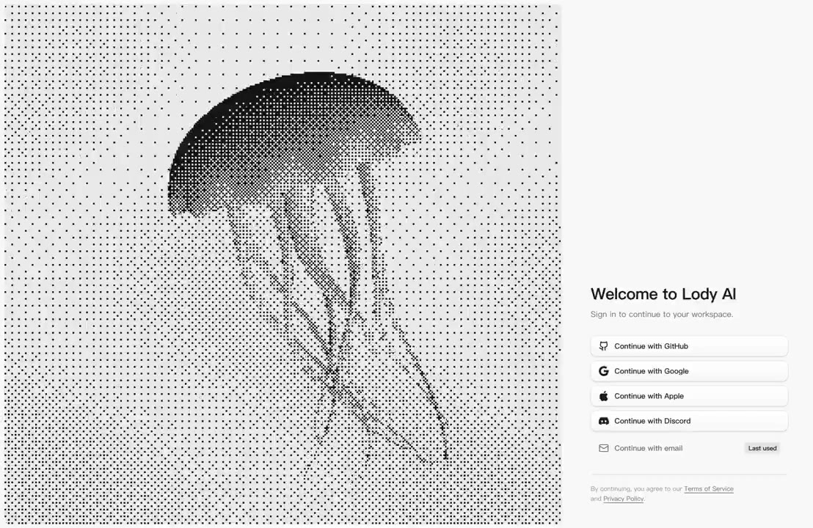

## 問題

登入頁需要建立品牌印象，也要讓使用者快速找到登入方法；大幅動態裝飾若與表單混排，容易搶走操作焦點。

## 做法

*左側大區域以黑白字元狀紋理呈現水母，右側窄欄放歡迎標題與多個登入入口。*

來源歸屬：leon7hao 發布歡迎帖與示範影片，畫面標題可辨識為 Lody AI；封包未確認其設計者身分與產品正式上線狀態，因此按概念示範收錄。抽樣影格中，左側水母輪廓與觸手形狀改變，右側登入區位置保持一致，包含多個第三方入口及電子郵件方式。Kubai 觀點是將它列為耐看的 ASCII 登入頁參考，不是作品署名。可回看[本地影片](01-source.mp4)，不能由展示推定登入已成功串接。

## 為什麼有效（推論）

收錄者推論：動態集中在獨立圖像區，表單維持固定欄位與閱讀順序，可能兼顧風格與操作定位。黑白處理也讓左右區域共享色調，但不代表所有文字對比與鍵盤操作已合格。

## 借鑑要點

- **適合**：桌面寬度足夠、需要品牌識別的登入入口。
- **不適合**：窄螢幕仍照比例擠入大型裝飾的場景。
- **移植時注意**：小螢幕先保住表單，裝飾可縮減；另驗證登入錯誤、焦點順序與減少動態設定。

原帖：[Kubai 的登入頁評論](https://x.com/Kubai087/status/2114350354720780333)、[leon7hao 的示範原帖](https://x.com/leon7hao/status/2114193251314065849)。
