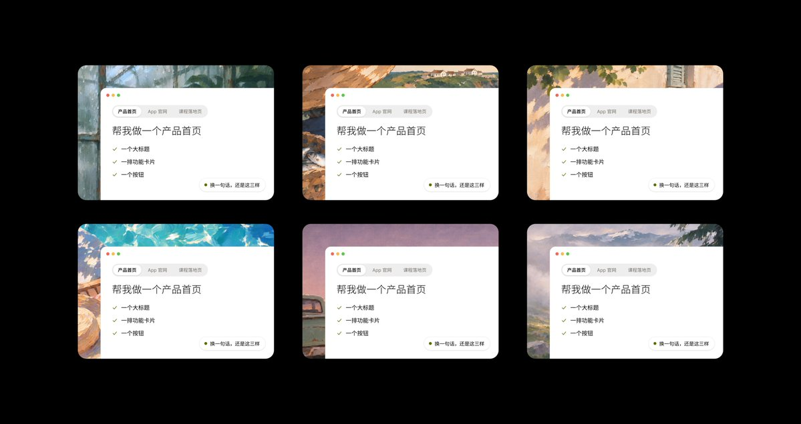
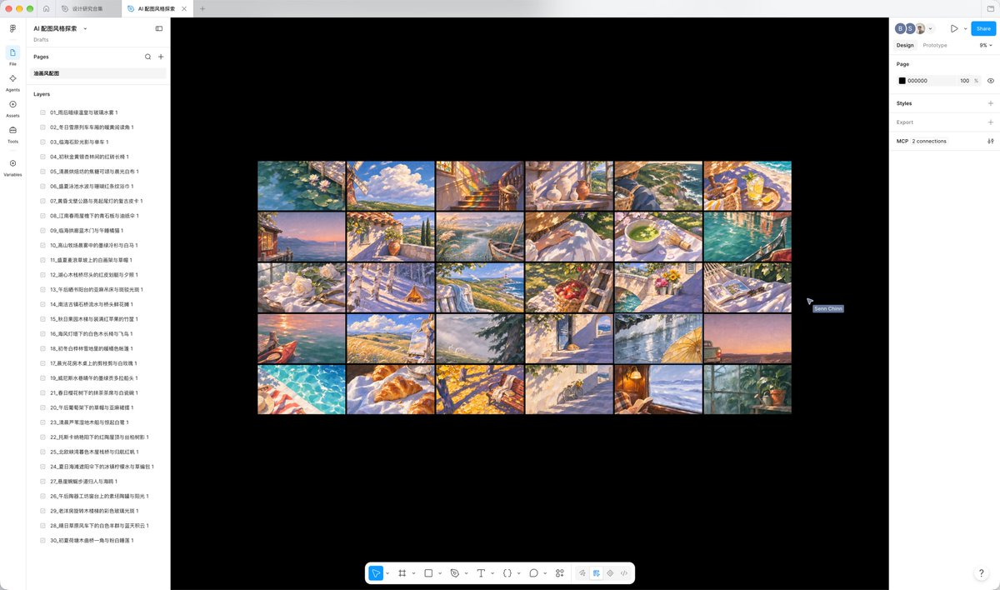

## 問題

產品首頁與卡片若東拼西湊配圖，光線、色彩和筆觸容易互相衝突；找到單張好圖也不代表能延伸成一套。

## 做法

*六張卡片更換風景背景，前方白色內容板的位置與資訊結構保持一致。*

*多張場景圖以等尺寸網格集中排列，左側可見逐項命名的圖層清單。*

原作者陳述：ianneo_ai 先分享手繪油畫配圖，將硬邊陰影、暖金亮部、冷色暗部與粗亞麻布紋理列為風格約束；後續宣布整理成 Figma 資源檔，第一期收集此系列，供首頁、卡片背景與頁尾使用。Kubai 分別轉發兩帖，並非圖像作者。展示中的海岸、室內與街景沿用相近筆觸，卡片則以白色面板承載正文。作者的[直接回覆](https://x.com/ianneo_ai/status/2119694721018966270)已提供 [Figma 配圖檔](https://www.figma.com/design/MwD2VZ8EzMRVKMCht3ylmD/AI-%E9%85%8D%E5%9B%BE%E9%A3%8E%E6%A0%BC%E6%8E%A2%E7%B4%A2?node-id=0-1)；本次未存取檔案或核對授權條款。

## 為什麼有效（推論）

收錄者推論：先限制光影與材質，再更換場景主題，可能比逐張找圖更容易維持一致。把正文移到獨立面板，也能降低背景細節對文字的干擾；來源沒有可讀性或轉換測試。

## 借鑑要點

- **適合**：需要同系列情境配圖的卡片與品牌頁面。
- **不適合**：必須忠實呈現商品外觀的實物展示。
- **移植時注意**：一併固定裁切比例、文字安全區與光線方向，使用前確認授權和原始解析度。

原帖：[配圖方法](https://x.com/ianneo_ai/status/2119422829016031382)、[Figma 整理說明](https://x.com/ianneo_ai/status/2119694716862357699)、[Kubai 首次分享](https://x.com/Kubai087/status/2119430740811337835)、[Kubai 資源分享](https://x.com/Kubai087/status/2119695083926966428)。
