## 問題

作品集或影像展示想讓同一組圖像循環出場，卻不想只做平面的左右位移。本例提供四種不同的空間排列，便於比較軌跡如何改變觀看重點；來源是動態概念展示，未驗證實際網站的導航功能。

## 做法

[desdivj 原帖](https://x.com/desdivj/status/2121551213112009164)寫「One carousel. 4 ways to loop it.」，附四支各約 5.016 秒影片。[Kubai 引用帖](https://x.com/Kubai087/status/2121938541240528957)於 2026-11-15T12:09:06+00:00 分享，反覆強調選圖好看；它沒有新增影片，也不是四個變體的原作者。兩個 ID 對應同一流程，本卡以原帖作 canonical source，引用帖作別名，不重複建卡。

四支影片都使用淺灰背景、左上小標題和色彩鮮明的直幅圖像，包含紅色車輛、人物、室內及靜物。沒有可見的按鈕、拖曳手勢或播放控制，因此只記錄影片中自動運動的過程，不推定使用者觸發方式。

### Spiral Trail：沿彎曲軌跡排隊

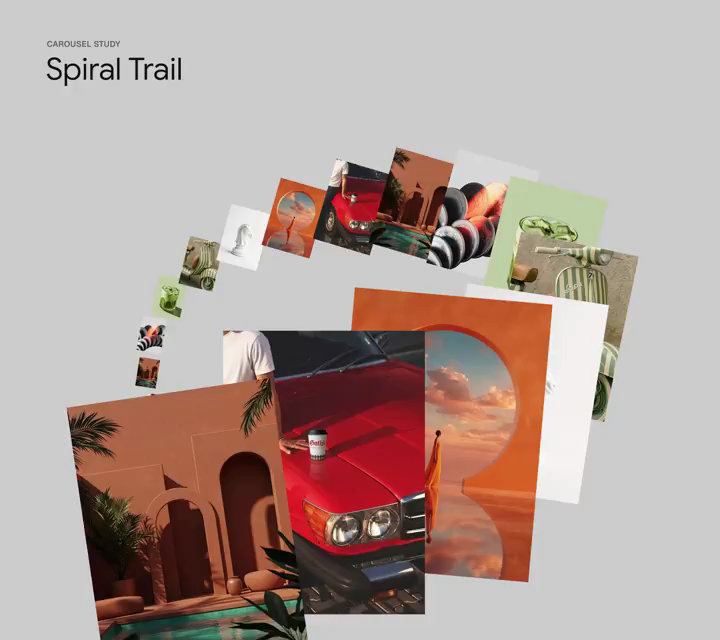
*0 秒，大圖位於前景左下，後續圖像沿彎曲路徑縮小，繞向上方再回到右側。*

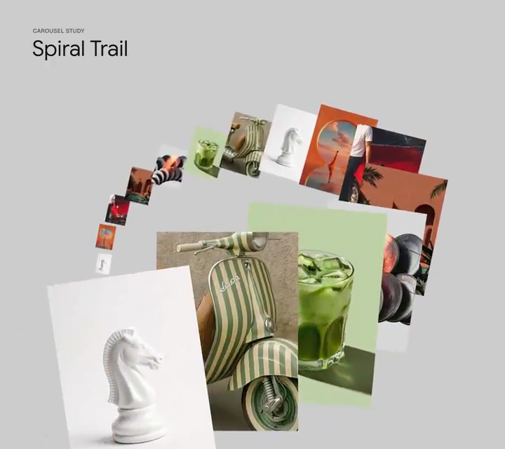
*2 秒，白色雕塑與綠色靜物輪到前景，相同路徑上仍可見較小的後續圖片。*

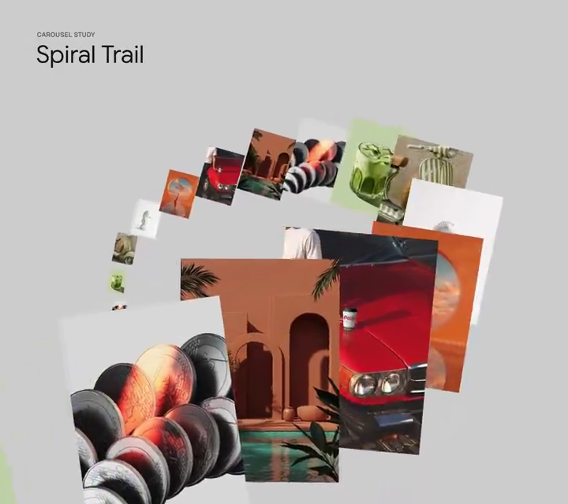
*4 秒，另一張靜物移到前景，遠處圖片持續沿弧線補入，形成連續隊列。*

- **播放 → 變化 → 結束狀態**：圖像沿彎曲路徑前進，同時改變尺寸與遮擋關係；前景依次換圖，截取片段結束時仍在運行。小圖串提供路徑形狀，大圖負責當下焦點。

### Dealt Hand：扇形發牌

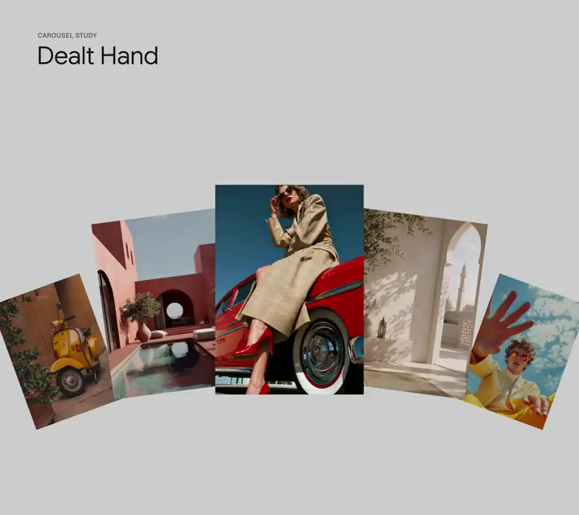
*0 秒，中央人物圖較大，兩側圖片各自傾斜，組成橫向展開的扇牌。*

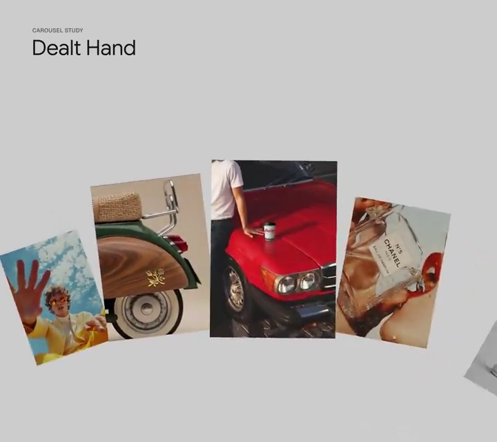
*2 秒，紅色車輛成為中央大圖，左右圖像隨排列移動並改變角度。*

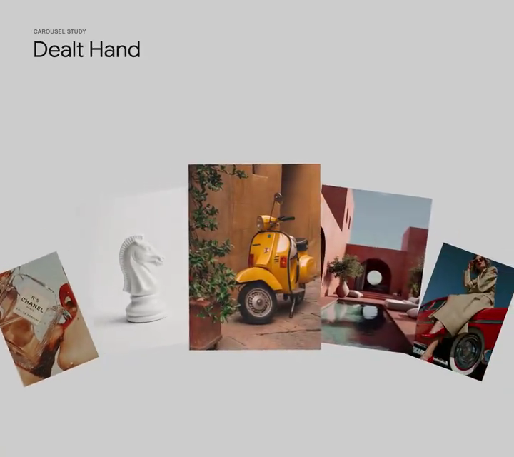
*4 秒，黃色機車進入中央區，圖片持續保持左右分開的扇形節奏。*

- **播放 → 變化 → 結束狀態**：主圖依序經過中央，兩側圖像用不同傾角展開；運動後仍保留扇形結構。不是將所有圖片維持正面等距平移。

### Rising Current：斜向上升流

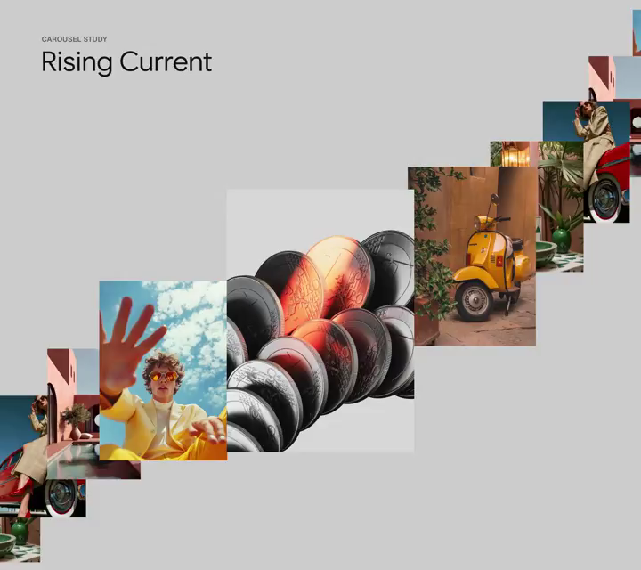
*0 秒，圖像由左下向右上形成斜向帶，中央人物與鄰近靜物互相遮擋。*

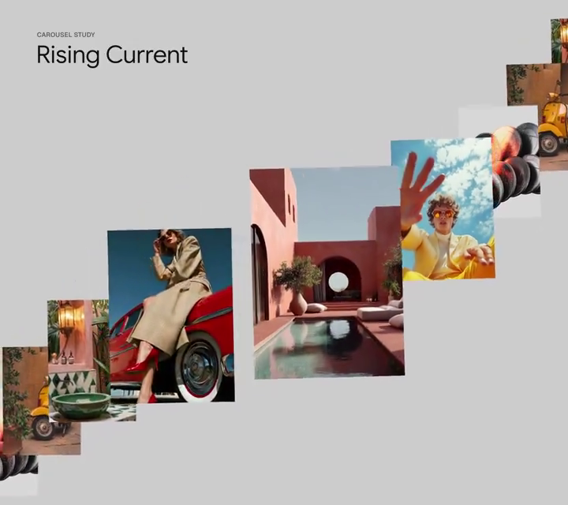
*2 秒，紅色車輛與室內圖像通過中央，斜線兩端仍延伸出畫面。*

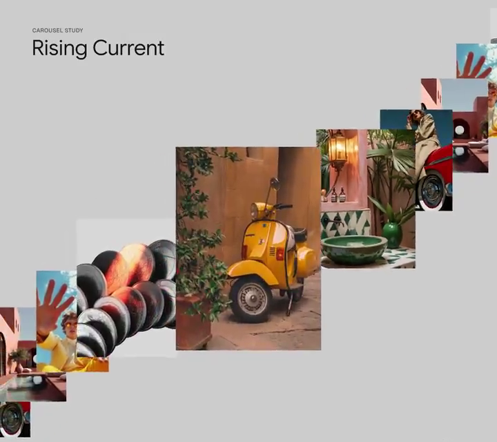
*4 秒，同一斜向帶繼續流動，中央大圖變換，但路徑方向維持一致。*

- **播放 → 變化 → 結束狀態**：圖像接續穿過左下至右上的帶狀區，沿線產生尺寸與遮擋變化；沒有在片段末端停在某張選中卡片。

### Depth Rail：正面主圖與景深側列

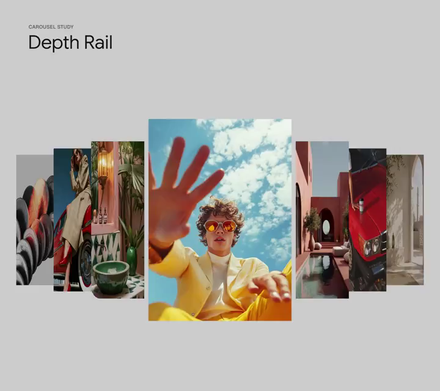
*0 秒，中央人物圖正面放大，左右圖片縮小並側轉，形成向兩邊退去的景深軌道。*

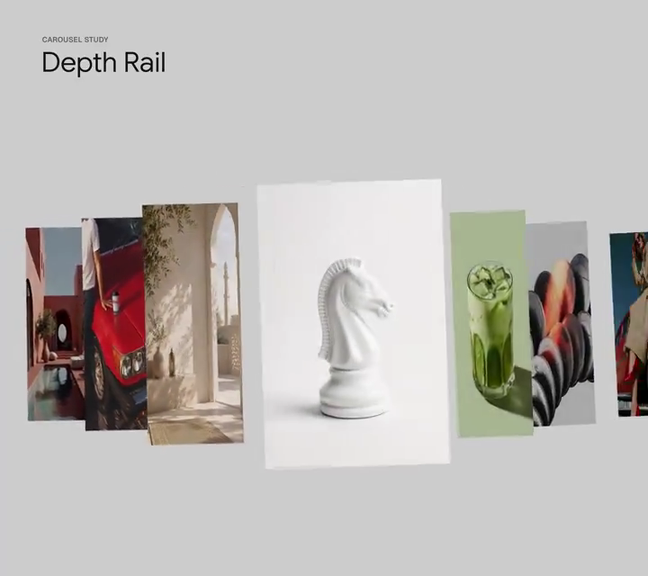
*2 秒，白色雕塑到達中央，原先主圖進入側列，軌道結構不變。*

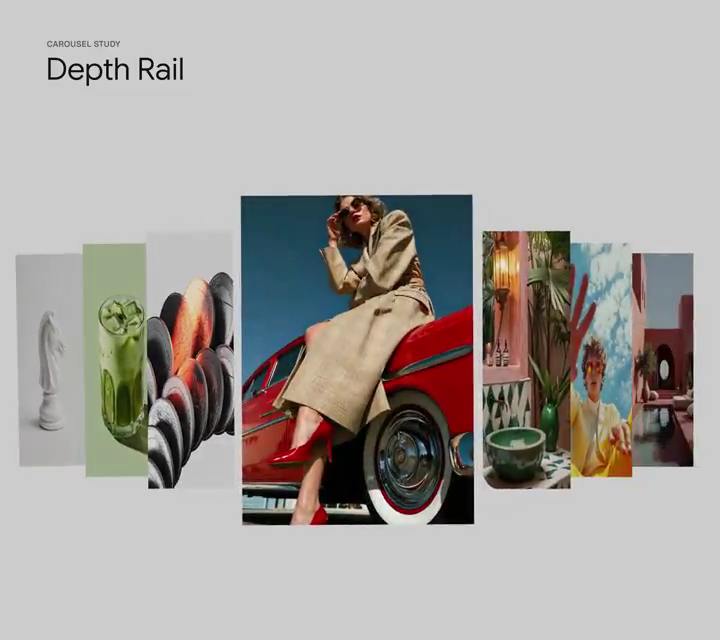
*4 秒，人物與紅車圖成為中央主圖，側列繼續提供相鄰內容預覽。*

- **播放 → 變化 → 結束狀態**：中央圖像維持較大的正面觀看區，離開中央後縮小、側轉；接續圖片補入焦點。影片證明排列在循環運動，不能據此認定實作已做到無縫重置或支援任意資料長度。

## 為什麼有效（推論）

- 保持圖集相近，只更換軌跡，讓比較集中在構圖：螺旋強調連續隊列、扇牌強調展開、斜流強調方向、景深軌道強調單一主圖。
- 圖片的色塊、主體與裁切本身已有辨識度，縮小或遮擋後仍留下節奏；這與 Kubai 的選圖評論一致，但不能推出成效數據。
- Depth Rail 的正面中央圖可能較適合需要看清單張內容的展示；Spiral Trail 與 Rising Current 可能更適合營造氛圍。來源未提供可用性研究。

## 借鑑要點

- **適合**：作品集首頁、攝影選集、品牌影像牆；圖片有一致比例與足夠視覺品質，可接受部分圖片暫時被遮擋。
- **不適合**：需要按順序讀完的教學、價格比較、搜尋結果，或使用者必須準確點選每一項的主要導航。
- **移植時注意**：先以實際素材測試最小縮圖及裁切，避免人物臉部或文字被切掉。需要導航時另加清楚的上一張、下一張、目前位置與暫停控制；不要把影片未展示的互動視為既有功能。觸控捲動、鍵盤焦點、減少動態偏好和低效能裝置應有平面靜態列表作替代。四種軌跡擇一即可，不必同頁混用。
