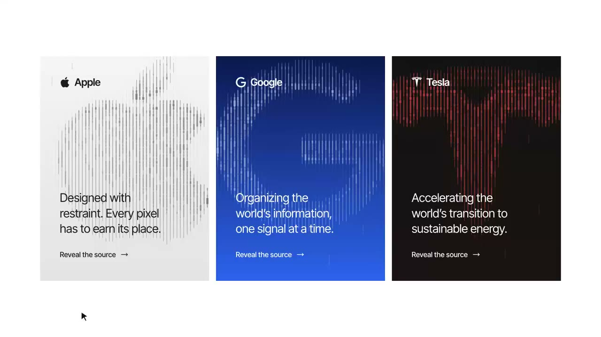

## 問題

標誌若是一張固定底圖，疊上的線條動效容易與輪廓分離；如何讓圖形本身參與散開、流動與重組？

## 做法

*Apple、Google 與 Tesla 三張品牌卡並列，以密集直線構成大標誌，文字另置於卡內。*

原作者陳述：ianneo_ai 介紹其觀察到的 Cloudflare 官網效果，並以三個其他品牌做復刻。其說明是先把標誌取樣成亮度表，再讓 Canvas 直線依取樣值改變粗細；滑鼠移入時線條散開再組回，伴隨檢測框。這是原帖的技術解讀，本卡未查驗官網實作。附[本地影片](01-source.mp4)屬作者復刻展示，不是 Cloudflare 官方素材。Kubai 只表達喜歡，並非原作者。

## 為什麼有效（推論）

收錄者推論：輪廓和動態使用同一批線條，可能減少固定底圖與裝飾錯位的感覺；卡內正文保持獨立，也讓品牌辨識之外仍有穩定閱讀區。來源未提供效能量測，不能由畫面推定渲染成本較低。

## 借鑑要點

- **適合**：品牌展示卡與短暫的指向回饋。
- **不適合**：必須隨時精確辨認標誌或長時間閱讀的核心操作區。
- **移植時注意**：保留靜止輪廓、文字與連結，補上觸控及減少動態模式；先測取樣密度，再調動作幅度。

原帖：[Kubai 評論](https://x.com/Kubai087/status/2112731876075180141)、[ianneo_ai 的解說與復刻](https://x.com/ianneo_ai/status/2112718197690691657)。
