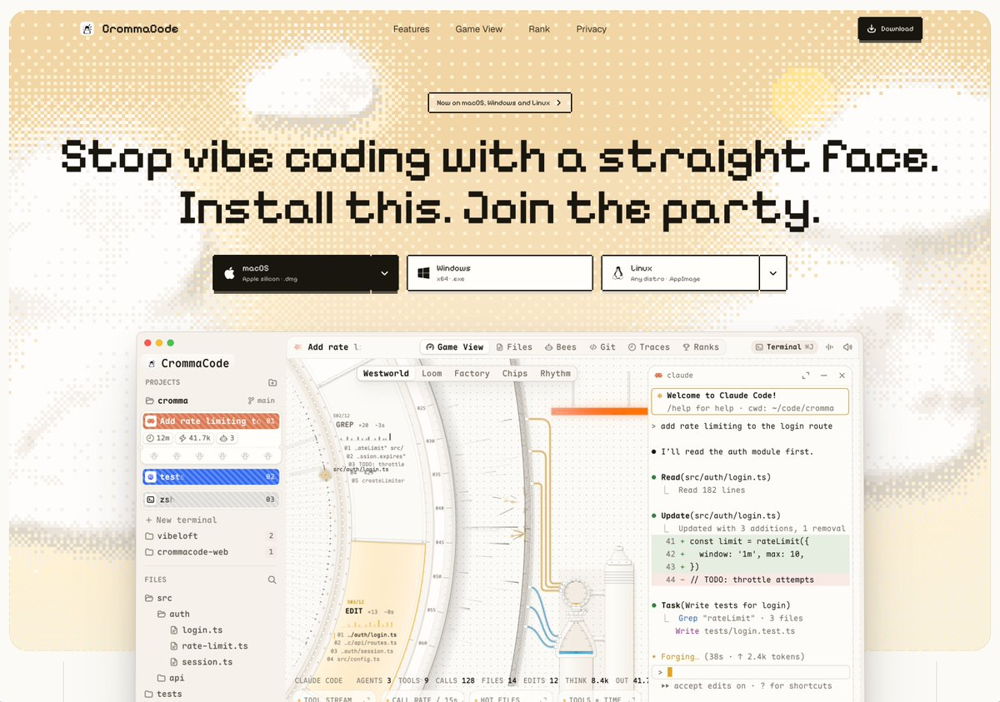

## 問題

Coding Harness 的檔案、終端與執行資訊容易只剩文字列表；如何引入鮮明主題，又保留可辨認的工作區？

## 做法

*像素字與米黃色網點背景下，工作區並列專案清單、機械視圖及終端輸出。*

原作者陳述：chunxiangai 正式介紹 CrommaCode，將它描述為結合多種工業裝置意象的 Coding Harness，並提出讓 VibeCoding 像遊戲的方向。附圖上方列出三種桌面系統的下載入口；下方保留左側專案與檔案、頂部分頁、右側終端，中間加入曲面軌道和機械圖形。下載入口只反映展示當時的提供方式，本卡未驗證安裝或執行。Kubai 觀點是對其像素風的讚賞，並非作品署名。

## 為什麼有效（推論）

收錄者推論：把裝飾集中在背景與中央視圖，周邊仍採熟悉的工具分區，可能讓強烈風格與工作定位並存。來源沒有證明遊戲化能提升開發效率，也未交代每個裝置如何對應執行狀態。

## 借鑑要點

- **適合**：希望建立遊戲感、可探索工作視圖的開發工具。
- **不適合**：螢幕空間有限且必須連續掃讀大量日誌的情境。
- **移植時注意**：先定義圖形與任務狀態的對應，保住檔案、終端及錯誤的可讀性。

原帖：[Kubai 評論](https://x.com/Kubai087/status/2120447885108240720)、[chunxiangai 的產品介紹](https://x.com/chunxiangai/status/2120421131123409353)。
