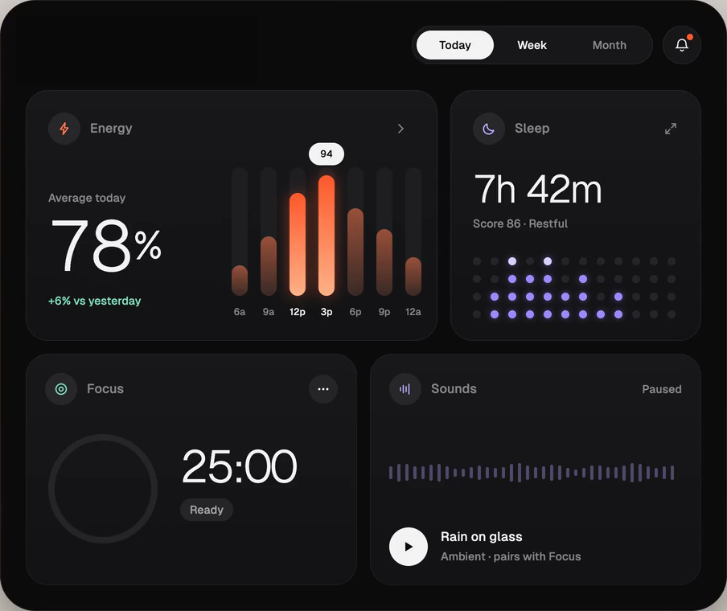
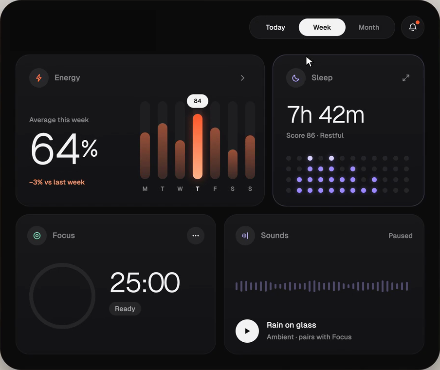
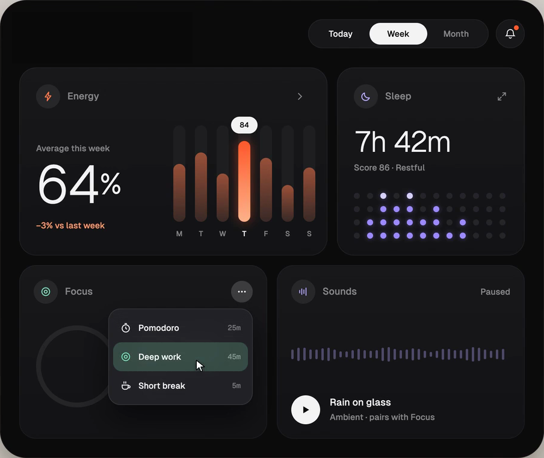
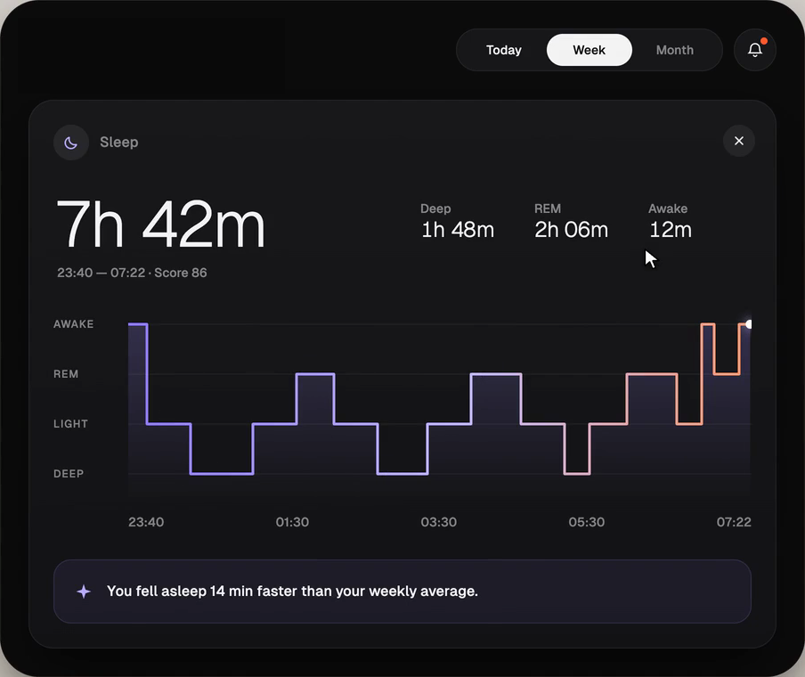
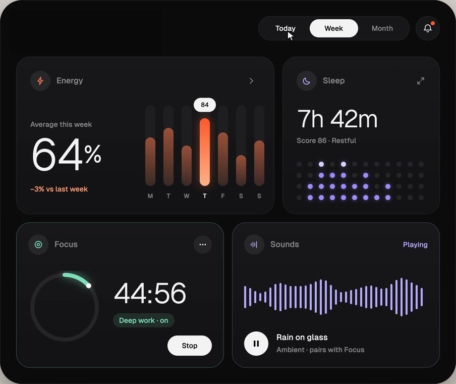

## 問題

儀表盤只有大數字時，讀者能看見結果，卻難以理解時間分布或繼續查原因。如何在保持總覽簡潔的同時，把詳情留在同一畫面？

## 做法

[官方原帖](https://x.com/Kubai087/status/2122869725273444611)建議結合數值卡與統計圖、做好篩選及點擊聯動，允許單卡下鑽。以下是其 12 秒示範影片可見內容，不把建議視為所有功能已驗證。畫面為深色四卡健康／專注概念示範，未取得產品身份；影格裁去外圍，遮除左上頭像、姓名與日期，遮罩不是原介面。

*0 秒：Energy 用大百分比搭配暖色柱狀圖；Sleep 用時長搭配紫色點陣。下排為 Focus 倒數與 Sound 波形。*

*2 秒：頂部 Week 選中，Energy 變為本週64%；Focus 仍顯示25:00與 Ready。*

*4 秒：Focus 展開 Pomodoro、Deep work、Short break 選單；Sound 仍是 Paused。*

*6.8 秒：原四卡區域由 Sleep 大卡取代，上方保留總時長與分期時長，下方展開階梯時間線及摘要，右上有關閉入口。*

*9 秒：四卡總覽恢復，Week 仍選中，Focus 顯示44:56與 Stop，Sound 顯示 Playing；此取樣不能證明所有返回狀態都持久保存。*

- **總覽**：卡片內同時呈現一個主數值與小圖；暖色區分 Energy，紫色連接 Sleep 點陣與詳情時間線。
- **時間切換**：Today／Week／Month 位於同一分段控制。影片可確認 Today 與 Week 切換、Energy 數值及標籤改變；Sleep 時長未見同步改變，不能宣稱全卡篩選聯動。
- **觸發 → 變化 → 結束**：游標移到 Sleep 卡的展開入口後，卡片擴成主要內容區；關閉後四卡總覽重新出現。詳情保留同一項指標的主數值，新增分期與時間線，沒有另開頁面。
- **觀察限制**：影片中的專注計時與聲音是示範狀態，未實測音訊播放或真正計時；展開並不等於完成業務歸因分析。

## 為什麼有效（推論）

- 大數值回答「多少」，小圖補充「如何分布」；先總覽再下鑽，可能減少一開始同時展示所有欄位的負擔。
- 詳情沿用原指標及配色，可能幫助理解總覽與詳情的關係。沒有可用性測試或決策效率資料。

## 借鑑要點

- **適合**：少數核心指標、需要週期比較且詳情可在單面板呈現的儀表盤。
- **不適合**：大量跨卡並列比較；展開取代其他卡片會暫時失去比較上下文。
- **移植時注意**：明確標註各卡的時間與資料範圍；下鑽保留篩選、提供返回入口與焦點恢復。若任務是找原因，另補關聯指標或分群，不以漂亮時間線代替分析能力。提供無動效替代並測試小螢幕。
