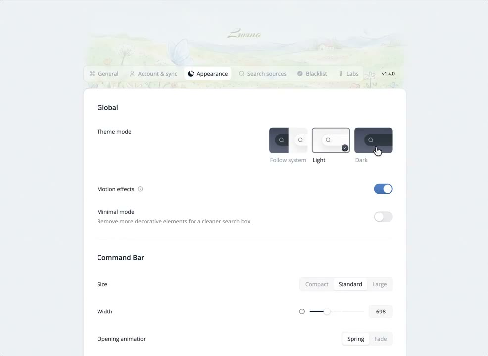
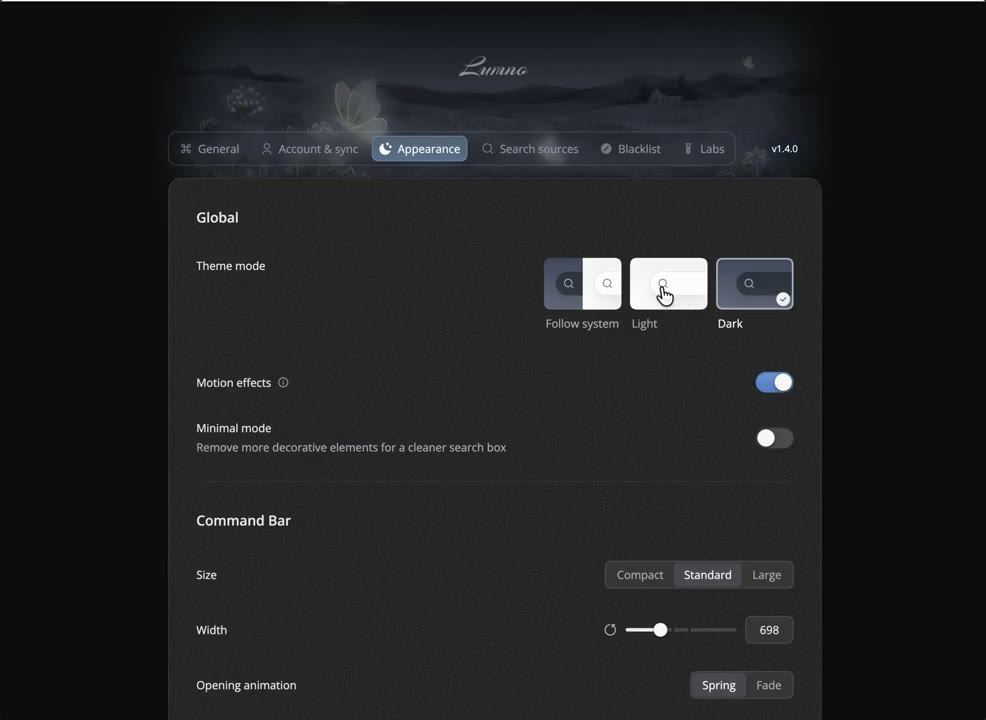
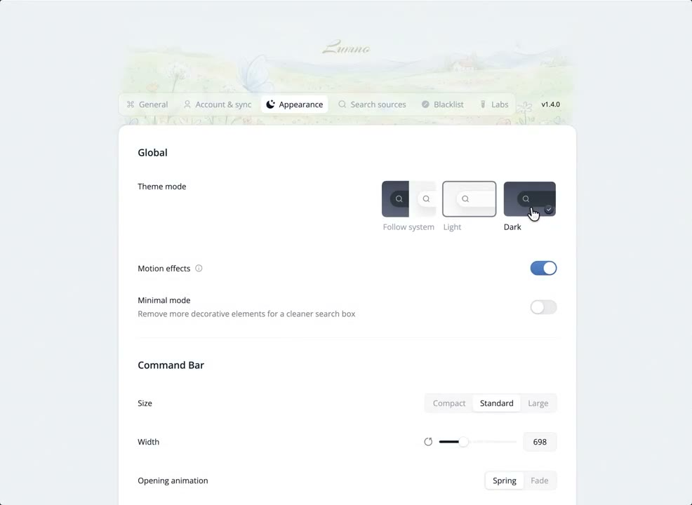

## 問題

介面切成深色後，若裝飾圖仍是一片明亮白日，圖片與周圍表面可能呈現兩種氛圍。只反轉文字與底色，未必能照顧整個畫面的明暗關係。

## 做法

Kubai 於 2026-11-06 建議：以淺色模式的白日裝飾圖為基礎，用 AI 製作對應夜景，再把周圍配色往深藍灰調整。重點是替同一場景準備兩種照明狀態，而非任意換成另一張深色圖片。

影片在外觀設定中反覆切換 Light／Dark。設定卡、文字與控制項的布局維持一致，上方裝飾區則由明亮景色轉為暗色夜景，周圍背景也一起變暗。原帖沒有公開生成參數、切換時長或對比測量。

*0.676 秒：白色設定卡上方是明亮裝飾區，主題選擇列標有 Light／Dark。*

*3.382 秒：設定卡與背景轉暗，上方裝飾區也呈現夜景。*

*11.499 秒：相同設定布局回到淺色，裝飾區重新變亮。*

[本地示範影片](01-source.mp4)

## 為什麼有效（推論）

收錄者推論：場景與介面一起改變照明，可讓主題切換更連貫；保留構圖也可能降低換圖帶來的辨識負擔。這不是可讀性或省電效益的驗證。

## 借鑑要點

- **適合**：設定頁、品牌頁與已有場景式裝飾的介面。
- **不適合**：照片必須忠實呈現原貌，或圖片承載關鍵資料的區域。
- **移植時注意**：固定兩張圖的構圖與裁切位置，檢查疊字對比和載入回退；不要把藍灰當成所有品牌的深色標準，內容區仍須獨立驗證。
