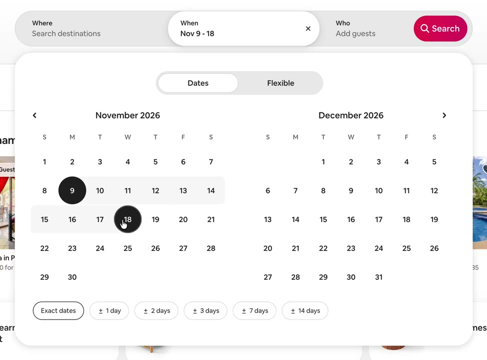
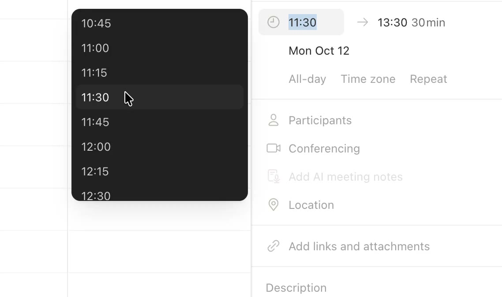
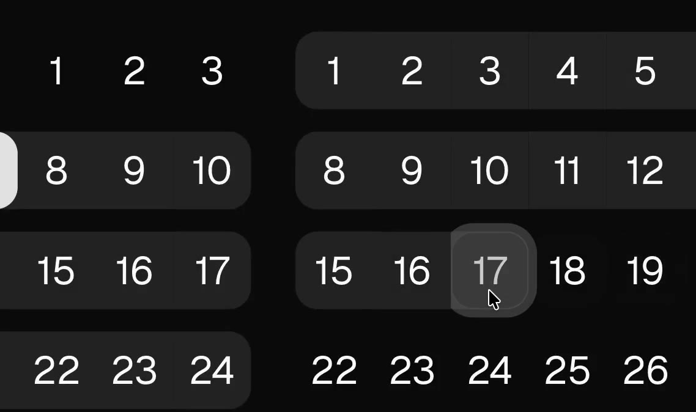
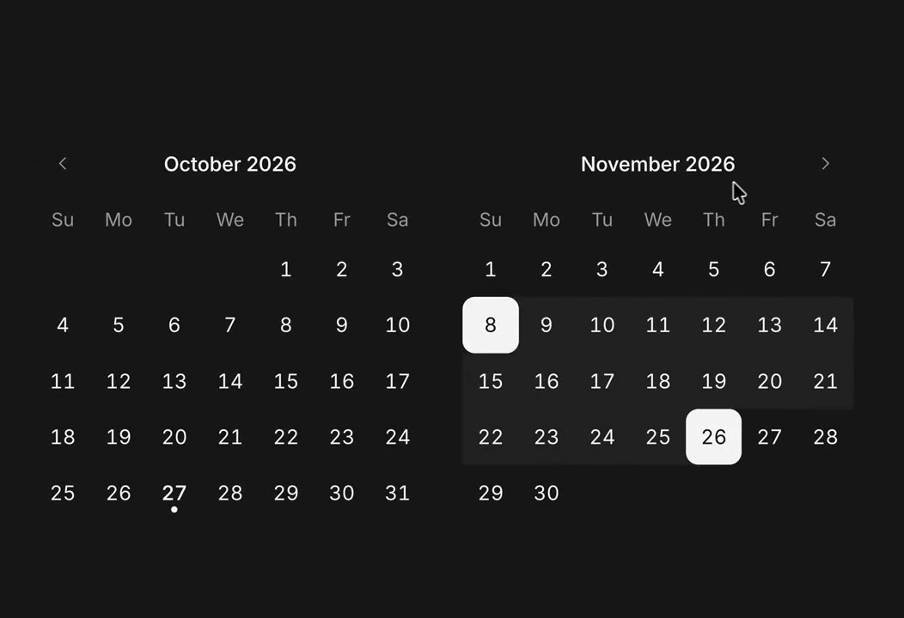

## 問題

換更強模型或套元件庫，仍可能留下動效、選取與狀態細節問題。若設計判斷沒有具體控制與檢查情境，就難以反覆比較及修正。

## 做法

Kubai 於 2026-10-24 主張先在工具中體現設計範式，再思考如何開放給 AI。被引用的 @emilkowalski 提議製作動效調參、效能問題視覺化、真實資料填充等工具；這些是工具方向，不是現成工具清單。

10-28 的補充引述 @micka_design 對日期選擇器的比較。原作者從 Airbnb、Notion Calendar、shadcn 檢視區間 hover、改選起訖點、時間選單定位、月份切換與深淺模式；Kubai 評論元件庫仍需設計思維。缺陷描述屬原作者當時觀察，不代表本卡重測或目前版本狀況。

*影片一 9.557 秒：@micka_design 的比較畫面顯示雙月曆與已選日期區間。*

*影片二 15.333 秒：時間下拉列出多個時段，選中時間與周圍內容可對照。*

*影片三 9.833 秒：日期區域被放大，呈現範圍底色與單日輪廓的重疊。*

*成品影片一 13.181 秒：雙月曆以亮色標出兩個日期，上方保留月份切換箭頭。*

本地素材均來自 @micka_design：[比較一](01-source.mp4)、[比較二](02-source.mp4)、[比較三](03-source.mp4)；[成品一](04-source.mp4)、[成品二](05-source.mp4)。

## 為什麼有效（推論）

收錄者推論：調參工具讓判斷可反覆比較，具體操作情境則把「看起來不對」變成可定位的狀態問題。這些例子沒有證明工具或某個元件庫整體更優。

## 借鑑要點

- **適合**：反覆調整動效、資料呈現或複雜選取狀態的工作流。
- **不適合**：尚未釐清使用需求，就先建立龐大的設計工具。
- **移植時注意**：先選一個常見判斷做最小工具，保留參數與比較基準；按元件版本重測問題，把當時評論和實際缺陷分開記錄。

來源：[工具觀點](https://x.com/Kubai087/status/2113886328169640435)、[元件評論](https://x.com/Kubai087/status/2115310558291587258)、[Emil 原建議](https://x.com/emilkowalski/status/2113707839760089198)、[Micka 比較原帖](https://x.com/micka_design/status/2115205154446483528)、[Micka 成品帖](https://x.com/micka_design/status/2115096599726858463)。

## 補充的迭代觀點

Kubai 另[引用少楠的原型迭代比喻](https://x.com/Kubai087/status/2115492771054358604)：先勾勒整體，再逐步打磨局部。這是被引用作者的工作方法觀點，沒有提供可比較的開發時間測量。
