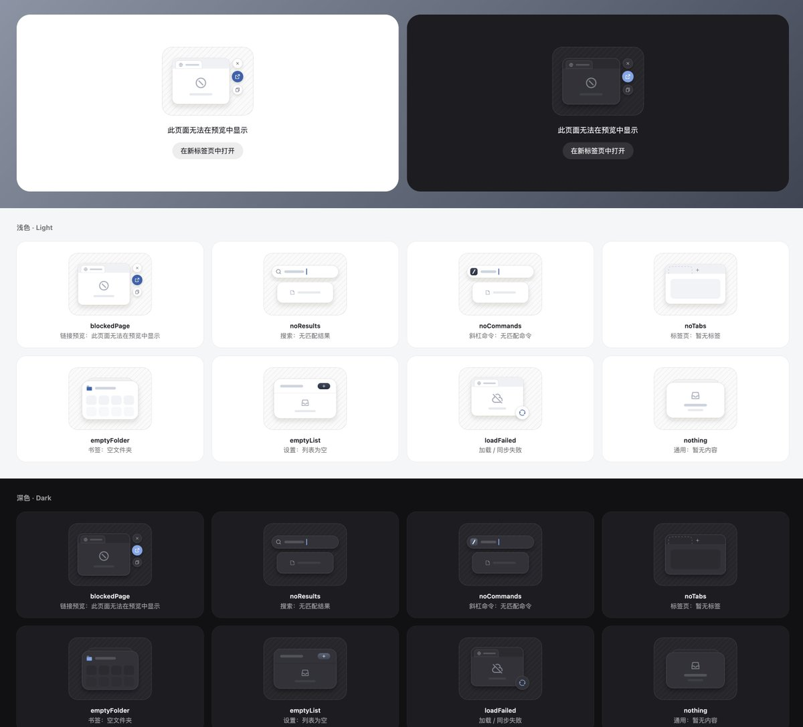

## 問題

無結果、空資料夾與載入失敗若共用抽象插畫，使用者難以分辨目前狀態，也不容易找到下一步。

## 做法

*深淺兩組示例以縮小視窗、搜尋框與資料夾區分場景；無法預覽時另提供開新分頁按鈕。*

Kubai 是原作者。SVG 長文的官方嵌入已核對作者、主題與媒體，完整設計約束由 FxTwitter 展開內容補充，不能視為已讀該篇官方全文。圖中以相同底板與線框語言呈現搜尋無結果、無分頁、空資料夾等狀態，操作提示依場景改變。補充長文提出占位條、單一操作強調色與深淺主題等約束；圖標歸屬 Remix Icon。後續開源說明的短帖全文已由官方嵌入核對，未檢查倉庫內容。

## 為什麼有效（推論）

收錄者推論：讓小圖重現所在功能的結構，可能比裝飾插畫更容易解釋缺少什麼；將下一步與狀態並置，也能減少尋找恢復入口的負擔。作者對生成效率的評價未重驗。

## 借鑑要點

- **適合**：同一產品內多種空白與錯誤狀態。
- **不適合**：需要長篇說明才能理解的複雜錯誤。
- **移植時注意**：先定義狀態和可執行動作，再統一造型；另測 SVG 隔離與深色對比。

原帖：[空狀態示例](https://x.com/Kubai087/status/2113849121299894727)、[資源開源說明](https://x.com/Kubai087/status/2114233252009664659)。SVG 長文補充來源為 FxTwitter。資源連結已在官方開源短帖的網址資料中核對：[Lumno Extension](https://github.com/kubai087/lumno-extension)、[Lumno Web](https://github.com/kubai087/lumno-web)。
