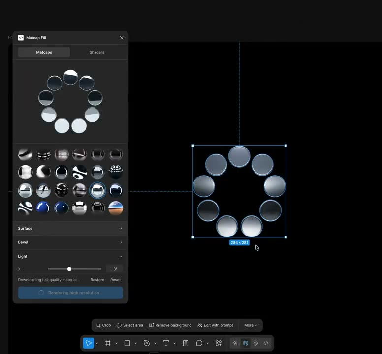
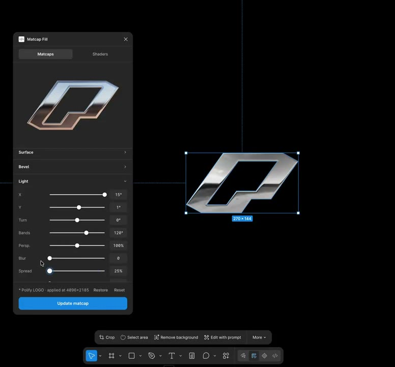

## 問題

替不同向量輪廓製作金屬感時，只套一張固定漸變，未必能跟隨字形邊緣與局部轉折。設計者需要同時比較材質預設和形狀對效果的影響。

## 做法

@todelsz 於 2026-10-27 展示自製 Figma 外掛，把 matcap 放到向量形狀上，並稱可調倒角、模糊、扭曲、平鋪、顏色及雜訊，使效果適應形狀。作者明說仍在開發，可能視興趣發布；Kubai 次日只是轉發，未提供外掛或功能驗證。

畫面觀察：外掛面板包含多個材質縮圖、預覽及參數滑桿；畫布示例有圓形排列、字母與折角符號，部分呈現金屬亮邊。截幀可用來比較樣式，無法單獨確認每個滑桿的作用或輸出格式。

*5.576 秒：材質縮圖與預覽旁，畫布選中一組帶明暗變化的圓形。*

*13.011 秒：面板顯示參數滑桿，畫布上的折角符號有明亮邊緣與深色內部。*

[@todelsz 原帖的本地影片](01-source.mp4)（約 14.87 秒）。

## 為什麼有效（推論）

收錄者推論：把形狀與材質參數放在同一工作環境中比較，可能方便反覆調整，而不必為每種輪廓重做效果。原帖沒有提供製作時間、可編輯性或效能測試。

## 借鑑要點

- **適合**：標誌、字形或裝飾符號的金屬材質探索。
- **不適合**：把開發中示範視為可直接依賴的已發布工具。
- **移植時注意**：比較凹角、細筆畫和小孔洞的結果；分開確認外觀、輸出解析度及可編輯性，不憑預覽推定仍保留純向量結構。

原帖：[外掛原作者](https://x.com/todelsz/status/2115149959636865499)、[Kubai 轉發](https://x.com/Kubai087/status/2115264447250157600)。
