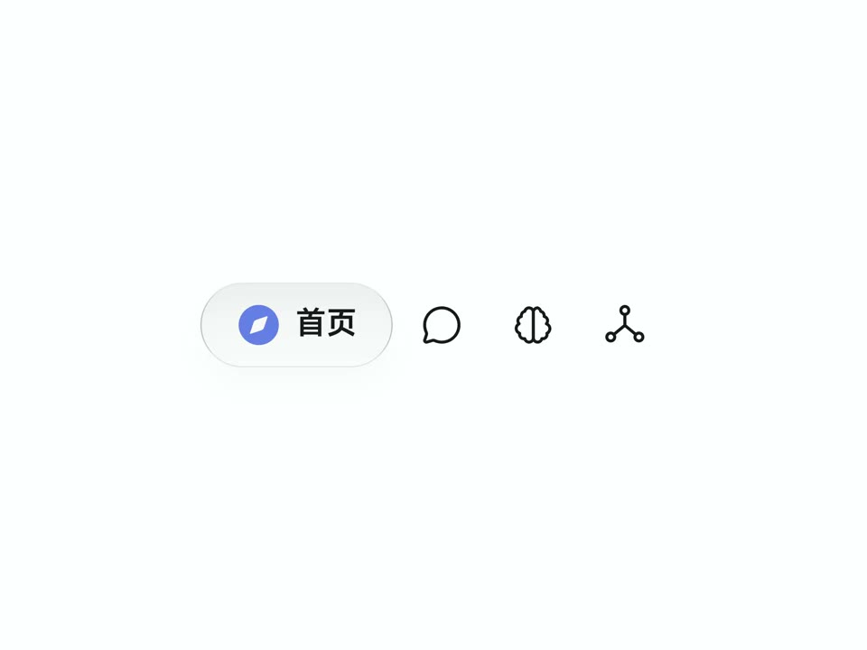

## 問題

用 AI 協作製作介面時，只說「玻璃感」容易讓不同控件各自發揮，難以重複同一套外觀。

## 做法

*淺底導覽列使用線條圖示，選中項以帶文字的淡色膠囊形容器強調。*

*資訊卡以低對比邊框與淡色光暈形成表面層次，右側保留小型操作入口。*

原作者陳述：eze_is_1 以 Apple 液態玻璃為啟發，整理名為「流光玻璃」的 AI Coding 視覺參考規範，並展示數個控件，期望後續產品沿用。這是作者自訂風格，並非 Apple 官方規範。抽樣影格包含導覽列、列表與帳戶卡，完整素材見[本地示範影片](01-source.mp4)；封包未含完整規範或具體材質參數。Kubai 的評論僅是讚賞質感。

## 為什麼有效（推論）

收錄者推論：用多種控件示例共同約束容器、選中狀態與層次，可能比單一風格形容詞更容易對齊預期。作者關於 AI 產出符合預期的說法，未在此重新生成驗證。

## 借鑑要點

- **適合**：已有風格方向、需要跨控件延伸的原型。
- **不適合**：要求高對比、密集資料閱讀的介面直接照搬。
- **移植時注意**：補齊背景、邊框、選中與停用狀態的明確數值，另測深色模式和文字對比。

原帖：[Kubai 質感評論](https://x.com/Kubai087/status/2113163277421473830)、[eze_is_1 的風格規範介紹](https://x.com/eze_is_1/status/2112907849743691984)。
