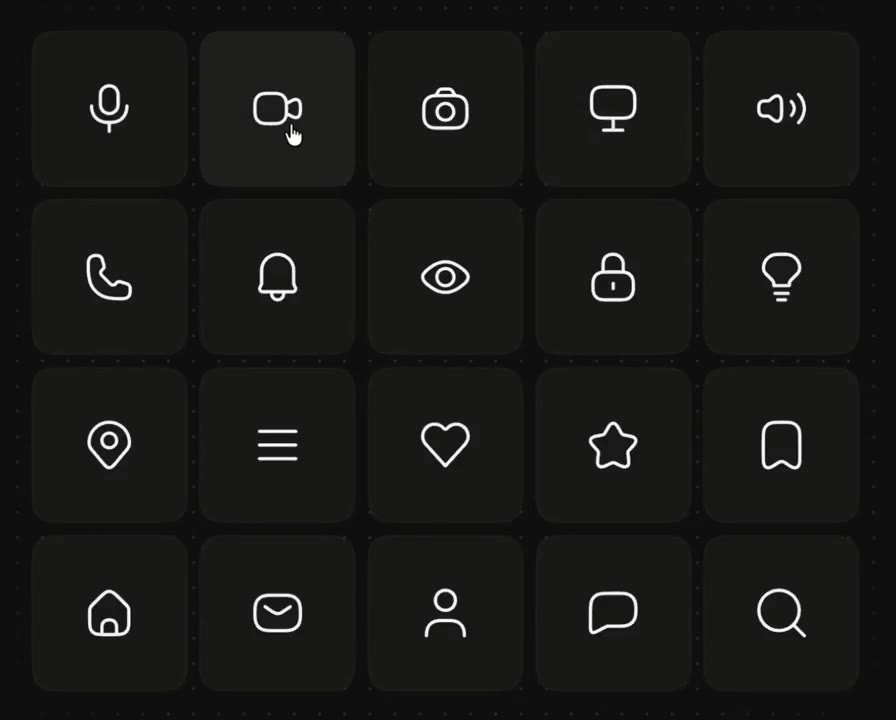
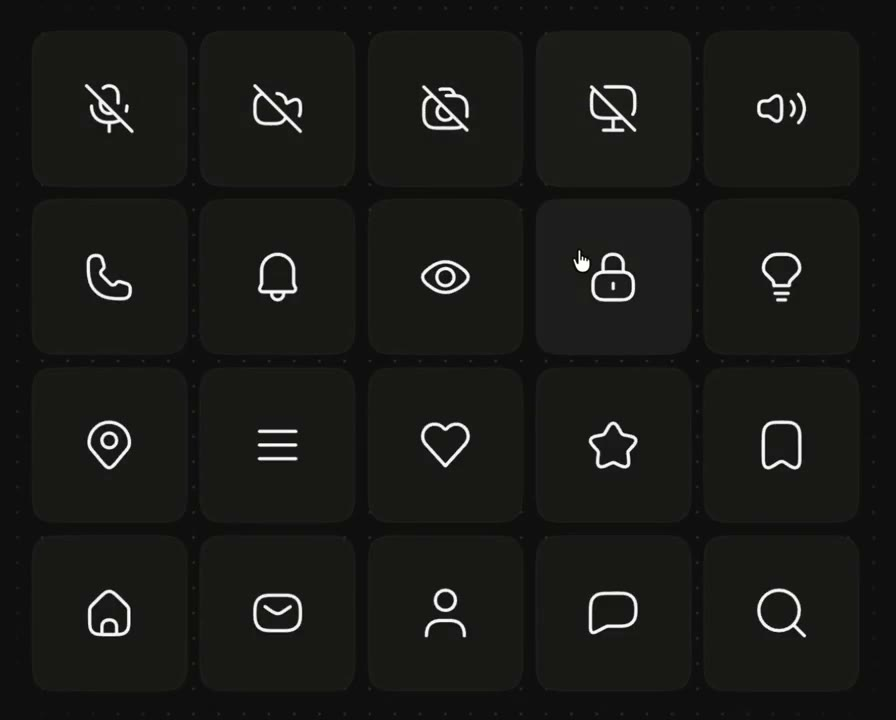
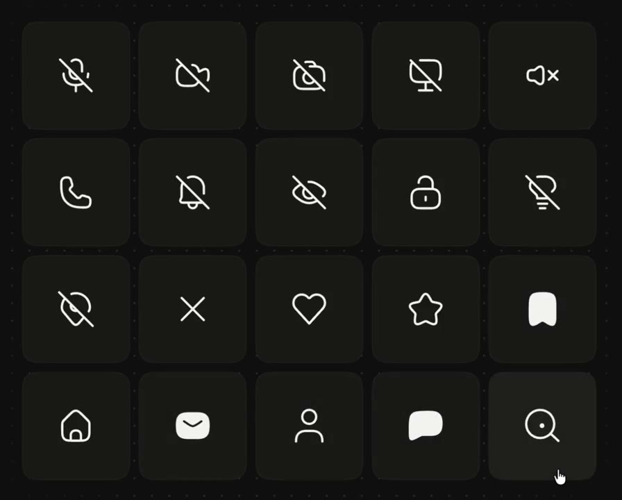
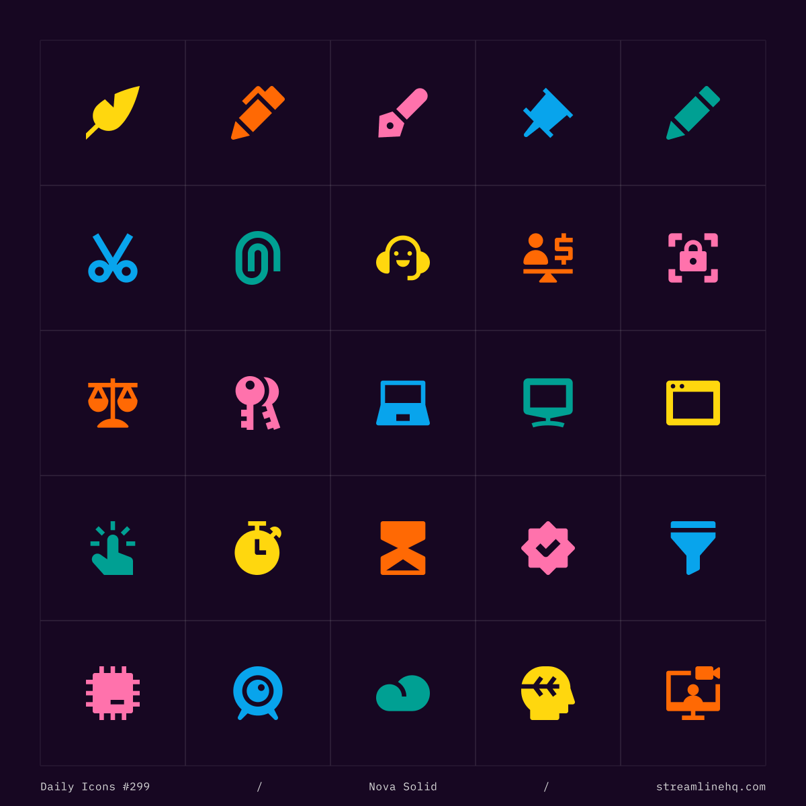

## 問題

功能圖標若只在初始畫面挑一次，開啟、停用、展開與隱藏後仍沿用同一形狀，使用者便只能猜狀態。美觀一致也不能取代清楚的操作含義。

## 做法

Kubai 於 2026-11-02 把圖標視為文字語義的延續，建議使用圖標庫配套的狀態變體：線性與實心可表達狀態差異，強調禁用時加斜線，交叉處留缺口以分開層次。影片用麥克風、相機、眼睛、鎖、選單等網格展示變化；原帖提及的 Lucide、Huge Icons、Remix Icon 是作者當時的資源推薦。

11-03 的補充評論認為銳利、面性的圖標也可用於產品，所引圖片來自 @streamlinehq 的 Nova Solid 展示，並非 Kubai 新繪作品。兩帖合併看的是語義與風格的選擇，不能把「實心」一律解讀為已啟用。

*0.517 秒：黑底網格排列線性圖標，包含麥克風、相機與書籤等功能。*

*2.583 秒：部分圖標出現斜線，與原本輪廓形成可比較的變體。*

*10.850 秒：部分書籤、信封與對話圖形呈實心，其餘仍保留線性輪廓。*

*@streamlinehq 補充圖以彩色面性圖形排列，底部保留 Nova Solid 與來源水印。*

[本地狀態示範影片](01-source.mp4)

## 為什麼有效（推論）

收錄者推論：成組變體保留共同輪廓，又可區分操作狀態；文字與圖標一致時，辨識可能較穩定。原帖未提供可用性測量。

## 借鑑要點

- **適合**：媒體控制、顯示切換與有明確雙態的功能。
- **不適合**：只靠線面變化交代複雜權限或錯誤原因。
- **移植時注意**：先列目前狀態與點按結果，再配圖形及可及名稱；保留文字提示，檢查小尺寸斜線缺口與動效減量。

來源：[狀態原帖](https://x.com/Kubai087/status/2117125759487934952)、[風格補充](https://x.com/Kubai087/status/2117489871791206700)、[Streamline 原帖](https://x.com/streamlinehq/status/2117233228558012494)。
