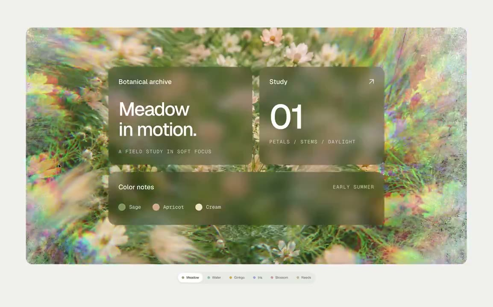
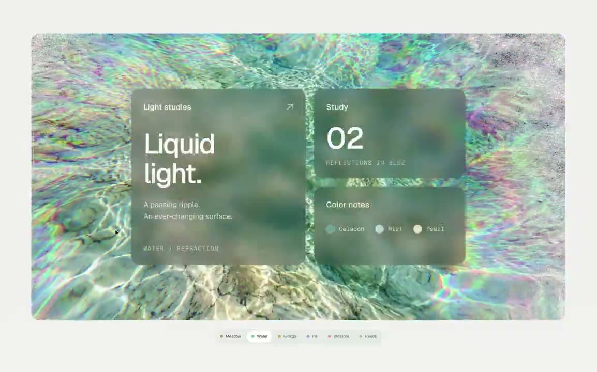
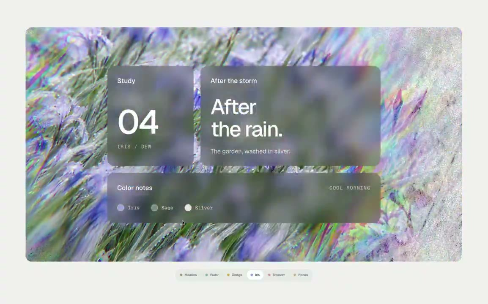

## 問題

玻璃卡片看起來混濁或缺乏色彩時，問題可能來自卡片下方的圖像，而非透明度本身。若參數與背景一起換，就難判斷哪個改動影響了材質。

## 做法

Ian 於 2026-11-02 表示用 AI 做了六版，在玻璃與折射參數相同的條件下更換背景，觀察卡片跟著偏向青藍、銀紫或香檳金。他特別提醒看背景中央：花瓣、葉片與水面反光經模糊後，是否仍形成有層次的明暗色塊，還是混成一團。

影片可見不同自然圖像上疊放半透明文字卡，卡內仍透出柔化的背景顏色；但沒有顯示參數面板，無法從畫面驗證各版設定完全一致。Ian 署名靈感來自 @davidhaz，未附原始連結；Kubai 只是轉發，不是這六版示範的作者。

*0.801 秒：花草圖像上放置半透明卡片，卡內偏綠並透出模糊色塊。*

*4.007 秒：水紋版本的卡片呈青藍色，背景明暗仍能透過卡片辨認。*

*10.418 秒：花葉版本改變整體色調，文字仍位於半透明卡片上。*

[Ian 本地示範影片](01-source.mp4)

## 為什麼有效（推論）

收錄者推論：固定材質設定再換背景，有助分離兩者的視覺影響；先看遮蓋區域，也比只挑整張好看的圖片更貼近實際構圖。原帖沒有閱讀對比或效能測量。

## 借鑑要點

- **適合**：品牌卡片與允許背景參與表面色彩的展示區。
- **不適合**：任意背景上仍須穩定辨識的高密度資訊介面。
- **移植時注意**：記錄材質參數與背景裁切，逐張檢查遮蓋區及文字對比；需要穩定閱讀時準備不透明回退，不把六版展示當作所有圖片都適用的證據。

來源：[Ian 原帖](https://x.com/ianneo_ai/status/2117126468425924695)、[Kubai 轉發](https://x.com/Kubai087/status/2117132891524325877)。
