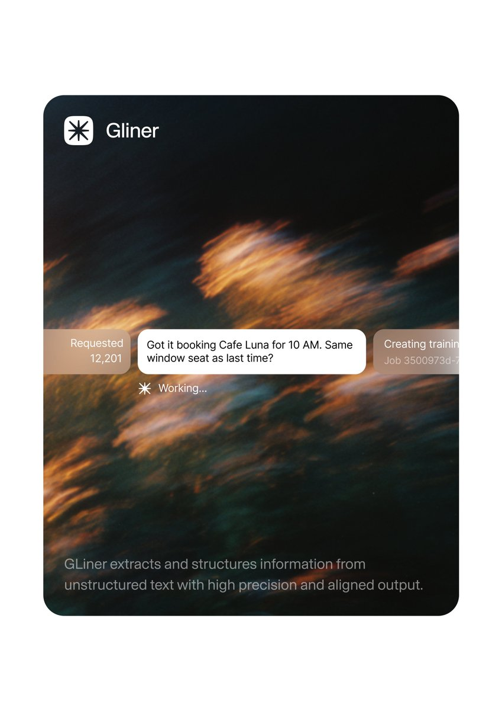
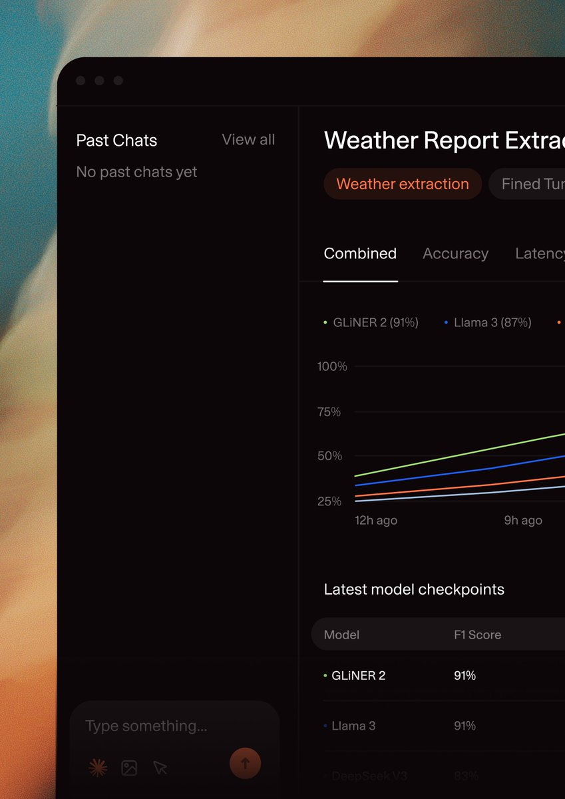

## 問題

AI 介面同時呈現請求、處理狀態與結果時，容易把「正在做什麼」和「已得到什麼」混在一起。

## 做法

*深色模糊背景上橫排任務卡，中央白色訊息下另列 Working 狀態。*

*左欄放歷史對話與輸入框，右欄以分頁、折線圖及表格展示結果。*

原作者陳述：studiobakers 將三張作品明稱為 Gliner 的 UI concepts；Kubai 僅以審美積累轉介。圖中宣傳頁使用大標題與主次按鈕，工作區則將對話和模型比較分開。卡片、圖表中的任務內容與百分比都是概念稿示例，不能作為模型準確率、延遲或產品實際功能的證據。

## 為什麼有效（推論）

收錄者推論：把處理中的短狀態留在訊息附近，將需要比較的結果放進獨立區域，可能降低來回尋找資訊的負擔。深底搭配亮色訊息也建立視覺焦點；但截圖無法證明互動、對比度或窄螢幕下的可用性。

## 借鑑要點

- **適合**：需要對照對話脈絡與結構化結果的 AI 工具。
- **不適合**：單次短回答、不需要持續比較資料的介面。
- **移植時注意**：先補齊等待、失敗與空結果狀態；不要把示意數據或品牌標誌當實際成效與合作證明。

原帖：[Kubai 轉介](https://x.com/Kubai087/status/2116107487250362777)、[studiobakers 的概念作品](https://x.com/studiobakers/status/2116102861021208777)。
