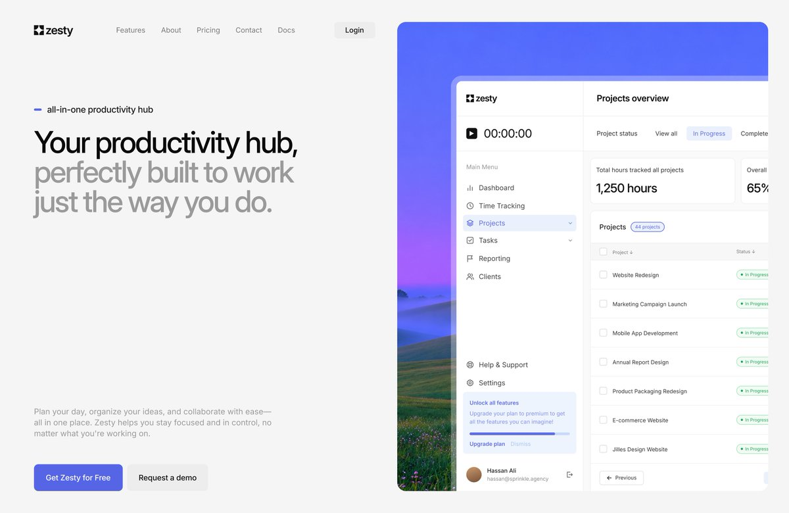
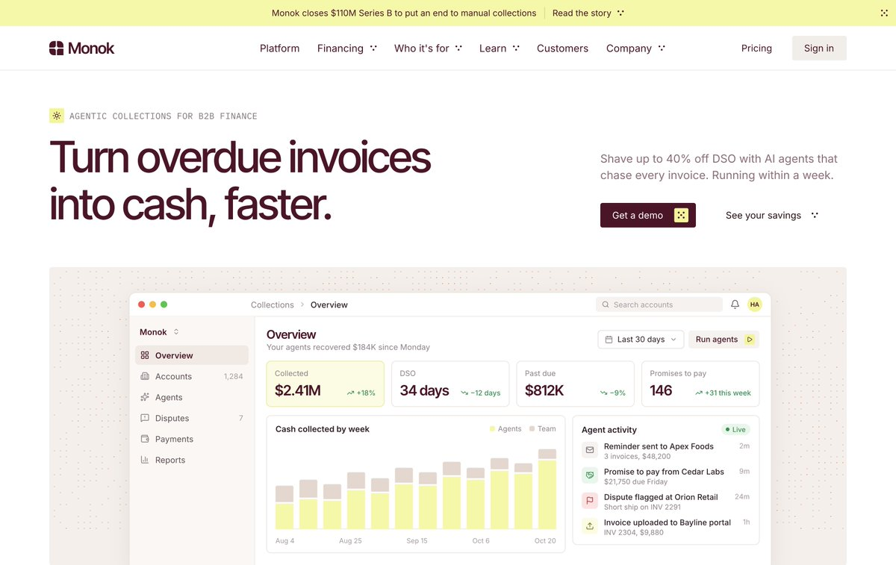
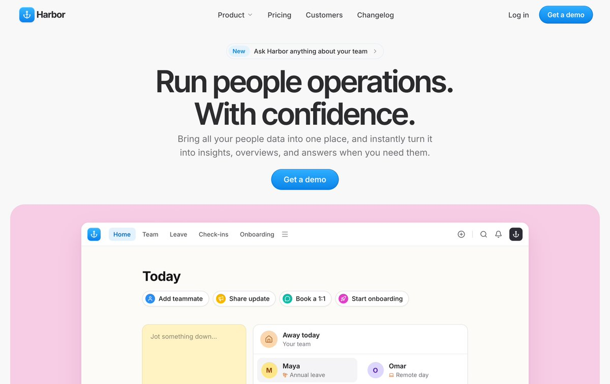
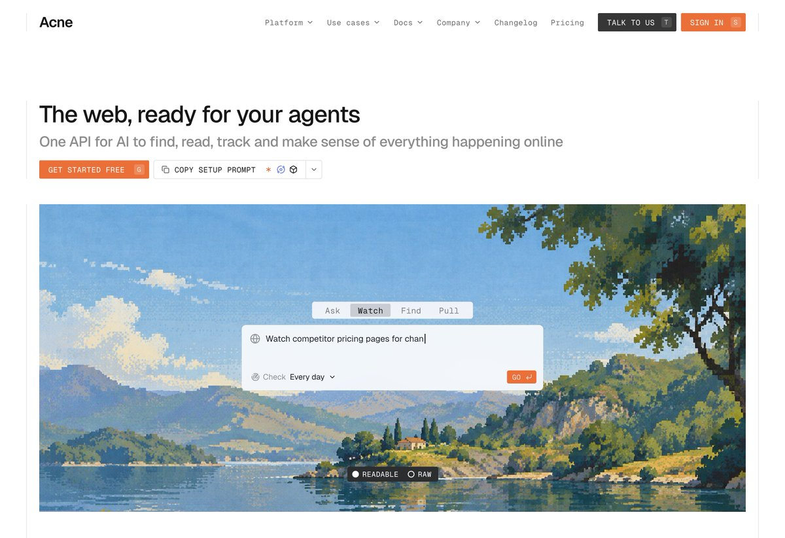
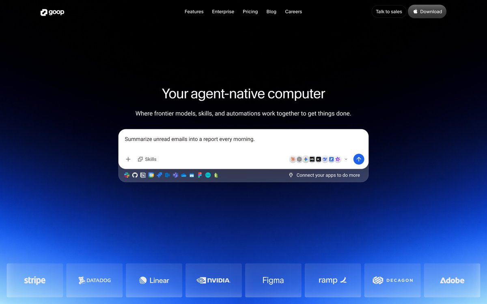

## 問題

工作台與 AI 工具若在官網首屏只放大字口號或抽象裝飾圖，訪客很難在幾秒內判斷產品實際長什麼樣、進站後每天會在哪個畫面上工作。

## 做法

Kubai 於 2026-11-13 引用 Hassan（`@uixhassan`）整理的[每月首屏設計精選](https://x.com/uixhassan/status/2116293829481701670)，指出網頁工作台類產品適合採用「UI＋截圖／襯底」呈現首屏（並舉 Raycast 為例）；前一分鐘亦轉發 Hassan 另一張 [Agent 桌面首屏探索](https://x.com/uixhassan/status/2120939691310727279)。五張概念首屏呈現出兩種具體構圖：

*Zesty：左側白底放雙色階層標題與雙行動按鈕，右側以風景底圖襯托向右下方自然裁切的專案管理側欄與工時表格。*

*Monok：上方左右分置大標題與價值說明，下方點陣暖底中置入完整瀏覽器視窗，直接展示收款指標卡、週次柱狀圖與右側 Live Agent 活動紀錄。*

*Harbor：頂部膠囊公告、居中主標題與單一主按鈕下，以粉色圓角底板框出「Today」快速動作膠囊列、便利貼與團隊請假狀態卡。*

*Acne：主按鈕旁並排「COPY SETUP PROMPT」與快捷鍵標記，下方像素風景畫中央直接放置「Ask／Watch／Find／Pull」模式切換與排程頻率選擇框，底部附「READABLE／RAW」切換。*

*goop：深藍光暈背景中央聚焦單一白色指令框，內含範例任務句、Skills 入口、多模型圖標切換與底部已連接的第三方應用圖標列，最底排放置半透明客戶標誌格。*

- **做法一：彩色／風景襯底＋真實工作台局部視窗（Zesty、Monok、Harbor）**
  - 將工作台視窗放在彩色漸層、風景照或細點陣底板內，留出外框邊距形成「畫框」，避免白底介面與白底網頁糊成一片。
  - 左右分欄時只截取工作台左上核心區域（側邊導覽＋當前視圖前幾列），省去捲軸與次要頁尾；上下結構則展示「指標摘要＋即時動態流」的完整首屏密度，文字與數據皆使用真實業務語境而非亂數假字。
- **做法二：把核心輸入器直接拉到首屏中央（Acne、goop）**
  - 當產品核心是「下一道指令交給 Agent 執行」而非複雜多欄報表時，省略整頁殼層，只把任務輸入框放大置中，並在框內外直接露出產品差異點（例如監控頻率 `Every day`、多模型切換、已連接的 Slack／GitHub／Linear／Figma 圖標列）。
  - 頂欄與主行動按鈕旁直接附上鍵盤快捷鍵徽章（如 `T`、`S`、`G`）或一鍵複製安裝 Prompt 按鈕，縮短開發者試用路徑。

原帖：[Kubai 引用點評](https://x.com/Kubai087/status/2121125744038543539)、[Hassan 首屏合集原帖](https://x.com/uixhassan/status/2116293829481701670)、[Kubai 同日轉發](https://x.com/Kubai087/status/2121125420506751462)、[Hassan goop 首屏原帖](https://x.com/uixhassan/status/2120939691310727279)。以上皆為設計師概念稿，非真實上線轉換率實測。

## 為什麼有效（推論）

- **用真實資訊密度建立具體預期**：工作台買家關心介面是否清爽、功能是否齊全；直接露出導覽結構、狀態標籤與真實文案，比三欄抽象圖標更能傳達產品成熟度。
- **襯底材質同時解決邊界與品牌識別**：淺色 SaaS 介面放在淺色官網上容易失去輪廓，加一層風景、暖色點陣或高飽和圓角底板後，既能穩住視窗邊界，也能在不汙染工作台內部配色的前提下建立品牌記憶點。
- **單一輸入器首屏降低理解門檻**：對對話式或 API 型產品，直接展示一句具體任務（如「每天早上彙整未讀郵件」或「每日監控競品定價頁」）與周圍掛載能力，能立刻說清使用方式。

## 借鑑要點

- **適合**：效率與專案工作台、B2B 營運後台、開發者工具、Agent／自動化平台官網首屏。
- **不適合**：尚未定型或視覺雜亂的後台直接原尺寸截圖貼上（會放大資訊噪音），以及主要依賴實體商品攝影的電商頁面。
- **移植時注意**：首屏內嵌的工作台畫面應精簡掉與核心價值無關的次要按鈕，確保縮放至筆電與手機寬度時關鍵數字與標題仍清晰可讀；若用 DOM 實作互動預覽，需注意首屏載入體積與鍵盤焦點順序。
