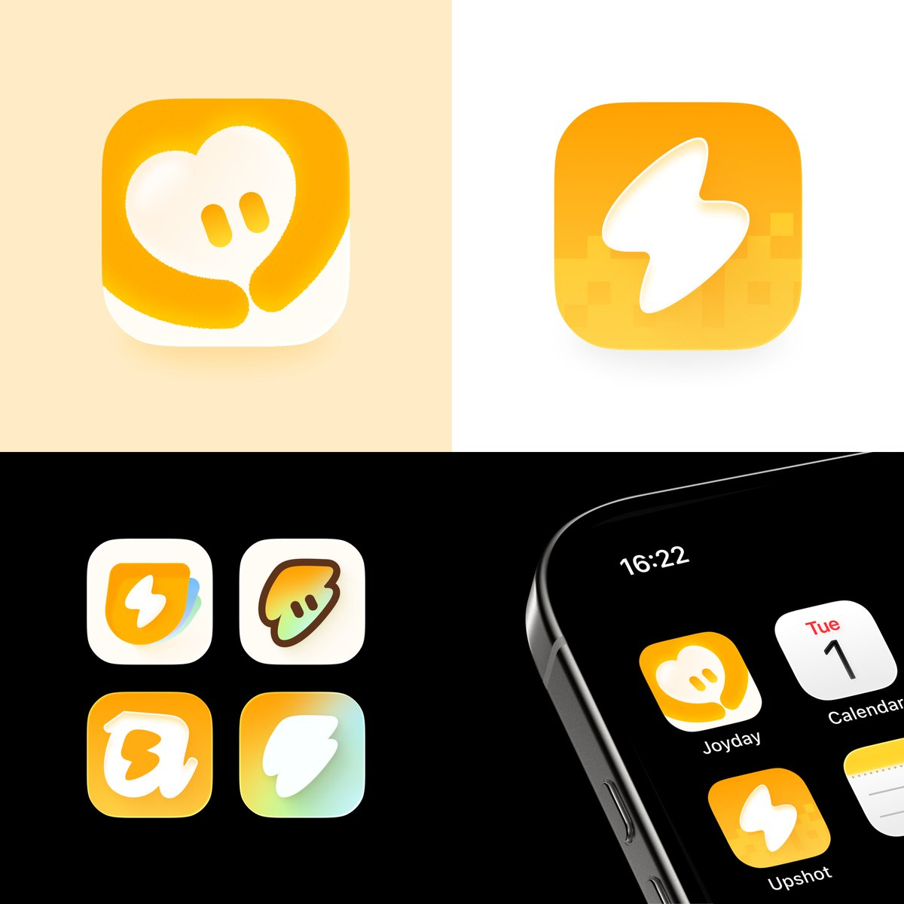

## 問題

同為健康類 App，健康監測與飲食控卡仍需要不同的識別線索。圖標既要表達服務方向，也要在一組相關產品中維持視覺關係。

## 做法

Kubai 於 2026-11-10 表示，這組圖標是年初為開發者製作，因產品發布而公開。發布狀態依作者當日陳述，本卡未確認商店版本與各變體的採用情況。

作者說明：Joyday 將健康監測常見的愛心與關懷的懷抱結合；Upshot 以閃電表達卡路里，並用像素格指涉食物的營養構成。畫面可見兩者同用黃橘色系，Joyday 以白色心形及環抱曲線為主，Upshot 以白色閃電和背景方格為主，另附較小變體及手機桌面情境。

*上方並列兩款黃橘色圖標，下方展示其他變體與桌面尺寸的應用情境。*

## 為什麼有效（推論）

收錄者推論：共同色系能建立系列感，不同中心輪廓則保留產品區別。把抽象服務轉成少量圖形線索，也方便在小尺寸比較識別度；原帖沒有辨識率或使用者偏好數據。

## 借鑑要點

- **適合**：同一開發者的相關產品，需要同時表現家族感與功能差異。
- **不適合**：直接把愛心或閃電當成健康效果、專業資格的證明。
- **移植時注意**：先選出每個產品最重要的一個意象；以縮小、灰階及並排情境檢查差異，確認裝飾方格不會遮蔽主體，並讓文字名稱補足圖形無法交代的功能。
