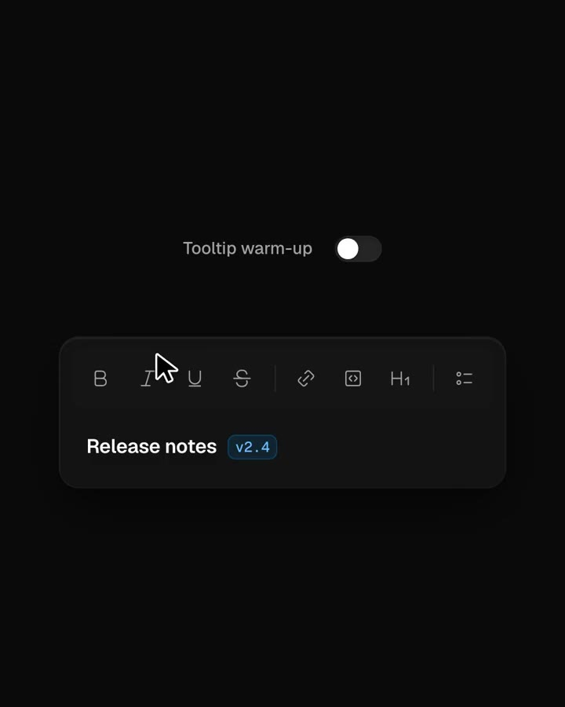
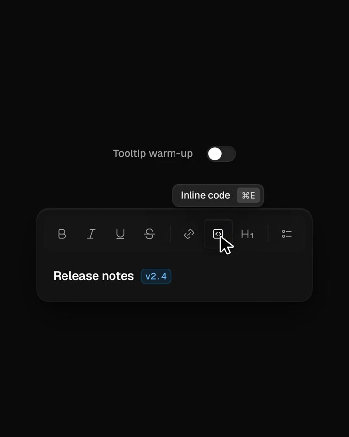
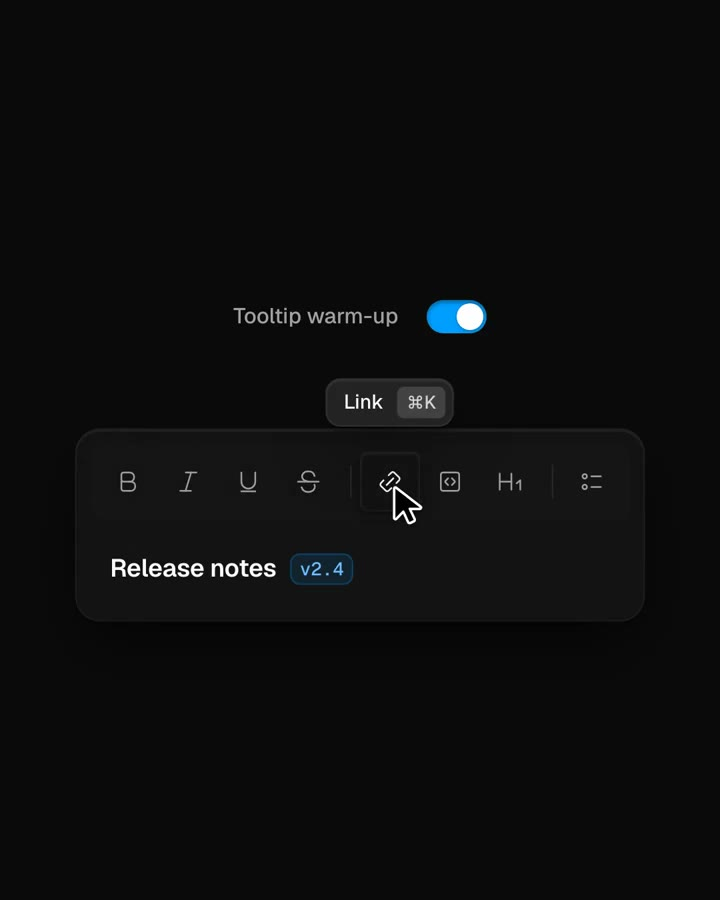

## 問題

首次引導教過快捷鍵後，使用者未必記得。若提示立即蓋出答案，就沒有回想空間；若完全不提示，忘記的人又只能離開操作位置找說明。

## 做法

Kubai 於 2026-11-01 分享影片，建議在軟體 onboarding 之後，讓使用者 Hover 時思考與回憶「幾秒」，再藉提示學快捷鍵。原文沒有給精確延遲，也沒有說明應如何依熟悉程度調整，不能自行換算成固定秒數。

影片是文字工具列，包含粗體、連結、行內程式碼等圖標，上方有 Tooltip warm-up 開關。停留時可見功能名稱及快捷鍵提示，例如 Inline code 與 Link；畫面展示了提示與開關的不同狀態，沒有公開內部計時規則。影片原設計者與產品名未附於封包，因此只歸屬為 Kubai 分享及評論。

*初段畫面：指標位於格式圖標附近，工具列上方尚未出現功能提示。*

*中段畫面：圖標上方出現 Inline code 及其快捷鍵標記。*

*後段畫面：Tooltip warm-up 開關為開啟狀態，連結圖標上方出現 Link 與快捷鍵。*

[本地分享影片](01-source.mp4)

## 為什麼有效（推論）

收錄者推論：先留回想時間、再在操作位置補答案，可能把提示變成溫和的記憶練習。原帖沒有學習成效或等待時間比較，不能據此認定延遲越長越好。

## 借鑑要點

- **適合**：初始引導後，已有清楚圖標與常用快捷鍵的工具列。
- **不適合**：必須等待提示才知道怎麼操作，或把 Hover 當唯一說明入口。
- **移植時注意**：分別考慮新手與熟手，另提供鍵盤焦點、觸控和可查詢的快捷鍵表；以實測決定等待策略，提示不可擋住點按或必要文字。
