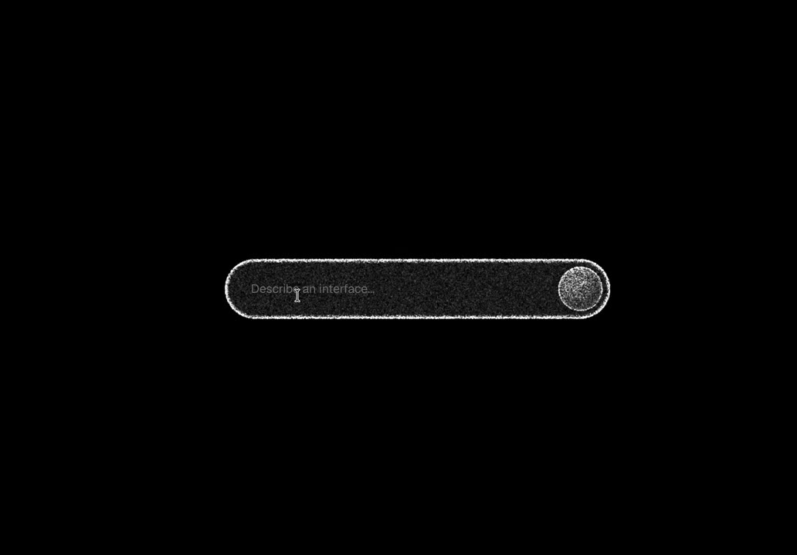
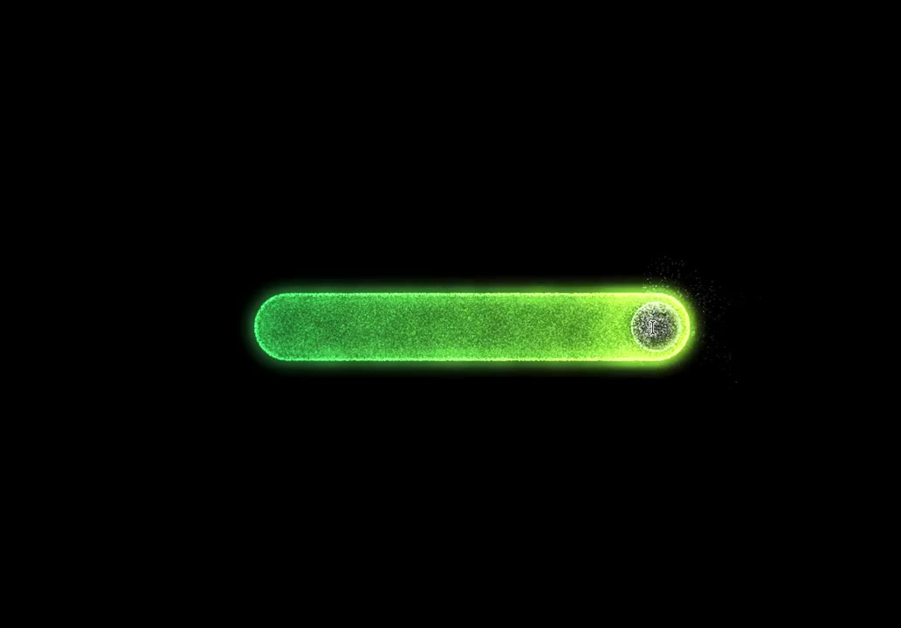
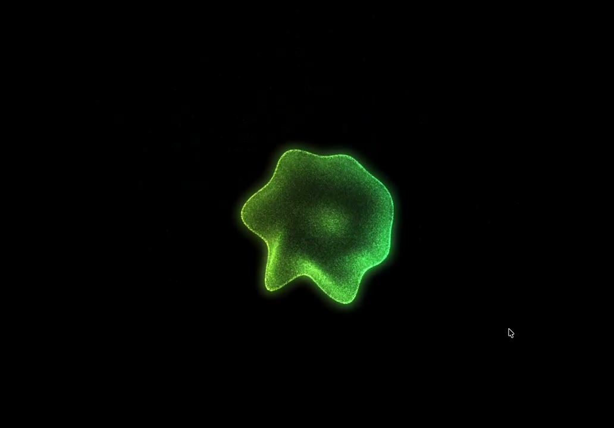
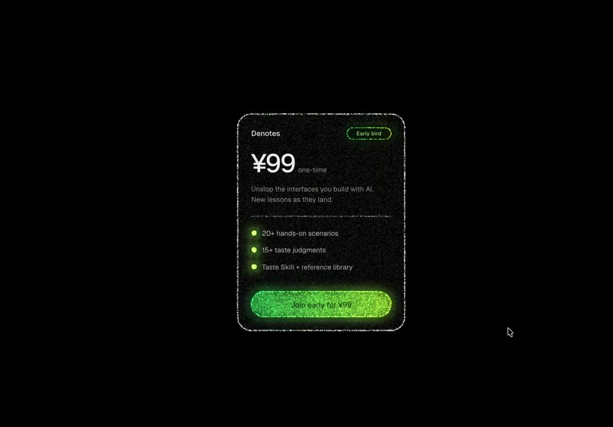

## 問題

一句話生成 UI 或卡片的流程中，若送出後輸入框直接消失、跳出獨立轉圈圈，幾秒後又突兀閃出成品，使用者感受不到「輸入內容正在被塑造成介面」的因果連續感。

## 做法

Ian（`@ianneo_ai`）於 2026-11-13 發布示範（Kubai 同日轉發，原帖註明靈感來自 `@dominikmartn`），並在[直接回覆](https://x.com/ianneo_ai/status/2121158077231890717)說明這是以原生 JavaScript＋WebGL 2 實作的單檔粒子過渡概念：

*1.22 秒：全黑畫布中央放置由細密亮點圍成的膠囊輸入框（提示字「Describe an interface...」）與右側圓形送出鈕。*

*3.66 秒：送出後膠囊內部由綠光粒子填滿，外緣發光並準備向中心收攏。*

*6.10 秒：整個膠囊如液體般向中心捲起，變成一團持續呼吸起伏的不規則綠色光團，取代傳統載入轉圈。*

*8.55 秒：約 5 秒後光團向外展開為圓角矩形定價卡片（`¥99`、三條綠點權益清單與綠色發光主按鈕），外框保留同質感的粒子邊緣；點擊卡片外部可再流回初始輸入框（[本地示範影片](01-source.mp4)）。*

- **同一套粒子貫穿三階段（觸發 → 生成中 → 結果／還原）**：輸入框邊界、生成中的翻湧光團與最終卡片外框／主按鈕共用同一組粒子與螢光綠主色，視覺上像同一塊材料被「揉捏」成新形狀。
- **形狀對應狀態語義**：水平細長膠囊對應「等待輸入文字」、居中不規則蠕動光團對應「AI 正在融合運算」、穩定垂直圓角矩形對應「結構化介面已就緒」；點擊卡片外側則反向流回輸入膠囊，形成閉環互動。

原帖：[Ian 示範原帖](https://x.com/ianneo_ai/status/2121158070994878740)、[Ian 回覆實作方向](https://x.com/ianneo_ai/status/2121158077231890717)、[Kubai 轉發](https://x.com/Kubai087/status/2121164460547346460)。此為固定約 5 秒的概念動畫展示，未接真實模型串流生成。

## 為什麼有效（推論）

- **用容器形變維持注意力錨點**：視線始終停留在畫面中央同一個發光物體上，不必經歷「元件消失 → 空白等待 → 元件突現」的斷裂。
- **把短暫等待包裝成具象的「塑形」隱喻**：約 3–5 秒的短等待若顯示百分比往往不準確，用翻湧光團暗示系統正在處理，再展開為同色系卡片，能強化生成體驗的戲劇感。

## 借鑑要點

- **適合**：Landing page 互動展示、一句話生成小工具／卡片／海報的首次體驗、耗時約 2–6 秒的單一產出型 AI 生成流程。
- **不適合**：耗時超過 10 秒以上的長任務（無進度階段或文字回饋會讓人懷疑卡死）、需要邊生成邊閱讀串流文字的工作台，或低功耗行動裝置上的高頻日常表單。
- **移植時注意**：接上真實後端時，光團階段需支援不確定時長與超時／失敗退回輸入框（保留使用者原輸入文字）；同時提供 `prefers-reduced-motion` 與無 WebGL 2 環境的純 CSS 尺寸過渡降級方案。
