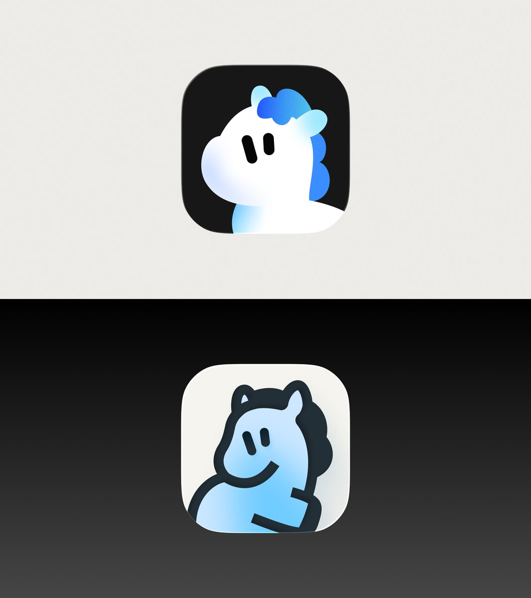
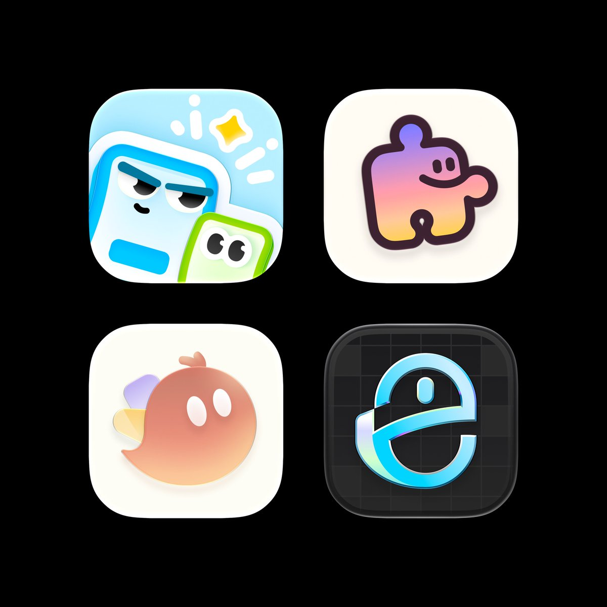

## 問題

開發者挑選圖標時，需要比較作品方向，也需要分清展示圖片與可交付的編輯素材。

## 做法

*同一張展示板上下排列兩個馬形角色圖標，以深淺底色區分輪廓。*

*較早的作品帖以二乘二排列展示角色、拼圖片與帶狀符號等不同構圖。*

原作者陳述：Kubai 在 11 月 2 日提出贈送四款圖標及工程檔，請有意者留下產品介紹；10 月 25 日則分享近期 icon 作品。兩帖合併收錄，但來源沒有逐項對照哪些作品屬於贈送範圍，也未提供可直接下載的工程包。這是作品與交付方式的參考，不能視為已取得可自由使用的圖庫。

## 為什麼有效（推論）

收錄者推論：先用同尺寸展示板協助比較，再索取產品背景，可能有助於討論圖標與產品的適配。附工程檔也可能方便調整，但實際可編輯範圍與授權仍需另行確認。

## 借鑑要點

- **適合**：委託前的風格比較與設計交付溝通。
- **不適合**：需要即時下載並確定商用權利的素材採購。
- **移植時注意**：明列交付格式、可修改範圍與使用權；不要把作品合集等同贈送清單。

原帖：[四款圖標贈送](https://x.com/Kubai087/status/2117289556408246331)、[近期作品合集](https://x.com/Kubai087/status/2114381581376995668)。

## 其他圖標靈感來源

Kubai 另[推薦 logoicon.cn](https://x.com/Kubai087/status/2120394788755341636)。這是圖標參考入口，與本卡贈送工程檔的取得方式分開記錄。
