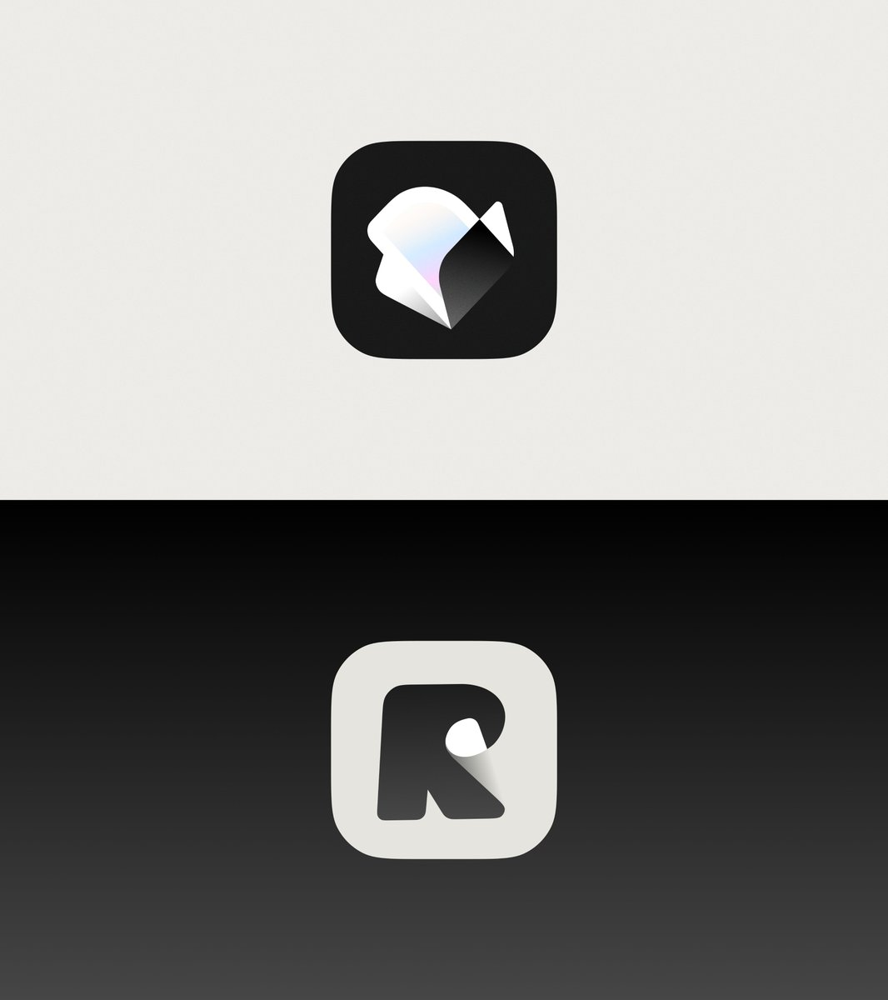
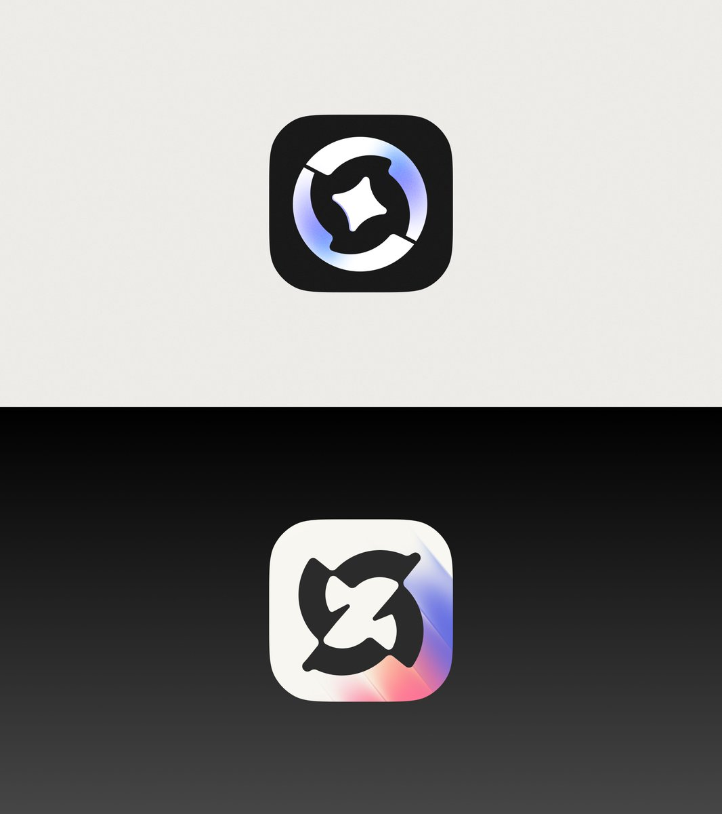
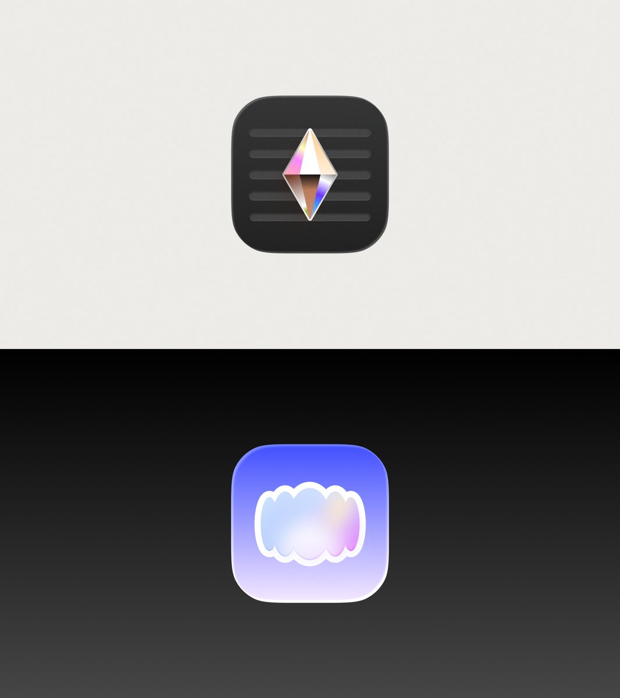

## 問題

簡單 App 符號加入材質時，容易只得到一張全面發亮的圖。如何讓質感仍服務主要輪廓，而不是靠更多細節搶眼，是這組參考的設計問題。

## 做法

Kubai 於 2026-10-29 把這組圖片概括為以漸變、紋理與材質增加圖標質感。原帖文字沒有公布製作步驟、色值或工具，以下僅記錄圖片可見的處理，不補寫生成流程。

第一張的白色折面沿轉折變明暗，另一個字形末端捲起並露出灰色內側。第二張讓簡單圓形與符號搭配局部藍紫漸變，淺底版本則在右下角出現彩色斜向光帶。第三張以菱形的明暗切面、背景橫向凹槽，以及帶亮邊的柔和彩色團塊，提供不同材質方向。

*上下兩例保留大塊單色區，以局部明暗交代折面或捲曲。*

*同類圓形符號分別搭配黑底與淺底，色彩集中在部分弧段或邊角。*

*上例呈現菱形切面與橫向凹槽，下例用亮邊包住柔和彩色輪廓。*

## 為什麼有效（推論）

收錄者推論：色彩與明暗沿著輪廓轉折分布，可能比整體加光暈更能解釋形體。作者的「高級感」是審美表述，不能當作品質評分或使用成效。

## 借鑑要點

- **適合**：輪廓簡單、可用少量色彩建立識別的圖標探索。
- **不適合**：需要一眼讀取的高密度工具列，或必須維持單色的符號。
- **移植時注意**：先選一種材質方向，確認小尺寸仍有清楚外形；不要把所有例子的折面、漸變、凹槽同時疊上，也別把展示底色誤當實際圖標底色。

## 相關產品回覆

[Reedle 開發者的回覆](https://x.com/ulshhke/status/2116085010939920499)引用本作品帖，提及多端閱讀器與 2.0 UI；[Kubai 的轉發](https://x.com/Kubai087/status/2116086352139919700)一併保留。這只能證明回覆與作品帖的關聯，沒有證實展示中的每個圖標分別對應哪個產品。
