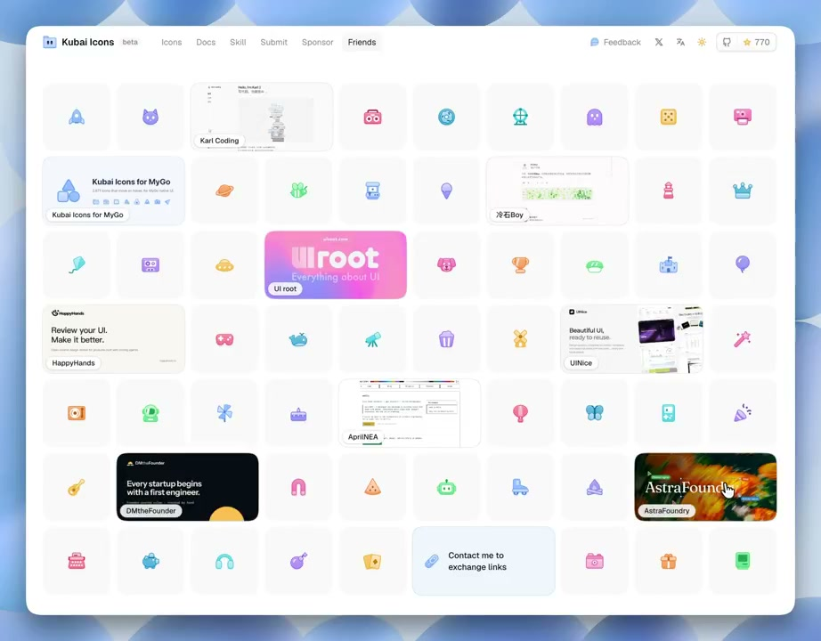
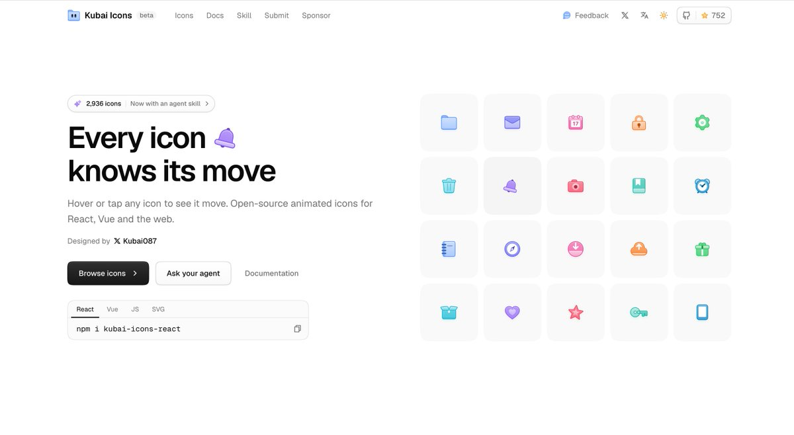
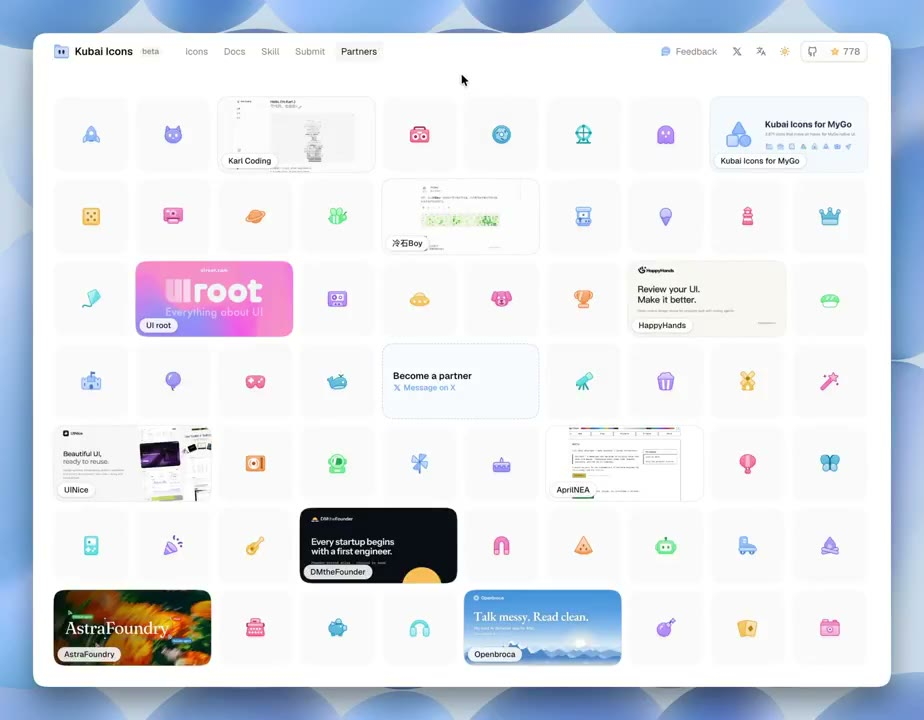
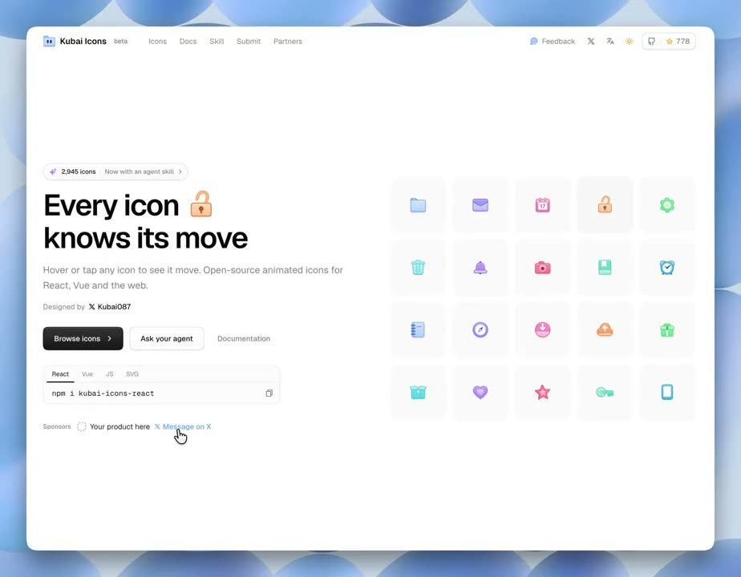

## 問題

友情連結或合作夥伴頁面常把各站截圖直接排成整齊列表：收錄站點還少時版面顯得空曠，站點變多後又因各家配色、字體與構圖差異過大而彼此干擾。

## 做法

作者於 2026-11-12 先發布[友鏈募集帖](https://x.com/Kubai087/status/2120765986899132726)（初始未編輯版本為 `2120761118176223435`），同日上線 [Kubai Icons 友鏈頁](https://icons.kubai.design/links/)並公開[展示影片](https://x.com/Kubai087/status/2120866563184308488)與[網站原始碼](https://github.com/kubai087/kubai-icons)。頁面延續首頁右側的動態圖標方格牆，把外部網站預覽卡與自家彩色動態圖標混合排成同一面「櫥窗」：

*0.5 秒：桌面 10 欄×7 列方格中，9 張橫跨兩格的網站預覽卡與末尾的交換邀請卡分散嵌入 50 個彩色圖標之間，整排填滿不留空缺。*

*4.0 秒：游標移近中段卡片時，周圍僅少數圖標處於懸停變形姿態，其餘保持靜止以維持版面穩定。*

*5.8 秒：游標停在 HappyHands 預覽卡上，外框描邊略微加深，左下角半透明毛玻璃膠囊固定顯示單行站名。*

*9.5 秒：游標移至右下深色預覽卡，底排可見同為兩格寬的淺藍底「Contact me to exchange links」入口卡。*

*募集帖附圖：首頁右側原本即採用圓角淺底方格陳列動態圖標，友鏈頁將這套視覺容器擴展為全頁混合網格。*

- **正方形基準格與響應式跨欄**：以容器查詢計算單欄寬度作為 `grid-auto-rows` 高度，建立正方形基準格並啟用 `grid-flow-row-dense`。斷點依序為 `10×7`（xl）、`8×8`（lg）、`6×9`（sm）與 `4×24`（手機）；在中大尺寸下，每張友站卡與邀請卡各佔 `2×1` 格（接近 `1200×630` 社交分享圖比例），手機 4 欄時友站卡改佔 `4×2` 格以維持縮圖可讀性，多餘圖標按均勻抽樣隱藏，確保每個斷點都剛好填滿整排。
- **均勻穿插緩衝**：將友站卡與末尾的交換邀請卡按固定比例插入圖標序列（首張卡片前先留出數格圖標），使高視覺密度的外部網站截圖彼此隔開，中間由淺灰底單色調圓角方格與 `36px` 彩色圖標緩衝。
- **統一卡片外框與毛玻璃署名**：每張友站卡滿版裁切 `1200×630` 預覽圖（部署與每 6 小時排程自動抓取更新），外圈加 `1px` 細邊框並在懸停時提高對比；左下角固定放置 `22px` 高的圓角膠囊（`85%` 背景不透明度、`backdrop-blur`、細描邊與微投影），僅顯示截斷後的站名，無障礙名稱（`aria-label`）則附上站名與去除 `www.` 的網域。
- **同規格行動號召卡**：最末張「Contact me to exchange links／聯繫我交換友鏈」卡片沿用相同的跨欄尺寸，改用 `#5393FF` 的 `10%` 淡藍底與 `30%` 藍框，左側放隨整卡懸停聯動的連結圖標，把募集入口變成牆面的一部分。
- **錯峰輪播與動態節制**：僅在牆面進入視窗（`IntersectionObserver`）且未開啟 `prefers-reduced-motion` 時啟動背景輪播；單格懸停姿態維持 `1400ms`，總週期按每格 `450ms` 隨牆面格數拉長，使同一時刻只有約 3–4 個圖標動作。滑鼠移入單一圖標格時立即鎖定其懸停姿態；圖標格獨立建層（`will-change-transform`），避免濾鏡重繪影響旁側毛玻璃站名標籤。

[本地展示影片](01-source.mp4)（10.3 秒）。注意：`kubai-icons` 倉庫將圖標本身以 MIT 釋出，但網站版面與程式碼屬 `LICENSE-SITE`（保留所有權利），友站預覽圖歸各原網站所有；借鑑時應自行實作版面結構，不可直接複製網站原始碼與他人預覽圖。

## 為什麼有效（推論）

- **用自家資產稀釋外部截圖的視覺衝突**：各網站的 OG 分享圖風格迥異，穿插統一底色與統一描邊語言的圖標格後，留白與節奏由圖標格主導，個別深色或高飽和截圖反而成為視覺焦點而非噪音。
- **無論收錄數量多少都能撐起完整版面**：即使初期只有不到十個友站，圖標補位也能讓頁面看起來像一面完整的品牌展示牆，同時順帶展示自家圖標庫的多樣性。
- **低頻錯峰動態兼顧生氣與可讀性**：若整牆圖標同時擺動會干擾閱讀站名；把同時動作的數量控制在少數幾格，既保留「櫥窗活物感」，也減少陰影與內發光濾鏡同時重繪的負擔。

## 同日迭代：合併 Partners 入口、中央虛線空位與首頁輕量贊助列

[作者同日稍晚發布的英文更新帖](https://x.com/Kubai087/status/2120923602031919194)（`2026-11-12T16:56:06+00:00`，初始未編輯版本 `2120923500370374926`）展示了友鏈與贊助機制整合後的介面調整：

*1.2 秒：頂欄將原本分開的 Sponsor 與 Friends 合併為單一 Partners 入口，招募卡改用虛線邊框移至網格視覺中央，底排亦新增合作站點卡片。*

*10.5 秒：首頁安裝指令框下方以單行呈現 Sponsors 空位（虛線圓角小方框＋「Your product here」＋私訊連結），主標題「Every icon」右側的內嵌圖標則在原地輪播切換（[本地迭代展示影片](03-source.mp4)）。*

- **導覽合併**：頂欄從同時並列的 `Sponsor`、`Friends` 收斂為單一 `Partners` 分頁，減少性質相近的次要導覽項。
- **從尾端實線卡改為中央虛線空位**：牆面上的「Become a partner（Message on X）」卡片移至 `10×7` 網格第 4 列中央（第 5–6 欄），邊框改為細虛線（dashed），直接以「待填入的空櫥窗格」表達尚有合作名額。
- **首頁輕量單行贊助位**：不在首屏放置大型橫幅，而是在 `npm i kubai-icons-react` 複製框下方放一列低對比 `Sponsors` 標籤、一枚與圖標同語彙的虛線圓角小方框、`Your product here` 與 `Message on X` 連結，不搶奪主行動按鈕視線。

## 借鑑要點

- **適合**：設計資源站、圖標／插畫／元件庫官網、個人作品集的友情連結、靈感收藏牆、早期合作夥伴或贊助商展示頁。
- **不適合**：需要按分類快速檢索、比較規格或大量掃讀文字介紹的目錄頁（例如外掛市集、API 整合清單）。
- **移植時注意**：先確認自身產品是否有足夠數量、視覺語言統一的輕量資產（圖標、徽章、色票、微元件）可作緩衝格；外部預覽圖需統一裁切比例並在底角提供高對比膠囊標籤，且務必支援 `prefers-reduced-motion` 停用背景輪播。
