## 問題

介面新增功能時，臨時補畫的圖標容易偏離既有風格；加入動態後，還需要讓不同圖標的狀態變化維持一致。

## 做法

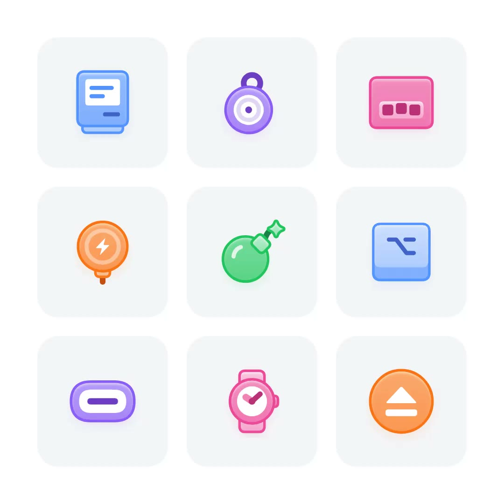
*九個彩色功能圖標排列成三乘三網格，各自置於淺色圓角底板。*

原作者陳述：Kubai 在 11 月 3 日首發動態圖標 Skill，稱可生成動態功能圖標及彩色、單色版本，並提及搭配 Opus 5.5 的效果；首發文字已由 X 官方完整快取核對。11 月 10 日更新稱新增九個動態圖標，總數為 2901，並提供 React 套件安裝方式與隨附 Skills。這些是當時的作者主張，未在本卡重驗。11 月 4 日與 11 月 10 日晚間兩筆 RT 均為轉發，不另算新作品或首發。

可對照[更新動圖](01-source.mp4)與[早期 Skill 展示影片](02-source.mp4)；封包沒有提供完整的風格約束文件。

## 為什麼有效（推論）

收錄者推論：既有圖標與生成規則一起交付，可能減少新增素材時的風格落差；網格展示也便於比較輪廓、配色與動態。不過展示不能證明生成穩定性或所有版本的相容性。

## 借鑑要點

- **適合**：需要持續擴充同系列功能圖標的產品。
- **不適合**：缺乏既有樣本、尚未確定視覺方向的團隊。
- **移植時注意**：先比對靜止狀態、動作幅度與單色版本，再驗證目標環境；免費與數量均以原帖日期為準。

原帖：[11 月 3 日 Skill 首發](https://x.com/Kubai087/status/2117605750474428446)、[主要更新](https://x.com/Kubai087/status/2120110508909133962)、[早期 Skill 自轉發](https://x.com/Kubai087/status/2118014184877428821)、[更新自轉發](https://x.com/Kubai087/status/2120215002594587073)。

## 風格約束的補充說明

[作者於 2026-11-05 的補充](https://x.com/Kubai087/status/2118188266025553929)指出，生成前已約束風格、元素關係與佈局；這是作者對工作方式的陳述，本次未重現一次生成的成功率。

## 後續圖標補充

[2026-11-11 的更新帖](https://x.com/Kubai087/status/2120484329830916286)稱新增 6 個動態圖標，當時總數為 2916。附圖展示多個圖例，這裡保存作者發布的整組示範，沒有逐一判定哪些是本次新增。

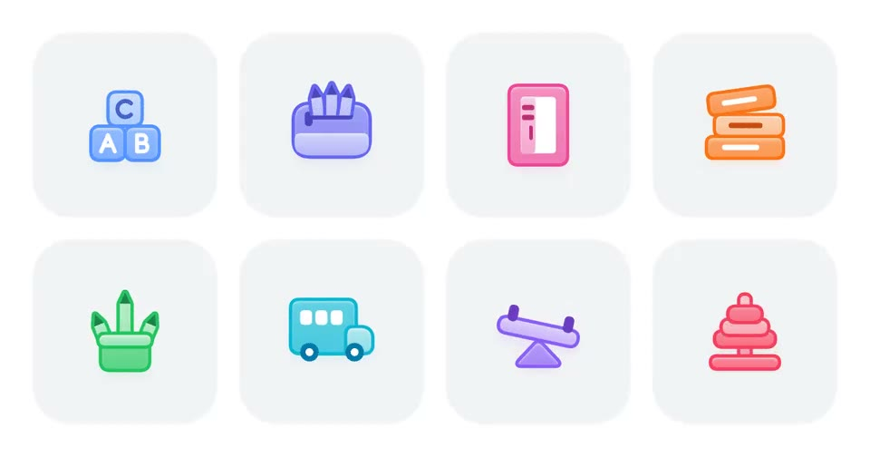
*1.075 秒：字母積木、日曆、書本、收納、畫筆、巴士、翹翹板與堆疊玩具等圖例共用淺色底板。*

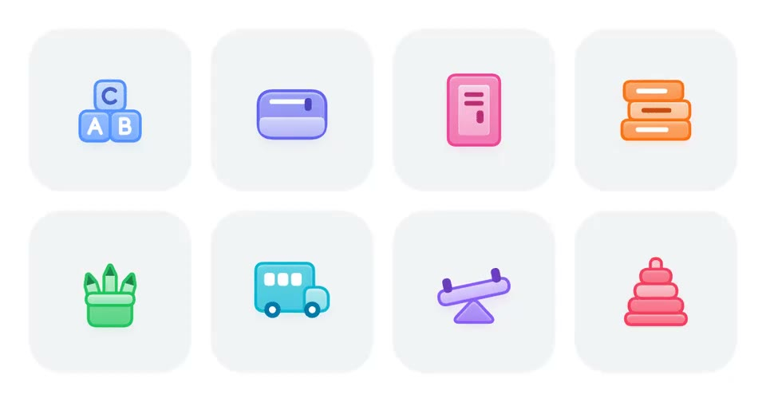
*3.655 秒：同一組圖標的另一取樣狀態，可配合[本地更新動圖](03-source.mp4)比較動作。*

## 22 個動態圖標展示補充

[作者於 2026-11-11 發布的展示影片](https://x.com/Kubai087/status/2120551252253974750)依序展示 Mac & gadgets、Back to school、On the road 三組圖標，再以網格總覽。影片標示本次展示 22 個圖標，結尾標示圖標庫總數 2,936；這是影片當時的資訊，未獨立核驗。原帖稱圖標庫採 MIT 授權並提供風格遷移 Skill，實際授權範圍與生成品質仍需另行確認。

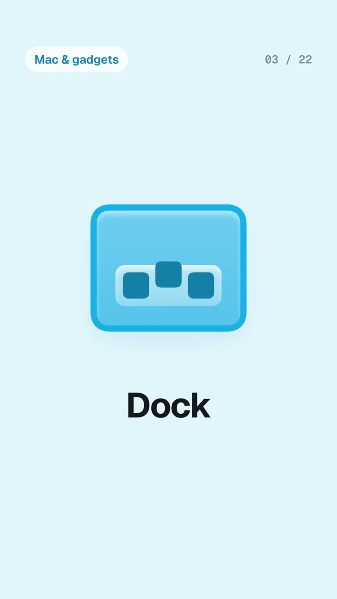
*4.4 秒：淺藍底中央是帶深色描邊的 Dock 圖標，下方標出名稱。*

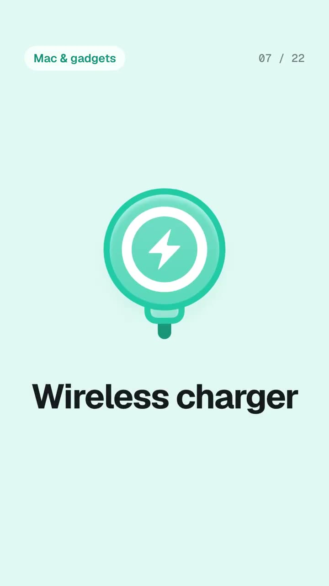
*8.4 秒：無線充電器以綠色圓形、閃電符號和短線材組成。*

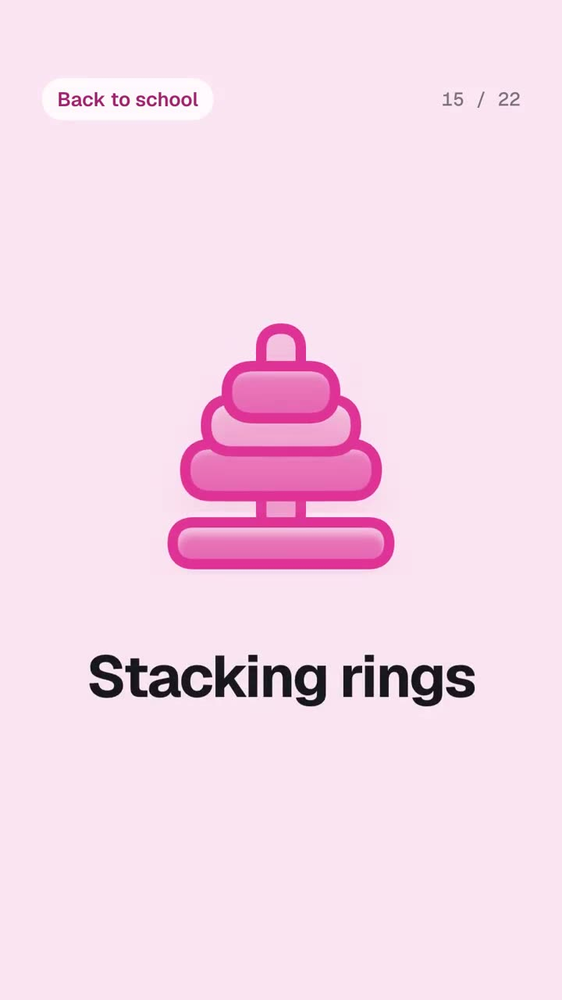
*16.4 秒：淺藍色收納櫃以外框、門板和通風孔形成圖示。*

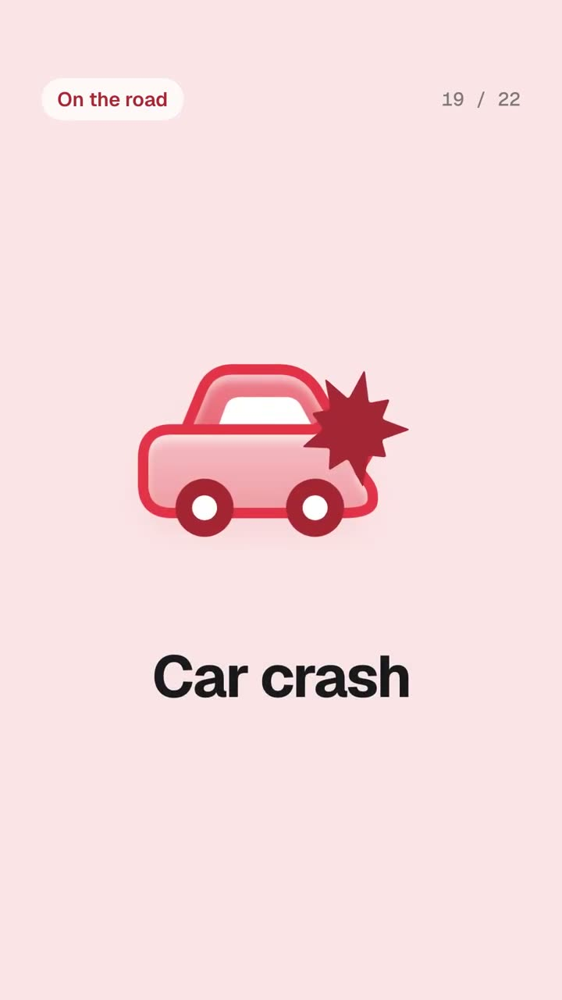
*20.4 秒：紅色汽車右側疊加星形撞擊標記，形成事故語義。*

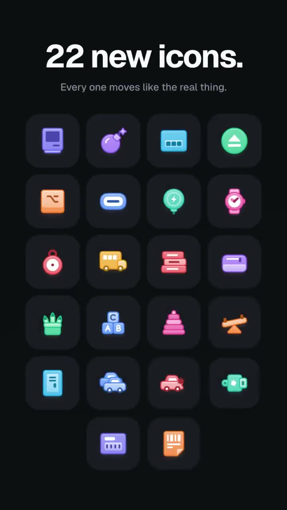
*24.4 秒：深色背景上的圓角方格集中陳列 22 個圖標，方便比較不同題材的共同視覺語言。*

影片逐個切換圖標、名稱與淡色背景，最後匯集成深色網格；這可作為展示一組設計資產的編排參考。上述為取樣影格，不能單憑靜態畫面還原每個圖標完整動效。

## 開源倉庫、授權分層與完整 Skill 風格規範（2026-11-12 補齊）

[作者於 2026-11-12 的更新帖](https://x.com/Kubai087/status/2120830679089090681)宣布新增 9 個戶外主題動態圖標（當時宣稱總數 2,945、GitHub 達 700 Star），並附上公開倉庫 [`kubai087/kubai-icons`](https://github.com/kubai087/kubai-icons) 與[官網](https://icons.kubai.design/)。經核對倉庫內的 `LICENSING.md`、`SKILL.md`、`PROMPT.md` 與 `docs/authoring.md`，先前缺少的完整風格約束規範與實際授權邊界已確認如下：

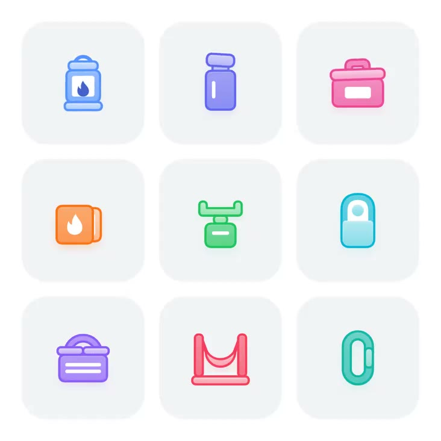
*0.23 秒：提燈、水壺、收納盒、火焰杯、爐頭、睡袋、野餐籃、吊床架與登山扣排成三乘三網格。*

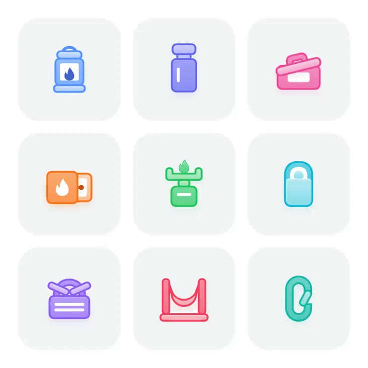
*2.03 秒：盒蓋掀起、爐火升起、野餐籃打開、登山扣彈開，呈現「物體本身會做的動作」（[本地更新動圖](05-source.mp4)）。*

- **三層授權邊界（修正單一 MIT 簡稱）**：倉庫分三種授權——`icons/`、`badges/` 與發布套件（`kubai-icons`、`-react`、`-vue`、`-static`）為 **MIT**；`SKILL.md`、`PROMPT.md`、繪製引擎與自檢腳本採 **Kubai Icons License（source-available）**，允許安裝執行且生成的圖標歸使用者，但禁止把 `PROMPT.md` 與 `SKILL.md` 複製進目標專案再散佈；官網 `site/` 為 **All Rights Reserved**。
- **畫布、Keyline 與 24px 辨識測試**：固定 `viewBox="0 -2 31 29"`、中心 `(15.5, 12.5)`，對應四種填充 keyline（圓形直徑 `23`、正方形 `20.6`、橫向 `23×18.4`、縱向 `18.4×23`）。只選正面或正側面、可用矩形／圓／圓弧拼出的實物，並在 `24px` 下排除易混淆造型（例如吊床加上底座避免像字母 `M`、小火苗至少畫一高一矮兩股避免像水滴）。
- **前後分片、外描邊與「0 或 ≥2」間距硬規則**：每個圖標至少兩層（後片中間調漸變＋投影、可選無描邊純白內容面、前片淺色漸變＋頂部 `overlay 50%` 內發光），前片上角設 `1.6–2` 圓角讓後片露出；主體圓角 `2.2`、內容圓角 `1.2`；外描邊寬 `1`（以 `stroke-width: 2` 加自身遮罩裁除內側一半）。移動部件與標記在靜止與懸停終點，彼此或離邊緣只能「距離 `0` 完全貼合」或「留空 `≥ 2` 單位」，禁止留出 `0–2` 之間的細縫，且最小細節尺寸須 `≥ 2.4` 單位。
- **單主色相對推導與兩種白色語義**：所有漸變、描邊、投影與深淺標記都從單一主色相對參考藍 `#5393FF` 推導；代表紙張、螢幕、錶盤的「白色內容面」固定 `fill="#fff"`，而壓在彩色主體上的符號「白色標記」標註 `data-w`，切換至藍灰、青瓷、薄荷等清透色板時自動轉為深色以維持對比。
- **雙關鍵幀插值與無頭瀏覽器自檢**：每個部件只寫靜止與懸停兩組數值關鍵幀（`460ms`、`cubic-bezier(0.22, 1, 0.36, 1)`），連鬧鐘震動或指南針擺動也用阻尼正弦／餘弦在終點收斂穩定，不做無限循環。每次新增圖標須執行 `scripts/check.mjs`，在無頭 Chrome 自動截出靜止、懸停、`0%–100%` 六階段中間幀、`24px`、`28px`、全色板與 `#F59E0B` 淺主色對比圖，並開啟 `--force-prefers-reduced-motion` 驗證終點狀態與捕獲載入期腳本錯誤。

## 0.8.0 更新：Web Component 支援與庭院園藝圖標（2026-11-13 補充）

[作者於 2026-11-13 發布 0.8.0 更新](https://x.com/Kubai087/status/2121123775051891148)，新增 9 個院子與園藝主題動態圖標，並在既有 React、Vue 與靜態 SVG 之外明確列出 **Web Component** 支援。

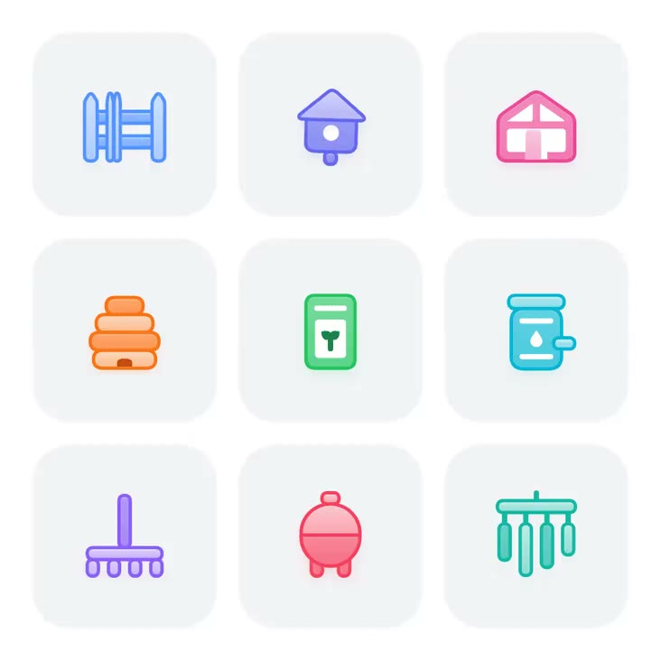
*0.27 秒：柵欄門、鳥屋、溫室、蜂箱、種子包、雨水桶、長柄耙、圓頂烤爐與風鈴維持統一的淺底圓角方格與外描邊比例。*

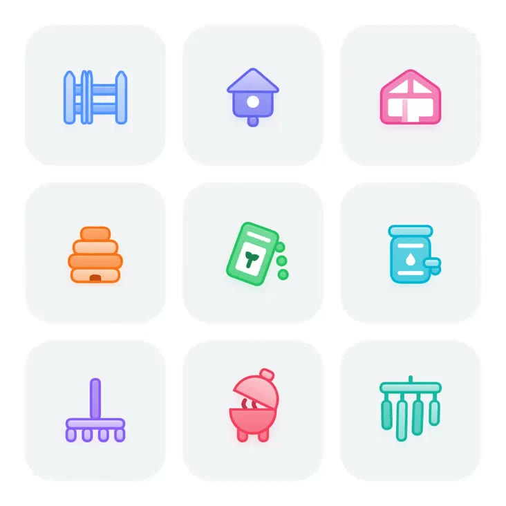
*1.17 秒：種子包傾斜灑出種子、圓頂烤爐掀蓋、風鈴擺動，延續「物體本身動作」的雙關鍵幀規則（[本地更新動圖](06-source.mp4)）。*

## Skill 1.2.0／圖標包 0.9.0：曲線、接縫與生成後自檢（2026-11-16 收錄）

[2026-11-15 官方更新](https://x.com/Kubai087/status/2121845833121579166)宣布 **Skill 1.2.0、圖標包 0.9.0**：調整全局動效曲線、修復或重繪 160 個圖標，並加入生成後自檢。這些是作者發布的版本與數量主張；本次核對官方貼文與影片，沒有執行 Skill 或逐一比對 160 個資產。前文的 460ms／曲線參數屬 11 月 12 日紀錄，本次影片沒有給出新曲線數值，不應視為 0.9.0 的實測參數。

### 做法（影片觀察）

影片先以全庫網格導入，再依序展示動效曲線、接縫、描邊、重繪數量與自檢項目。曲線示意從起點展開，抬升後回到終點；接縫以同一物件的前後對照呈現，最後把檢查項目逐一標成綠色通過。這是宣傳展示的過程，不能據此證明實際每次生成都會通過。

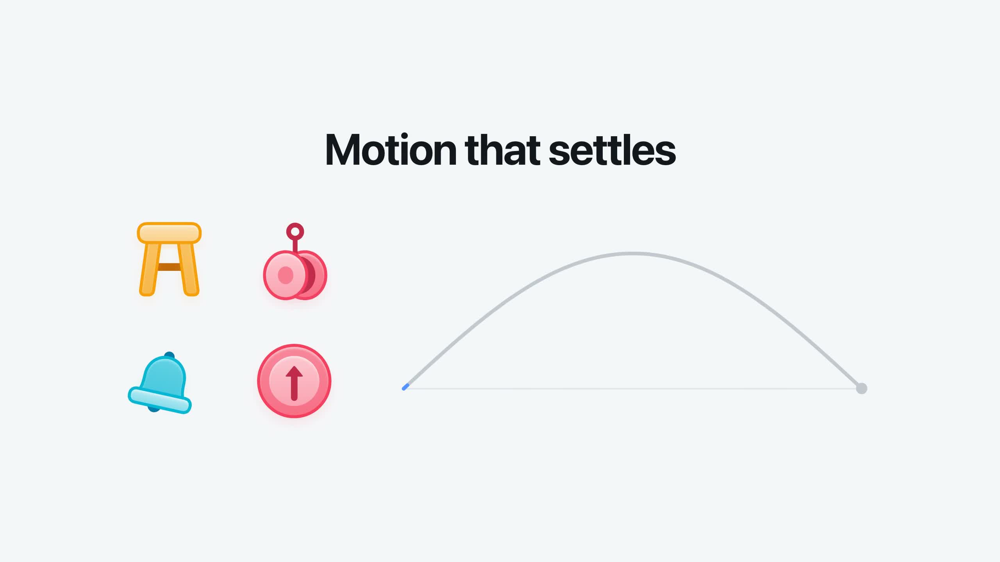
*4.92 秒：「Motion that settles」把凳子、吊墜、鈴鐺與箭頭圖例放在曲線左側，右側以弧線說明動作收斂。*

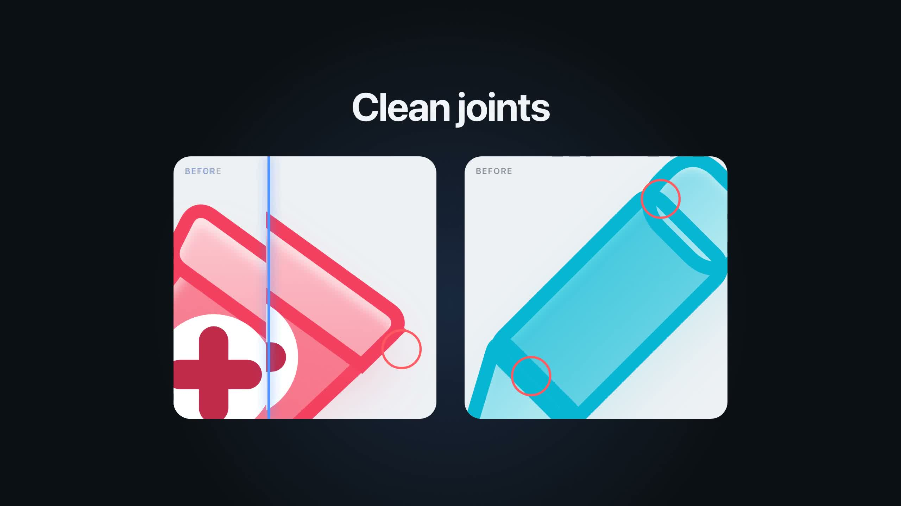
*9.85 秒：「Clean joints」以垂直比較線展示紅色物件與青色鉛筆的局部接縫。*

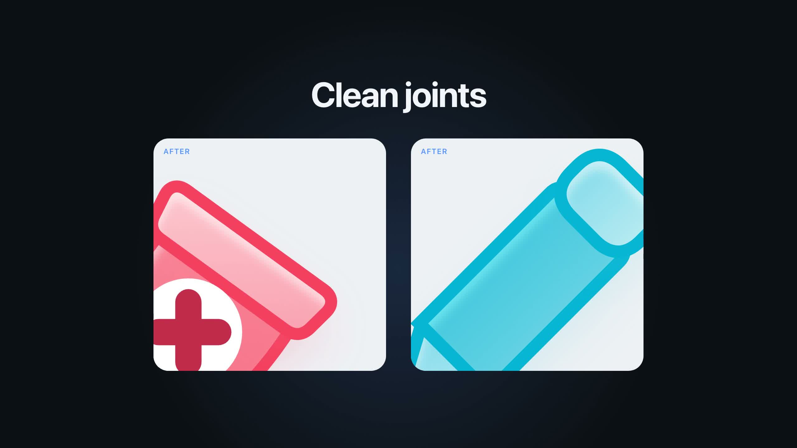
*12.31 秒：比較線移開後，紅色物件與青色鉛筆以完整輪廓呈現，便於與前一畫面比較。*

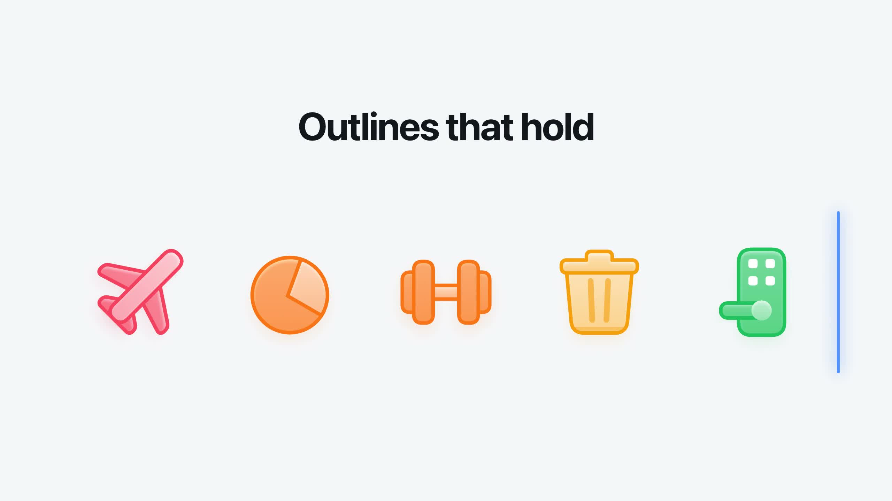
*14.77 秒：「Outlines that hold」橫向排列飛機、圓餅、啞鈴、垃圾桶與門把，旁邊的掃描線提示描邊比較。*

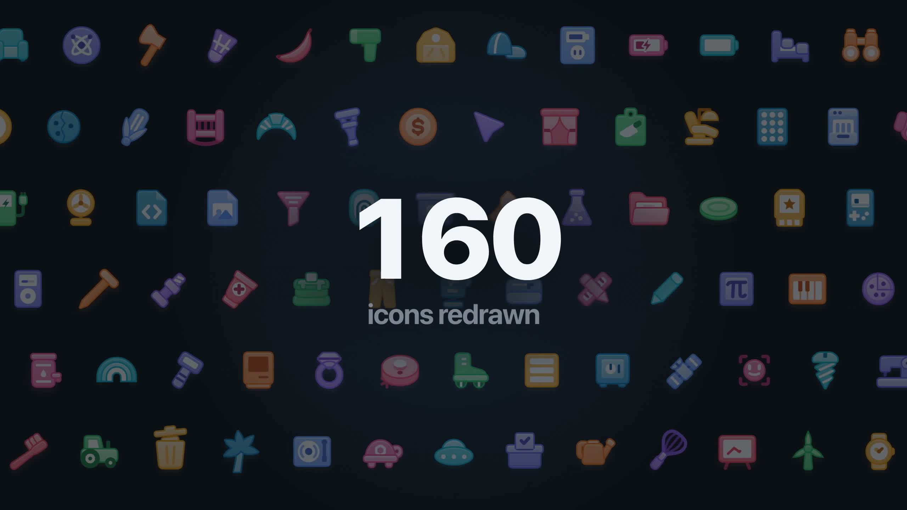
*19.70 秒：深色圖標網格中央顯示「160 icons redrawn」，屬作者在影片中的數量陳述。*

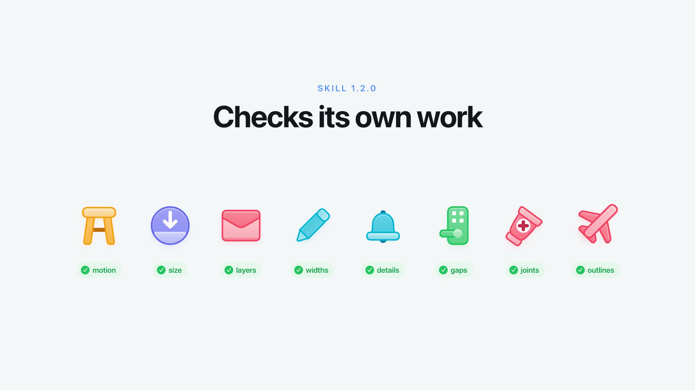
*24.62 秒：「SKILL 1.2.0 / Checks its own work」下方列出 motion、size、layers、widths、details、gaps、joints、outlines 八項綠色檢查標記。*

### 為什麼有效（推論）與借鑑

把動效、接縫、描邊拆成可見的檢查項，可能讓生成後的修正更具體。移植到自己的圖標工作流時，可把這八項做成人工覆核清單，另外保存靜止、中間態、終點與小尺寸對照；實際自檢規則及攔截能力仍須在目標版本執行驗證，不能用影片中的綠色標記代替測試。

## 六個寵物主題圖標（2026-11-16 收錄）

[2026-11-16 官方貼文](https://x.com/Kubai087/status/2122357349151383553)稱新增六個寵物相關圖標，圖標庫已近 3,000 個，並再次說明配套 Skill 內置設計規範；數量與生成一致性均屬作者主張，授權仍以前文分層說明為準。

### 做法（官方動圖觀察）

六個圖例以三欄兩列排列：食盆、毛線球、鳥籠、貓砂盆與鏟、帶爪印的飼料袋、貓跳台。播放後，毛線球轉動，鳥籠與鏟子的角度變化，跳台上的懸球擺動；後段回到接近起始排列。來源是循環動圖，未展示滑鼠或明確操作觸發，不能據此斷定是 hover 效果。

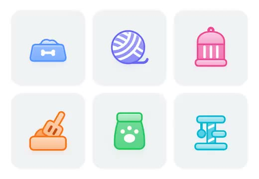
*0.00 秒：六個寵物圖例置於淺灰圓角底板，各自使用藍、紫、粉、橙、綠、青主色。*

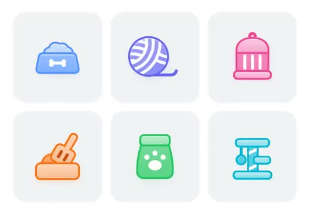
*0.90 秒：毛線球紋路方向、鳥籠角度與跳台懸球位置已改變，保留原有網格位置。*

*3.30 秒：毛線球、鳥籠與懸球回到接近起始的位置，形成可重播的展示循環。*

**借鑑（推論）**：同題材圖標可用固定網格比較動作幅度與配色；用在寵物商品分類時，先驗證食盆／飼料袋等相近語義的小尺寸辨識，不要僅靠顏色區分。

## 六個辦公主題圖標（2026-11-16 收錄）

[2026-11-14 官方貼文](https://x.com/Kubai087/status/2121638625582653570)明確稱新增六個辦公類圖標。本次由該網址的 X 官方 SSR 核對原文、作者與附帶動圖。

### 做法（官方動圖觀察）

六個圖例沿用三欄兩列及六種主色：抽屜櫃、碎紙機、飲水機、印章、辦公椅、升降桌。動圖從收起／靜止排列開始，抽屜露出紙張、碎紙機送紙、飲水機出水、升降桌桌腳延伸，後段回到接近起始態。影片沒有操作游標，以上只描述播放中可見的變化，不推定互動觸發方式。

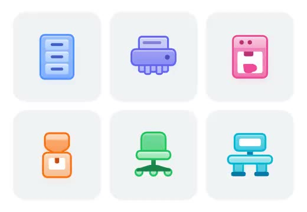
*0.00 秒：六個辦公圖例維持相同底板尺寸，抽屜閉合、升降桌較低。*

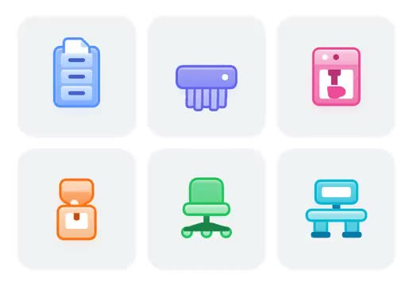
*0.78 秒：抽屜上方露出紙張、碎紙機上蓋與紙條位置改變，飲水機中央出現水流，桌腳開始延伸。*

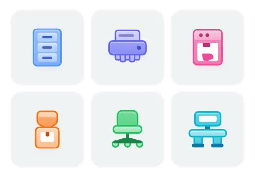
*2.86 秒：抽屜、碎紙機與升降桌回到接近起始位置，保留完整六格總覽。*

**借鑑（推論）**：用物件本身的功能作為動作語義，適合工具分類或功能入口；移植時要檢查紙條、水流、桌腳在中間態是否相交，並另驗證減少動態偏好的呈現。

三則更新都屬同一產品、同一圖標生成與擴充流程，因此追加於本卡。收錄日期為 **2026-11-16**，原始發布日期以上述 UTC 日期為準；新增素材只保留 07／08／09 前綴的關鍵影格，未收錄原始影片或完整提示詞。本次官方文字與媒體取得完整，素材缺漏為無；生成品質、自檢有效性與執行相容性未在本次實測。

## 九個 Y2K 元素圖標（2026-11-19 補充）

[官方原帖](https://x.com/Kubai087/status/2122673122566644158)發布於 **2026-11-17 12:48:04 UTC**；[同日自轉發](https://x.com/Kubai087/status/2122726146764865625)為 **16:18:46 UTC**，只作傳播紀錄，不另算新作品。文字與時間依本次取得的 X 官方公開逐帖資料核對；另一路直接開啟頁面返回 403，未據此推斷來源不存在。動圖由原帖媒體網址直接下載並逐時點檢視。

作者稱本次新增 **9 枚 Y2K 元素圖標**、全庫超過 **3,000 個**、GitHub 已有 **910 多個 Star**，並稱圖標以 MIT 免費開放、配套 agent skill 可生成統一風格的動態圖標。這些均是原帖當時的作者主張；本次未獨立盤點數量、查核 Star、重驗授權或執行生成。MIT 說法不能延伸為 Skill 或全專案的授權證明，也不取代前文的歷史分層紀錄。

### 做法（官方動圖觀察）

九個圖例排成三欄三列，置於淺灰圓角底板：上列為藍色翻蓋鍵盤裝置、紫色蛋形螢幕裝置、粉色雙圓孔盒；中列為橙色拱頂圓盤裝置、綠色機器人、青色支架螢幕；下列為紫色抓爪機、粉紅雙筒背包狀裝置、青綠球形支座。以上依可見外形描述，不把未標名的圖例當成已確認產品。

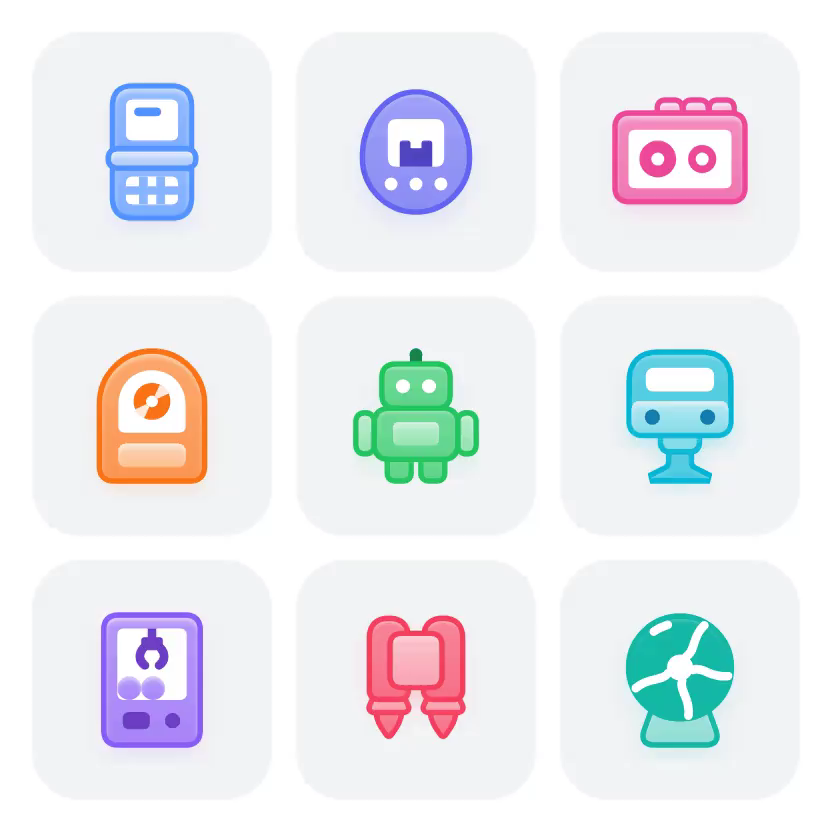
*0.00 秒：九格維持統一底板、彩色漸層與同色外描邊，翻蓋裝置接近直立，機器人雙臂靠近身側。*

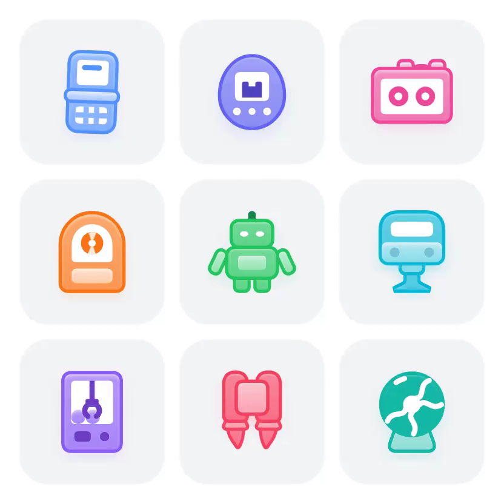
*0.60 秒：翻蓋裝置向一側傾斜，機器人雙臂向外轉，抓爪下降；橙色圓盤與青綠球面的紋樣方向也已改變。*

*1.20 秒：機器人雙臂較前一取樣收回，抓爪位置抬高；蛋形裝置螢幕內的紫色圖形持續變化。*

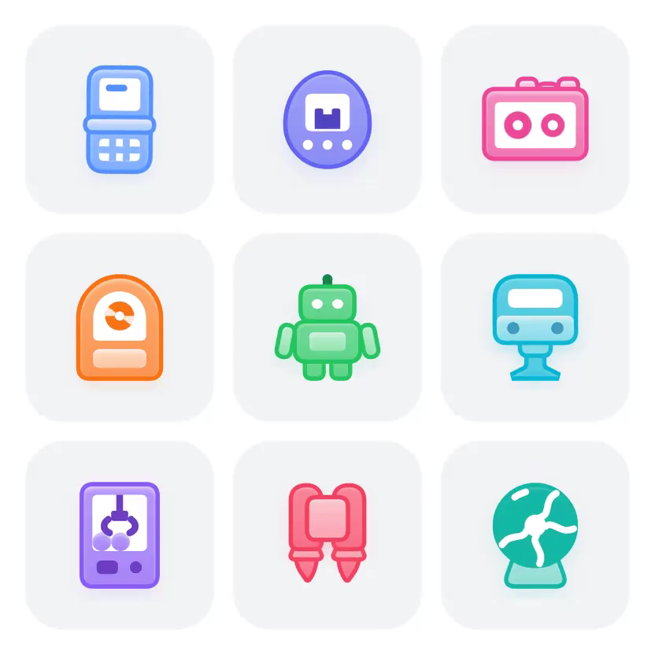
*2.00 秒：翻蓋裝置與機器人回到接近起始排列，抓爪上移，各格位置與底板保持固定。*

**動效過程**：播放即見局部旋轉、傾斜、升降與螢幕內容變化，後段多個部件回到接近起始態。來源標記為 animated GIF，下載的 MP4 為 832 × 832、25 fps、2.16 秒；沒有游標或明確操作觸發，不能據此判定為 hover，也不能把展示循環當成實際元件無限循環的證據。僅保留上述四張原尺寸影格，原始下載影片與臨時總覽已刪除，未收錄完整提示詞。

### 借鑑（推論）

固定底板與網格可供比較同系列圖標的輪廓、配色及動作幅度；適合復古科技主題入口或資產總覽。用於工具列時，先確認未標名造型的辨識度，避免只靠 Y2K 風格傳達功能，並另測小尺寸與減少動態偏好。本次補充未發現素材缺漏；不涉及生成品質或執行相容性的驗收。

## 2026-11-20：雙色圖標預覽

[作者預告](https://x.com/Kubai087/status/2123750291065712709)發布於 **2026-11-20T12:08:21+00:00**，表示稍後發布可生成一致風格雙色動態功能圖標的 Skill。這是未來式預告，本次未安裝或驗證 Skill 已發布。

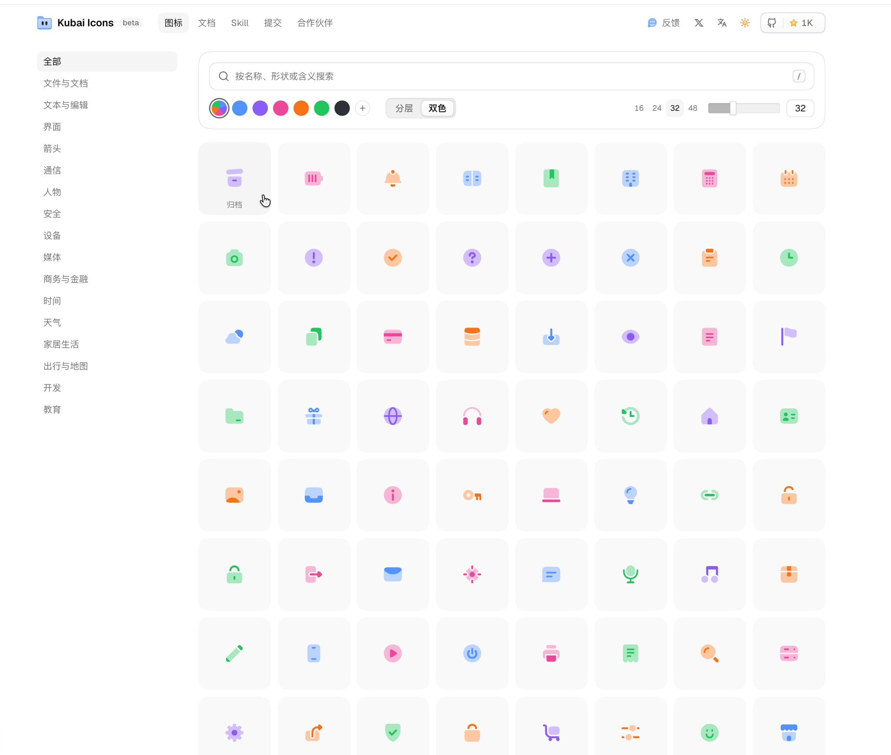
*靜態原圖：左側依功能分類，右側在搜尋列下提供色票、「分層／雙色」、尺寸預設與滑桿，下面保持等大圖標卡片網格。*

- 可見設定選中「雙色」與32尺寸；圖標以同色系深淺區塊區分局部結構，與前文立體Y2K圖例的表現不同。單張截圖未展示切換後結果、生成過程或動效，不據此確認 hover／播放觸發。
- 借鑑（推論）：將顏色、表現模式與預覽尺寸集中在網格上方，可能便於在同一批圖例中比較。移植時須檢查各尺寸辨識度，讓語義不依賴顏色；本次未做可及性或相容性驗證。

## 2026-11-22 補充：雙色圖標在專案選擇器的使用展示

[Kubai 分享](https://x.com/Kubai087/status/2124058518898815373)發布於 **2026-11-21T08:33:08Z**，引用 [Chris Lin（@Chris_lin040818）原帖](https://x.com/Chris_lin040818/status/2124057304614195657)，原帖時間為 **2026-11-21T08:28:19Z**。指定 `fetch.py` 的 X 官方頁面內嵌資料明確給出引用目標；亦直接讀取 Chris 原帖核對。Kubai 是圖標作者與分享者，外掛畫面發布者為 Chris Lin，不能將該外掛介面歸為 Kubai 設計。

Kubai 說剛發布、喜歡新的雙色圖標，並稱不滿意可用配套 Skills 生成；Chris 說自己的 Gemini 外掛使用了這些圖標。這些是兩位作者當時的陳述，不是本次安裝或生成驗收。分享帖無獨立媒體，以下原圖來自被引用的 Chris 原帖；同帖另一張側欄圖已檢視，但帶有專案名稱，未保存。

### 做法（原帖靜態圖片觀察）

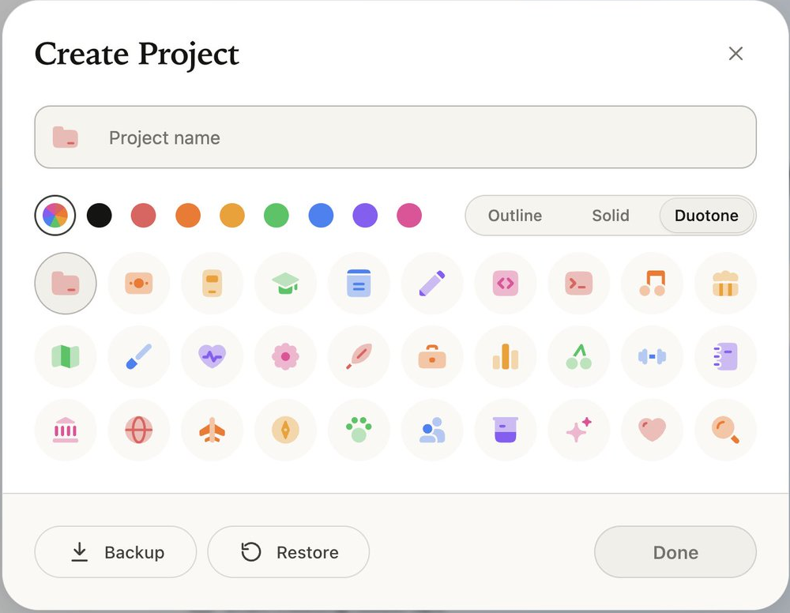
*Create Project 對話框在名稱輸入框下排列色票及 Outline／Solid／Duotone 切換，Duotone 為選中狀態；三列十欄的圓形底板承載不同功能圖例。*

- 首個資料夾圖例有外圈，與名稱欄左側的粉色資料夾對應；不同圖例保留相同底板與間距，使用同色系深淺區塊表現結構。
- 色票與風格選項置於同一列，選擇網格位於其下；底部有 Backup、Restore 與灰色 Done。靜態圖不能證明切換結果、儲存成功、停用條件或動效觸發。
- 保留對話框設計區裁圖，移除外圍背景；沒有帳號、對話內容或帶權限網址。本次兩張來源均為 photo，不需要也沒有補造影片影格。

### 合併與證據邊界

此為同一 Kubai Icons 產品的雙色使用展示，合併到既有生成／擴充工作流，不另建外掛案例。與 [11 月 20 日預覽](https://x.com/Kubai087/status/2123750291065712709)連續，但預覽仍是預告；本次分享增加作者「已發布」說法與使用者展示，未核實正式發布版本、套件內容、Skill 安裝或生成品質，不能倒推預覽當時已交付。

### 借鑑（推論）

將顏色、風格與具體圖例放在同一選擇器，可減少在設定頁與預覽間往返，適合專案、資料夾或分類圖標設定。若圖例數量增加，應另設搜尋與鍵盤導覽；移植時檢查選中圈的對比與小尺寸辨識，避免僅靠色彩傳遞選中狀態。本次未驗證外掛可操作性或對應色票的所有結果。

## 2026-11-23 補充：Avalonia 移植展示

[安可_Anko（@sylanko）原帖](https://x.com/sylanko/status/2124888257859408186)發布時間為 **2026-11-23T15:30:13+00:00**；[Kubai 引用致謝](https://x.com/Kubai087/status/2124888688568185022)為 **2026-11-23T15:31:56+00:00**。本次使用指定 `fetch.py` 讀取兩個官方逐帖頁面，並與當前公開首頁資料中的引用關係核對。Kubai 是圖標設計者與分享者，安可是移植發布者，不將移植程式或 Studio 介面歸為 Kubai 製作。

原帖編輯鏈列出 `2124888257859408186`、`2124888718259724361`、`2124888762031411571`；本次讀到的是指定的初始版本，不聲稱已核對後續版本內容或編輯時間，也不把它們當成新作品。

**作者主張**：已移植至 Avalonia 12，提供 3,000+ 多層與 500+ 雙色變體、多色動畫、預編譯二進位按需載入、發布後穩定不變的枚舉，並連到 [Sylinko/KubaiIcons.Avalonia](https://github.com/Sylinko/KubaiIcons.Avalonia)。本次未安裝、建置、盤點數量或實測效能、序列化與相容性，也未查核移植倉庫的當前授權；上述說法不能代替執行或授權驗證。

### 做法（原帖靜態圖片觀察）

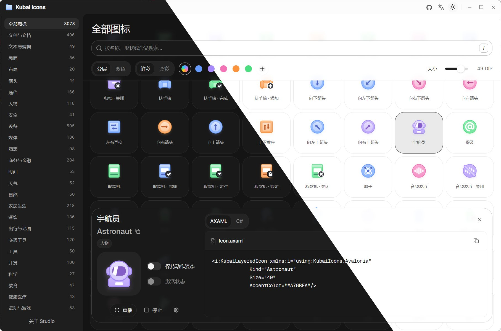
*原帖單張圖片以斜線拼接深淺外觀：左側分類與數量，上方搜尋、分層／雙色、色票及 49 DIP 尺寸滑桿，中間圖標網格，下方為 Astronaut 詳情與 AXAML 程式碼預覽。*

- 圖標卡片有名稱，宇航員卡片帶較深外框；詳情區同時呈現名稱、分類、放大圖例及 AXAML／C# 分頁，程式碼中可見 Kind、Size、AccentColor。
- 詳情區還列出保持動作姿態、激活狀態、重播、停止等控制；靜態圖只能證明這些控制可見，不能確認操作後狀態或動畫。
- 搜尋文案提示依名稱、形狀或含義尋找；分類、模式、配色與尺寸集中在同一瀏覽畫面，便於對照同批圖例。畫面標示 3078，是截圖中的數字，未獨立計數。
- 斜線深淺拼接是作者發布圖的編排，不是本次觀察到的主題切換動畫。來源為一張 `photo`；引用帖無獨立媒體，因此沒有影片、時間點或抽影格，也不補造觸發→過渡→結束流程。

### 合併與借鑑（推論）

這是既有 Kubai Icons 的框架移植與使用展示，仍屬圖標瀏覽、設定及取用流程，只補入本卡，不另建 Avalonia 案例。把圖例預覽、狀態控制與程式碼並列，可能減少選圖到接入的來回切換；移植時應自行驗證程式碼與預覽一致、小尺寸辨識、鍵盤導覽及減少動態偏好。

本次靜態素材取得完整；缺口是未核對後續編輯內容、移植正式版本／授權與執行結果。此補充不解除前文雙色 Skill 的發布及生成驗證缺口。僅新增一張公開設計圖片，沒有保存原始影片、完整提示詞或個人資料。
