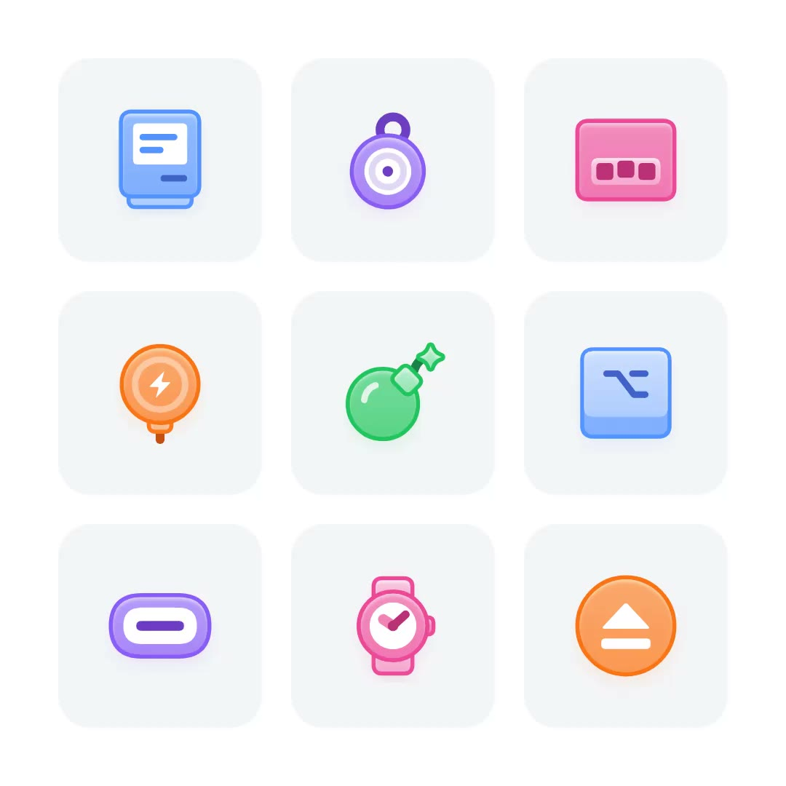
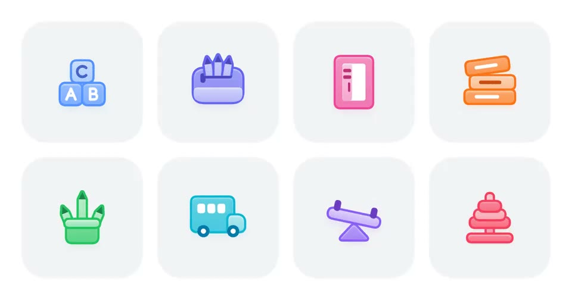
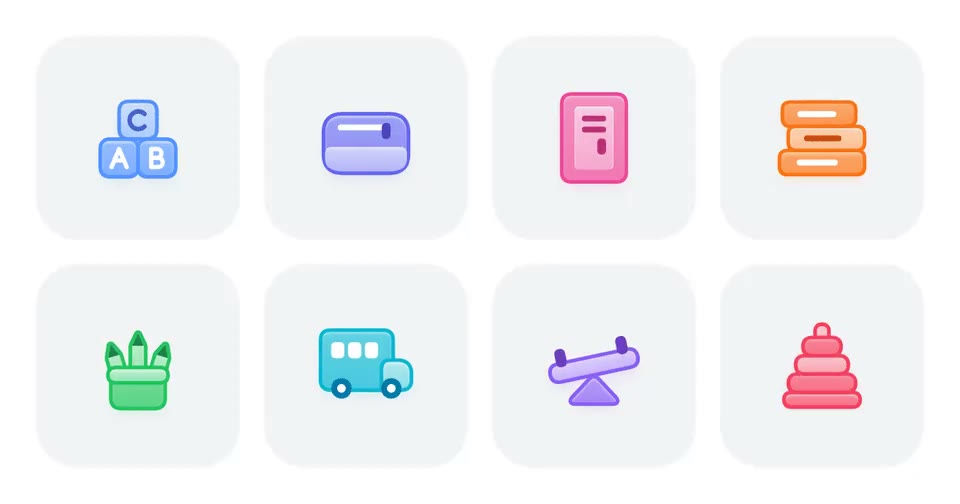
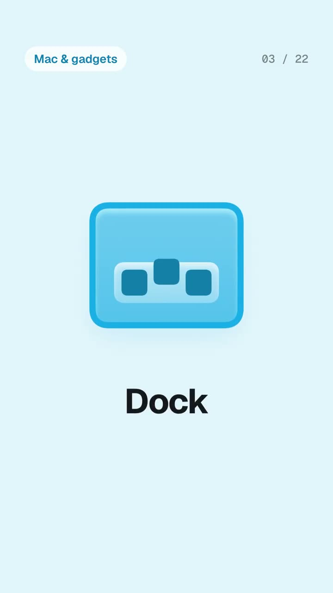
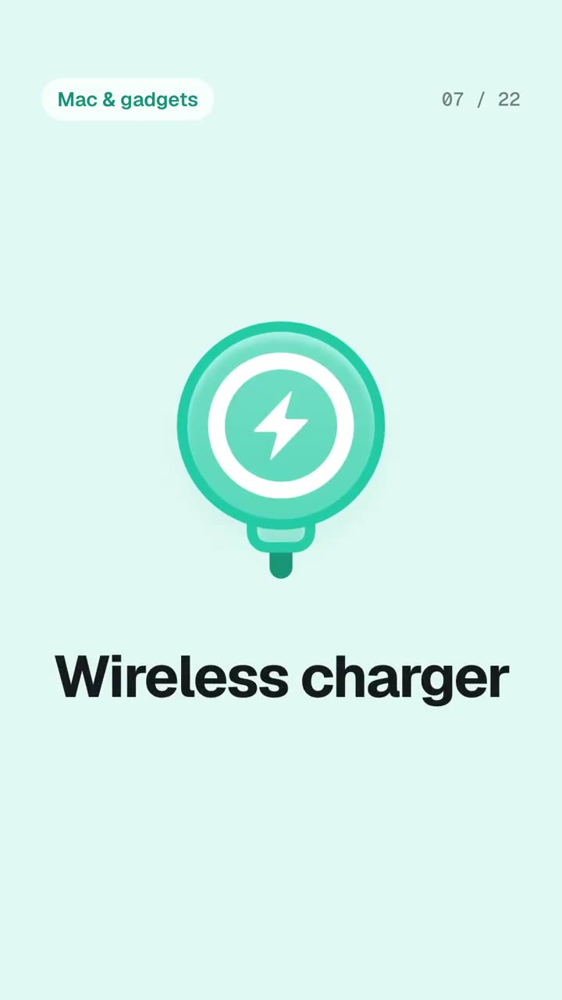
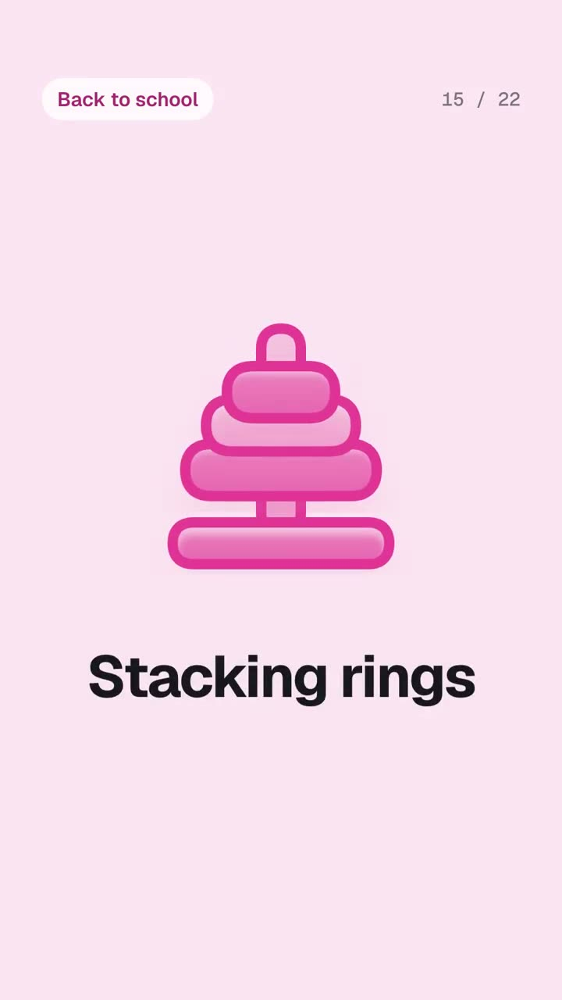
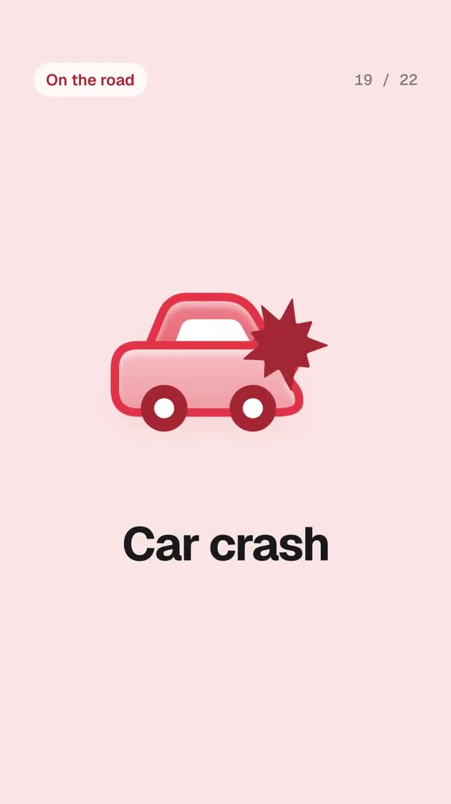
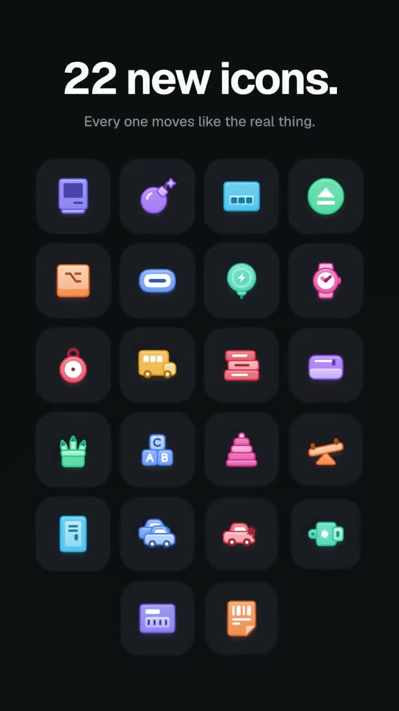
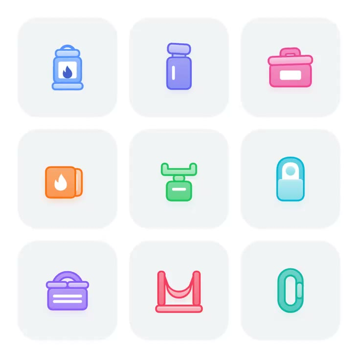
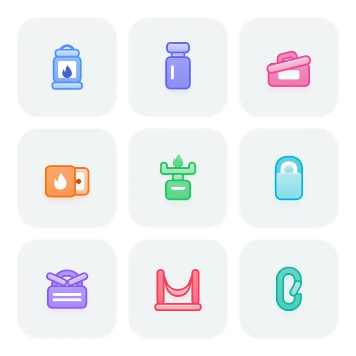

## 問題

介面新增功能時，臨時補畫的圖標容易偏離既有風格；加入動態後，還需要讓不同圖標的狀態變化維持一致。

## 做法

*九個彩色功能圖標排列成三乘三網格，各自置於淺色圓角底板。*

原作者陳述：Kubai 在 11 月 3 日首發動態圖標 Skill，稱可生成動態功能圖標及彩色、單色版本，並提及搭配 Opus 5.5 的效果；首發文字已由 X 官方完整快取核對。11 月 10 日更新稱新增九個動態圖標，總數為 2901，並提供 React 套件安裝方式與隨附 Skills。這些是當時的作者主張，未在本卡重驗。11 月 4 日與 11 月 10 日晚間兩筆 RT 均為轉發，不另算新作品或首發。

可對照[更新動圖](01-source.mp4)與[早期 Skill 展示影片](02-source.mp4)；封包沒有提供完整的風格約束文件。

## 為什麼有效（推論）

收錄者推論：既有圖標與生成規則一起交付，可能減少新增素材時的風格落差；網格展示也便於比較輪廓、配色與動態。不過展示不能證明生成穩定性或所有版本的相容性。

## 借鑑要點

- **適合**：需要持續擴充同系列功能圖標的產品。
- **不適合**：缺乏既有樣本、尚未確定視覺方向的團隊。
- **移植時注意**：先比對靜止狀態、動作幅度與單色版本，再驗證目標環境；免費與數量均以原帖日期為準。

原帖：[11 月 3 日 Skill 首發](https://x.com/Kubai087/status/2117605750474428446)、[主要更新](https://x.com/Kubai087/status/2120110508909133962)、[早期 Skill 自轉發](https://x.com/Kubai087/status/2118014184877428821)、[更新自轉發](https://x.com/Kubai087/status/2120215002594587073)。

## 風格約束的補充說明

[作者於 2026-11-05 的補充](https://x.com/Kubai087/status/2118188266025553929)指出，生成前已約束風格、元素關係與佈局；這是作者對工作方式的陳述，本次未重現一次生成的成功率。

## 後續圖標補充

[2026-11-11 的更新帖](https://x.com/Kubai087/status/2120484329830916286)稱新增 6 個動態圖標，當時總數為 2916。附圖展示多個圖例，這裡保存作者發布的整組示範，沒有逐一判定哪些是本次新增。

*1.075 秒：字母積木、日曆、書本、收納、畫筆、巴士、翹翹板與堆疊玩具等圖例共用淺色底板。*

*3.655 秒：同一組圖標的另一取樣狀態，可配合[本地更新動圖](03-source.mp4)比較動作。*

## 22 個動態圖標展示補充

[作者於 2026-11-11 發布的展示影片](https://x.com/Kubai087/status/2120551252253974750)依序展示 Mac & gadgets、Back to school、On the road 三組圖標，再以網格總覽。影片標示本次展示 22 個圖標，結尾標示圖標庫總數 2,936；這是影片當時的資訊，未獨立核驗。原帖稱圖標庫採 MIT 授權並提供風格遷移 Skill，實際授權範圍與生成品質仍需另行確認。

*4.4 秒：淺藍底中央是帶深色描邊的 Dock 圖標，下方標出名稱。*

*8.4 秒：無線充電器以綠色圓形、閃電符號和短線材組成。*

*16.4 秒：淺藍色收納櫃以外框、門板和通風孔形成圖示。*

*20.4 秒：紅色汽車右側疊加星形撞擊標記，形成事故語義。*

*24.4 秒：深色背景上的圓角方格集中陳列 22 個圖標，方便比較不同題材的共同視覺語言。*

影片逐個切換圖標、名稱與淡色背景，最後匯集成深色網格；這可作為展示一組設計資產的編排參考。上述為取樣影格，不能單憑靜態畫面還原每個圖標完整動效。

## 開源倉庫、授權分層與完整 Skill 風格規範（2026-11-12 補齊）

[作者於 2026-11-12 的更新帖](https://x.com/Kubai087/status/2120830679089090681)宣布新增 9 個戶外主題動態圖標（當時宣稱總數 2,945、GitHub 達 700 Star），並附上公開倉庫 [`kubai087/kubai-icons`](https://github.com/kubai087/kubai-icons) 與[官網](https://icons.kubai.design/)。經核對倉庫內的 `LICENSING.md`、`SKILL.md`、`PROMPT.md` 與 `docs/authoring.md`，先前缺少的完整風格約束規範與實際授權邊界已確認如下：

*0.23 秒：提燈、水壺、收納盒、火焰杯、爐頭、睡袋、野餐籃、吊床架與登山扣排成三乘三網格。*

*2.03 秒：盒蓋掀起、爐火升起、野餐籃打開、登山扣彈開，呈現「物體本身會做的動作」（[本地更新動圖](05-source.mp4)）。*

- **三層授權邊界（修正單一 MIT 簡稱）**：倉庫分三種授權——`icons/`、`badges/` 與發布套件（`kubai-icons`、`-react`、`-vue`、`-static`）為 **MIT**；`SKILL.md`、`PROMPT.md`、繪製引擎與自檢腳本採 **Kubai Icons License（source-available）**，允許安裝執行且生成的圖標歸使用者，但禁止把 `PROMPT.md` 與 `SKILL.md` 複製進目標專案再散佈；官網 `site/` 為 **All Rights Reserved**。
- **畫布、Keyline 與 24px 辨識測試**：固定 `viewBox="0 -2 31 29"`、中心 `(15.5, 12.5)`，對應四種填充 keyline（圓形直徑 `23`、正方形 `20.6`、橫向 `23×18.4`、縱向 `18.4×23`）。只選正面或正側面、可用矩形／圓／圓弧拼出的實物，並在 `24px` 下排除易混淆造型（例如吊床加上底座避免像字母 `M`、小火苗至少畫一高一矮兩股避免像水滴）。
- **前後分片、外描邊與「0 或 ≥2」間距硬規則**：每個圖標至少兩層（後片中間調漸變＋投影、可選無描邊純白內容面、前片淺色漸變＋頂部 `overlay 50%` 內發光），前片上角設 `1.6–2` 圓角讓後片露出；主體圓角 `2.2`、內容圓角 `1.2`；外描邊寬 `1`（以 `stroke-width: 2` 加自身遮罩裁除內側一半）。移動部件與標記在靜止與懸停終點，彼此或離邊緣只能「距離 `0` 完全貼合」或「留空 `≥ 2` 單位」，禁止留出 `0–2` 之間的細縫，且最小細節尺寸須 `≥ 2.4` 單位。
- **單主色相對推導與兩種白色語義**：所有漸變、描邊、投影與深淺標記都從單一主色相對參考藍 `#5393FF` 推導；代表紙張、螢幕、錶盤的「白色內容面」固定 `fill="#fff"`，而壓在彩色主體上的符號「白色標記」標註 `data-w`，切換至藍灰、青瓷、薄荷等清透色板時自動轉為深色以維持對比。
- **雙關鍵幀插值與無頭瀏覽器自檢**：每個部件只寫靜止與懸停兩組數值關鍵幀（`460ms`、`cubic-bezier(0.22, 1, 0.36, 1)`），連鬧鐘震動或指南針擺動也用阻尼正弦／餘弦在終點收斂穩定，不做無限循環。每次新增圖標須執行 `scripts/check.mjs`，在無頭 Chrome 自動截出靜止、懸停、`0%–100%` 六階段中間幀、`24px`、`28px`、全色板與 `#F59E0B` 淺主色對比圖，並開啟 `--force-prefers-reduced-motion` 驗證終點狀態與捕獲載入期腳本錯誤。
