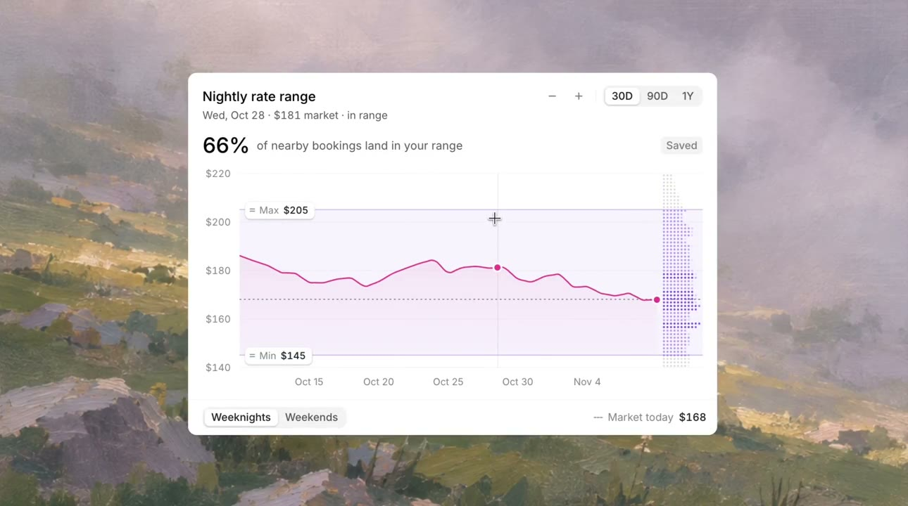

## 問題

使用者比較價格走勢與可接受區間時，若摘要、範圍與資料點分散在不同位置，難以理解改動條件會帶來什麼結果。

## 做法

*折線置於淡紫價格帶內，上下界、日期指示線與頂部比例摘要同時呈現。*

原作者陳述：ianneo_ai 分享可拖動區間、聯動資料與摘要的視覺化示範，由 Kubai 轉發。抽樣影格可見晚間價格折線、上下界標籤、右側點狀分布，以及 30D、90D、1Y 和平假日選項；不同取樣中，曲線與摘要比例會改變。完整操作見[本地影片](01-source.mp4)。畫面價格、百分比與市場摘要皆為示範資料，來源未交代資料集、計算方式或實際產品名稱。

## 為什麼有效（推論）

收錄者推論：把可調範圍與資料放在同一座標中，可能幫助使用者直接對照條件與結果；同步摘要則提供較短的閱讀入口。動態本身不能證明關係更易理解，也不能保證範圍與比例的計算正確。

## 借鑑要點

- **適合**：需要探索時間、價格或容許範圍的比較工具。
- **不適合**：只有單一數字、不需要調整條件的資訊展示。
- **移植時注意**：先寫清資料口徑與摘要公式，提供鍵盤調整及精確輸入；保持座標含義穩定，避免動畫掩蓋缺值。

原帖：[ianneo_ai 的互動示範](https://x.com/ianneo_ai/status/2119660327742931149)、[Kubai 分享](https://x.com/Kubai087/status/2119662437100347810)。
