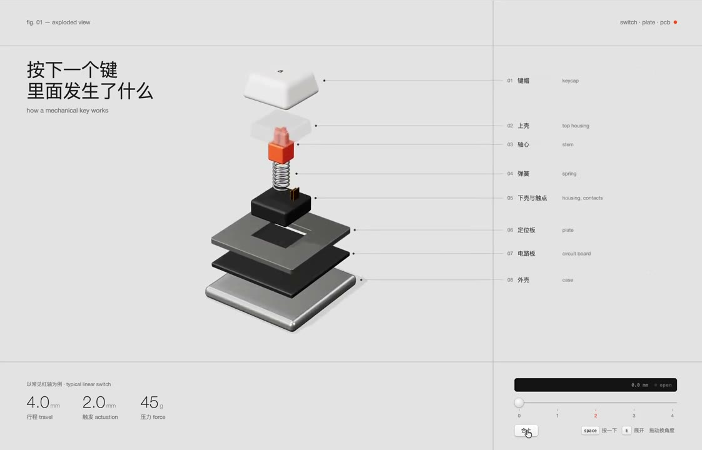
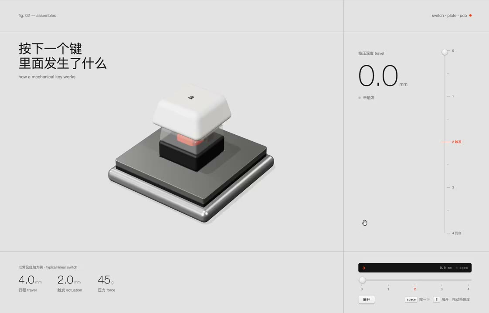

## 問題

只看機械鍵盤外觀，難以理解零件如何疊合，以及按鍵尚未到底時為何已送出訊號。

## 做法

*鍵帽、軸心與底部零件沿垂直方向分開，右側以引線對應各層。*

*按鍵合攏後，右側改呈現按壓深度與觸發刻度，下方另列行程控制。*

原作者陳述：ianneo_ai 展示可拆合的按鍵結構與按壓行程，由 Kubai 轉發。作者描述點擊拆開、再次點擊合上；組合狀態可用推子慢看行程及金屬接點，並以噴砂外殼、霧面鍵帽與半透明軸體表達材質。圖中與原帖的 2 毫米觸發值屬這個示例，不代表所有機械軸。抽樣影格可確認拆合視圖與刻度配置；完整操作見[本地影片](01-source.mp4)，未實測互動或物理精確度。

## 為什麼有效（推論）

收錄者推論：先分層建立零件位置，再合攏展示動作，可能讓結構與功能較容易對應；行程刻度也為視覺運動提供量化參照。來源沒有證明它比靜態圖更易學。

## 借鑑要點

- **適合**：需要解釋內部結構與動作關係的硬體展示。
- **不適合**：沒有可靠尺寸與機構資料的精密教學。
- **移植時注意**：以實際零件與參數建立模型，補充文字說明；保留可暫停、可逐步操作的入口。

原帖：[ianneo_ai 的結構示範](https://x.com/ianneo_ai/status/2115308735807750176)、[Kubai 分享](https://x.com/Kubai087/status/2115322076995465260)。
