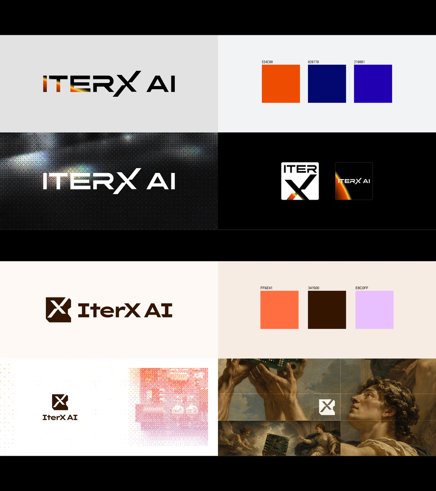
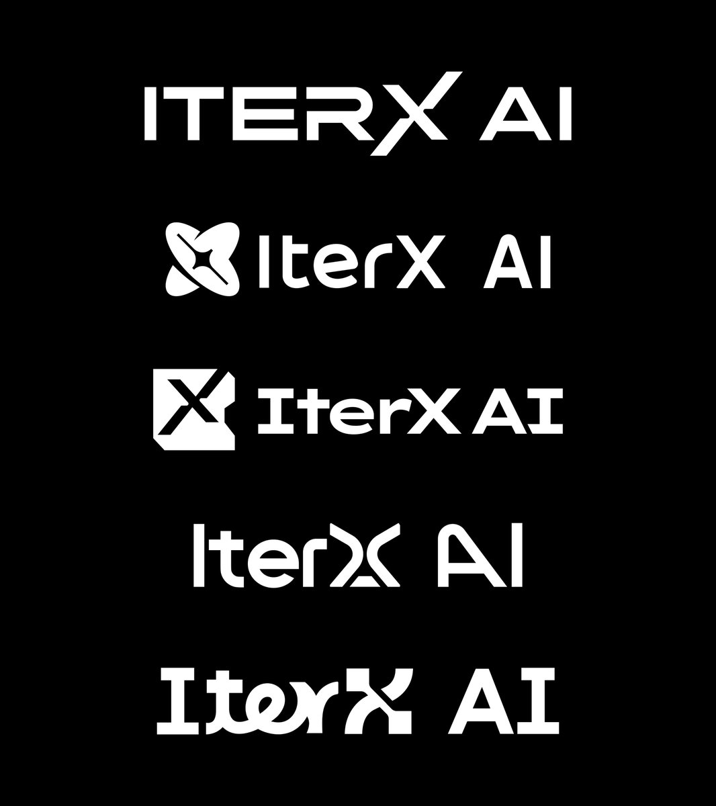
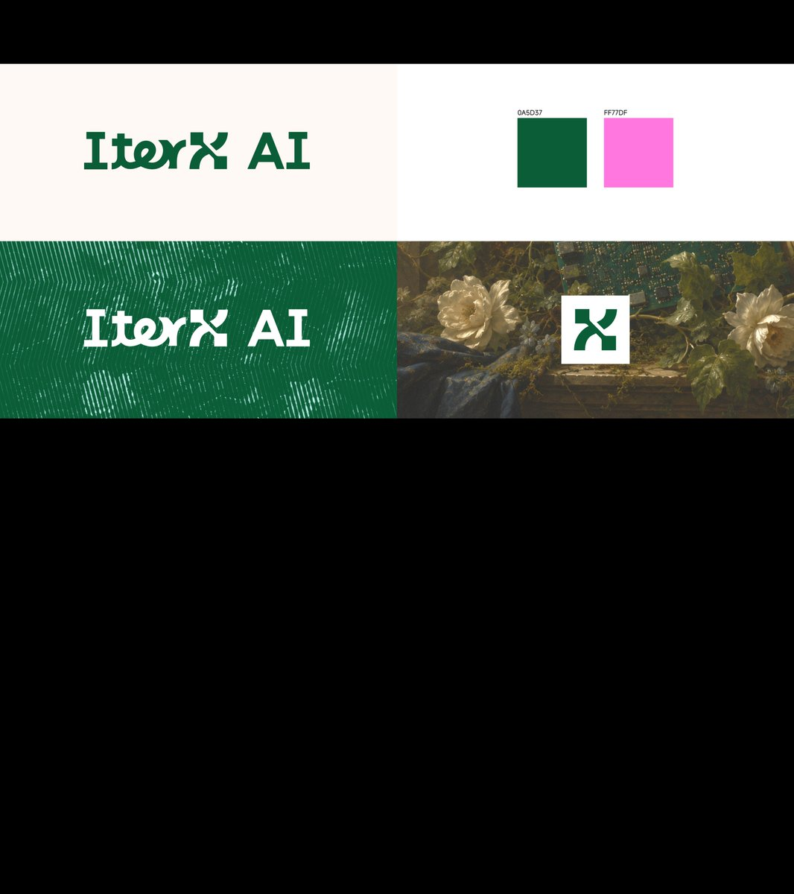

## 問題

面向「AI＋硬體」的企業識別，沒有唯一的視覺答案。提案需要讓人比較不同字形、符號與色彩所構成的整體方向，而不只選一張孤立的標誌。

## 做法

Kubai 於 2026-10-30 分享數月前為 @IterxAI 製作的標誌風格探索，並感謝團隊委託。作者將它們描述為對 AI 與硬體語境的理解，沒有指認最終採用稿或公開品牌成效。

畫面觀察：五組字標在黑底以白色並排比較，包含不同字重、襯線及無襯線字形，部分把 X 拆分或另配圖形標記。其他提案頁將字標與色票、深淺背景、方形圖標及情境圖片組合；其中可見橘藍、棕橘及綠粉等不同配色方向。

*提案頁將不同字標分別搭配色票、背景與方形標記。*

*五個白色字標置於同一黑底，便於直接比較字形與符號結構。*

*綠色字標搭配綠粉色票、紋理背景及獨立方形符號。*

## 為什麼有效（推論）

收錄者推論：先用單色比較結構，再放入色彩與情境，可分開討論標誌本身和延伸風格。展示獨立符號也有助於檢查字標縮成小型識別時還剩下什麼。

## 借鑑要點

- **適合**：品牌方向尚未確定，需要比較數個成套方案的階段。
- **不適合**：從裝飾性情境圖直接推定標誌在硬體上可生產。
- **移植時注意**：用同一組尺寸與情境評比，另測單色、雕刻及小尺寸字母間隙；清楚標示探索稿與採用稿，避免將提案誤作正式品牌規範。
