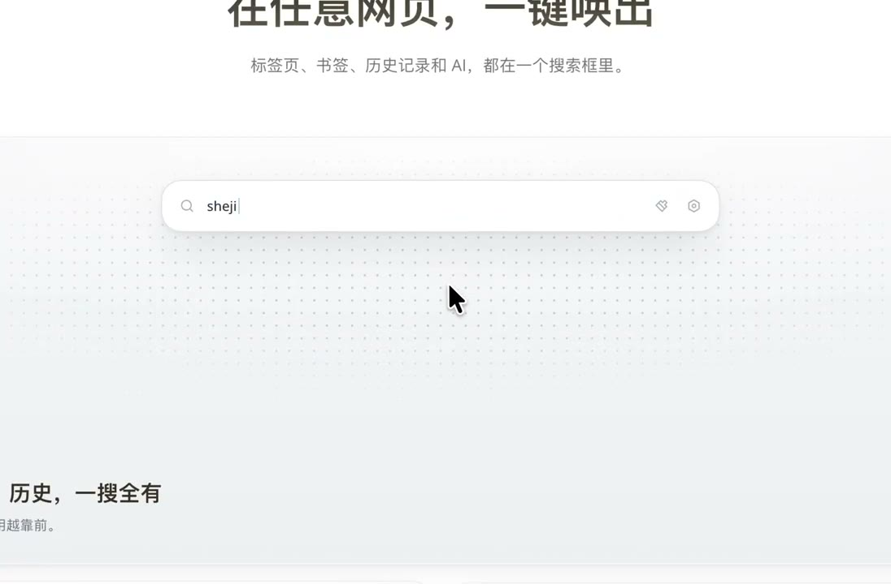
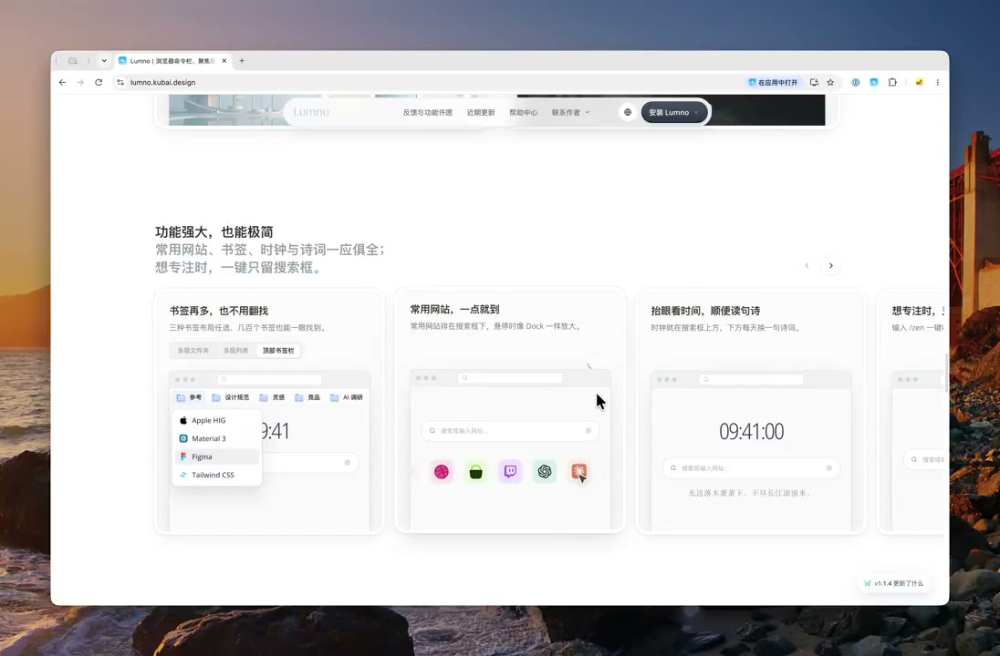

## 問題

官網需要解釋功能，但另做一套示意介面，容易偏離實際產品的元件、字體與操作方式。對持續更新的小型產品而言，示範素材也需要能跟著產品維護。

## 做法

Kubai 於 2026-10-22 分享 Lumno 官網動畫的製作方式：先口述需求，再讓 AI 閱讀產品程式碼，利用已有元件、風格與圖片，依功能點製作 SVG 動畫。作者當時使用「Opus 5.5 High」，並稱官網程式碼以 MIT 協議開源；這是其工作流程紀錄，未核驗目前模型或授權狀態。

附片包含命令輸入、搜尋候選與官網功能區塊。可借鑑的具體做法，是把產品現有視覺資產與要解釋的功能一起交代，而非只要求生成一段漂亮動畫；原文沒有提供完整生成過程或耗時比較。

*13.955 秒：官網標題下方以輸入框與候選列介紹命令入口。*

*36.283 秒：官網將多個功能示例並列於卡片中。*

[本地示範影片](01-source.mp4)（約 66.98 秒）。

## 為什麼有效（推論）

收錄者推論：共用元件與資產，可能減少宣傳畫面與產品之間的差異；按功能拆分示範，也方便逐段替換。來源沒有證明此流程必然更快或不需設計稿。

## 借鑑要點

- **適合**：已有元件與清楚功能邊界的產品官網。
- **不適合**：把程式碼掃描當成正確理解使用情境的保證。
- **移植時注意**：逐段指定觸發、狀態變化與終點，對照真實產品校正文字及操作；另檢查循環、窄螢幕與減少動態效果版本。

延伸來源：[作者附的官網程式碼短鏈結](https://t.co/zQN8erjEx8)（封包未展開目的地）。
