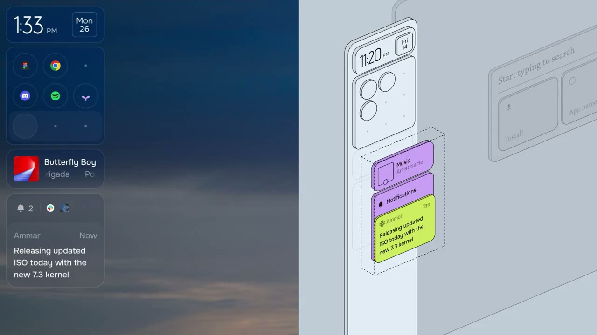

## 問題

軟體宣傳影片需要將多項特色轉成容易辨認的視覺段落。除了錄下桌面，也可以透過形狀、字體、空間與配色建立節奏，供品牌動效設計參考。

## 做法

Kubai 於 2026-10-28 分享一支他稱為 Linux 系統宣傳片的影片，提出 2.5D、線框圖、解構主義與新粗野主義等風格關鍵字。這是他的視覺分類，原文沒有署名影片製作者或直接具名系統，本卡保留歸屬缺漏。

畫面觀察：片段包含深色桌面拼接、紫色底上的等角立體圖形、大型襯線文字，以及實色介面與線框輪廓並列的畫面。這裡收錄的是宣傳構圖和視覺語彙，未驗證其中的 UI 操作、系統功能或效能主張。

*12.96 秒：深紫底文字與淺紫底立體圖形左右並置。*

*24.48 秒：桌面片段旁排列實色卡片與淡色線框介面。*

[本地宣傳影片](01-source.mp4)（34.56 秒；製作者待補）。

## 為什麼有效（推論）

收錄者推論：線框與實色並置，可在構圖上呈現結構和表面的差異；大字與少量強對比色也能建立段落重點。這些只是視覺解讀，沒有傳播成效數據。

## 借鑑要點

- **適合**：軟體宣傳片、功能預告與動效情緒板。
- **不適合**：用宣傳剪輯推演真實點擊步驟或介面可用性。
- **移植時注意**：先選一項空間或排版語彙，對應要講的功能；控制資訊同時出現的數量與閱讀停留，保留產品真實畫面和原作署名。
