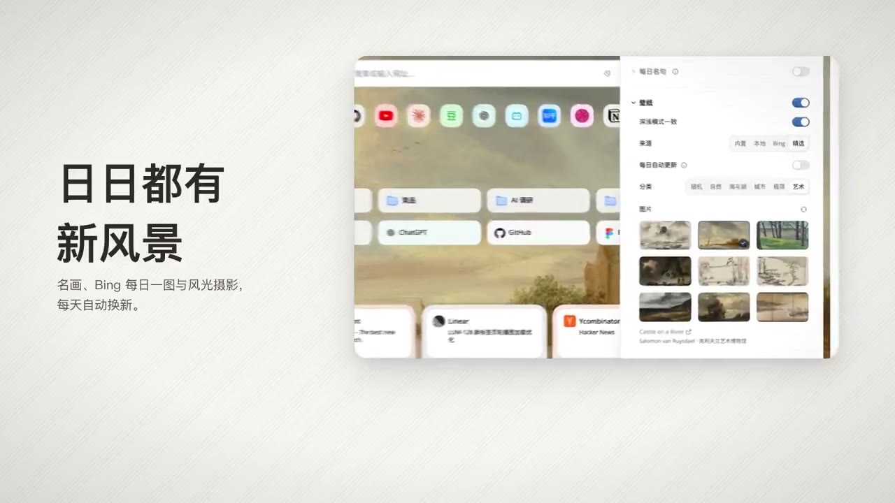

## 問題

新標籤頁既是高頻入口，也承載個人偏好。背景圖片改變後，固定的卡片材質與時間字體未必仍然協調；視覺客製也需要與搜尋、書籤等主要任務共存。

## 做法

Kubai 於 2026-10-19 宣布 Lumno「1.10」更新，列出液態玻璃、磨砂玻璃及多種時間字體。原文同時聲稱修復問題、改善記憶體與載入表現，並可從 Chrome、Edge、Firefox 商店取得；這些都是當日發布陳述，未在本卡重新測試。

更新帖引用較早的正式發布帖，後者將命令搜尋、新標籤頁和自動畫中畫放在同一產品中介紹。現有影片來自該較早帖，不能用來證明 1.10 新材質的折射、透明度或切換細節。

*57.35 秒：較早發布影片展示新標籤頁及側邊背景設定區，非 1.10 材質近照。*

[較早發布帖的本地影片](01-source.mp4)（約 105.88 秒）。

## 為什麼有效（推論）

收錄者推論：材質和時間字體可以成為少量、可辨識的個人化選項；若保留原有資訊位置，可能在改變氛圍時維持操作熟悉度。來源未提供偏好或可讀性比較。

## 借鑑要點

- **適合**：使用頻繁、兼具工具與個人展示性的新標籤頁。
- **不適合**：僅憑材質名稱便推定文字對比與效能已達要求。
- **移植時注意**：用明暗及高紋理背景比較各材質，提供預覽與恢復預設；驗證時間字體在小尺寸下的辨識，不依宣傳影片判斷版本差異。

原帖：[1.10 更新](https://x.com/Kubai087/status/2112007298709344475)、[被引用的較早發布帖及影片](https://x.com/Kubai087/status/2109339158863056998)。
