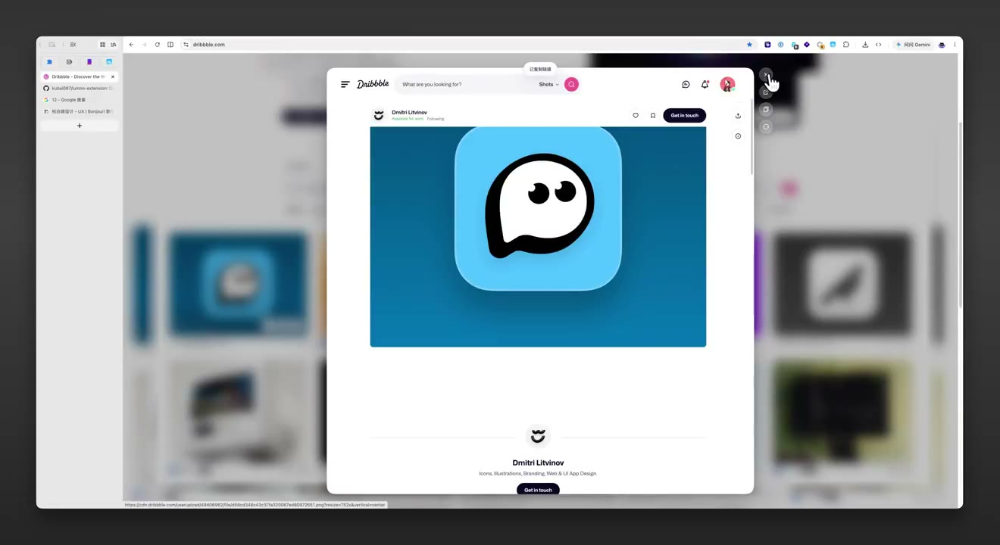
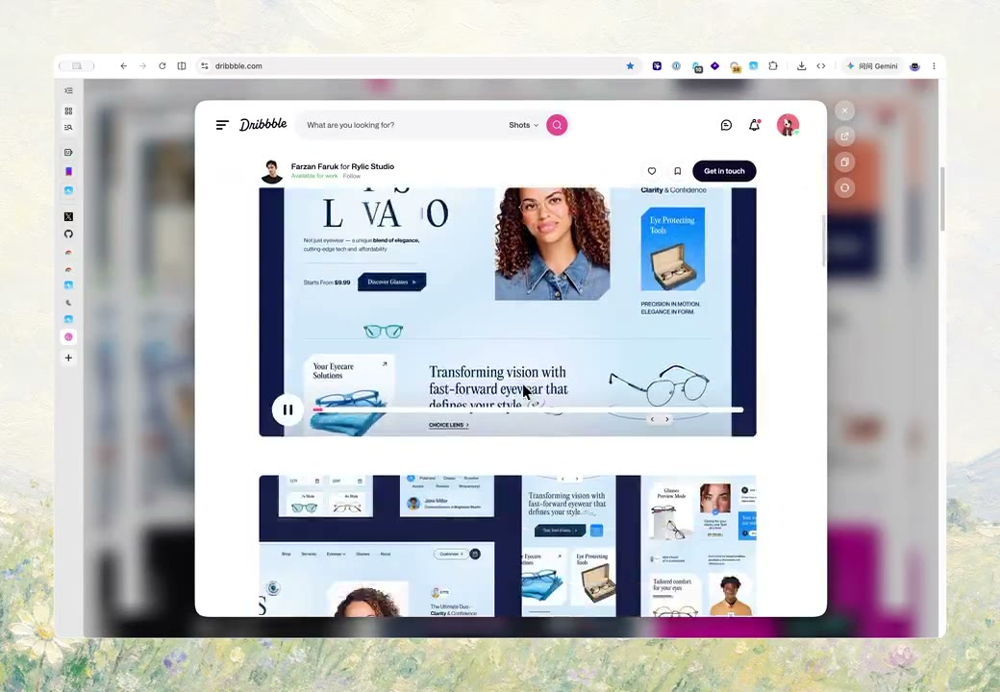
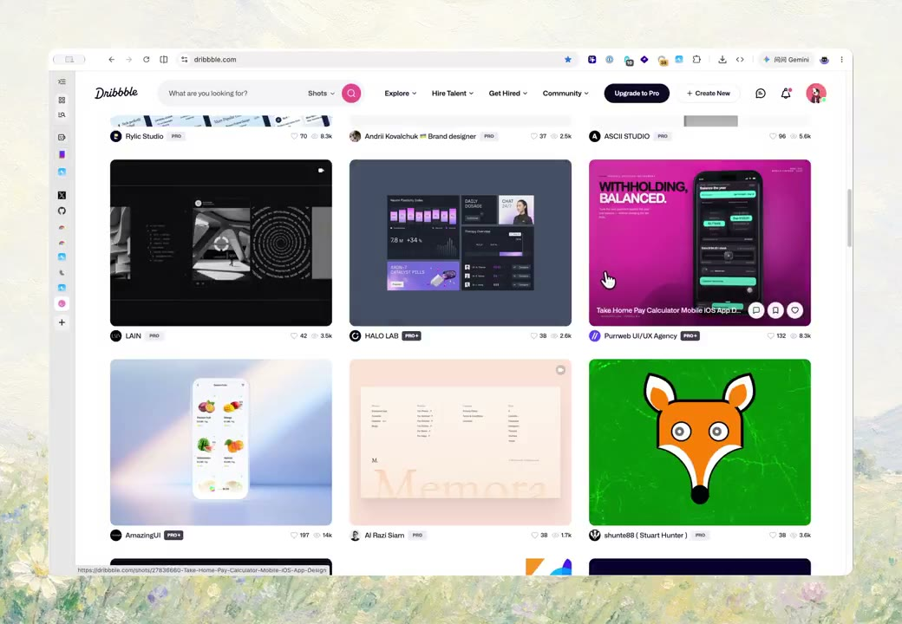

## 問題

瀏覽連結清單時，使用者可能只想快速看一眼內容；每次跳走或開新分頁，都會增加回到原位置的步驟。預覽也需要清楚的離開與轉為正式閱讀的出口。

## 做法

Kubai 先於 2026-10-23 預告 Lumno 的 Shift+點擊小窗預覽，10-25 則以自己擴充功能中的能力介紹：Shift+Click 連結後，在目前分頁上方開浮窗；讀完可關閉，想繼續則轉成完整分頁。前者是開發預告，後者是產品功能介紹，兩筆並非兩個作品。

影片保留原頁在後方，預覽內容出現在中央浮窗，後景變模糊；另有回到原頁網格的畫面。作者稱開關縮放經過多次迭代，並表示支援 Firefox 與 Chromium 系瀏覽器；這些是 10-25 的作者陳述，未驗證目前版本、網站相容性或流暢度排名。

*10-23 影片 0.378 秒：中央浮窗展示連結內容，後方原頁仍在。*

*10-25 影片 11.971 秒：連結頁面位於中央浮窗，周圍可見模糊的原頁。*

*10-25 影片 15.654 秒：畫面重新顯示原頁內容網格，不再有中央預覽窗。*

本地影片：[10-25 功能介紹](01-source.mp4)、[10-23 開發預告](02-source.mp4)。

## 為什麼有效（推論）

收錄者推論：浮窗保留來源頁的空間線索，關閉與轉分頁分別對應短暫查看和持續閱讀。縮放若連貫，可能降低切換感，但原帖沒有任務時間或可用性數據。

## 借鑑要點

- **適合**：資料搜尋、作品探索與需要逐一查看連結的情境。
- **不適合**：把預覽當成登入、付款或複雜編輯的唯一入口。
- **移植時注意**：提供可發現的替代入口，確認焦點進出與關閉後回位；預覽失敗須能開完整頁，並逐站核對載入限制，不能只沿用當時的相容性說法。

來源：[10-25 功能介紹](https://x.com/Kubai087/status/2114407051648725027)、[10-23 開發預告](https://x.com/Kubai087/status/2113698845242863740)。
