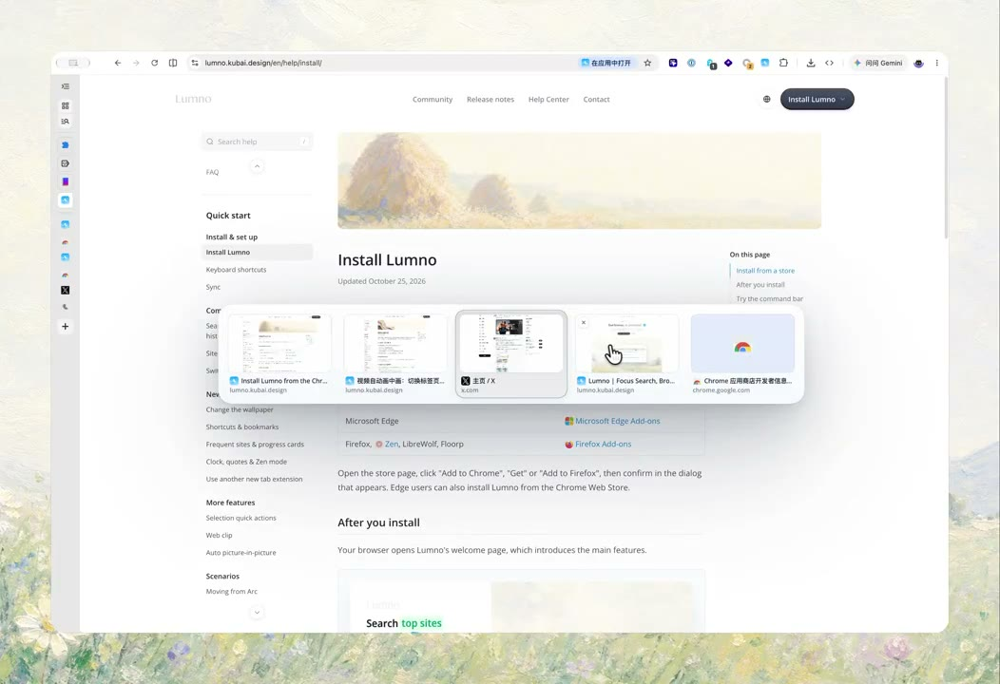
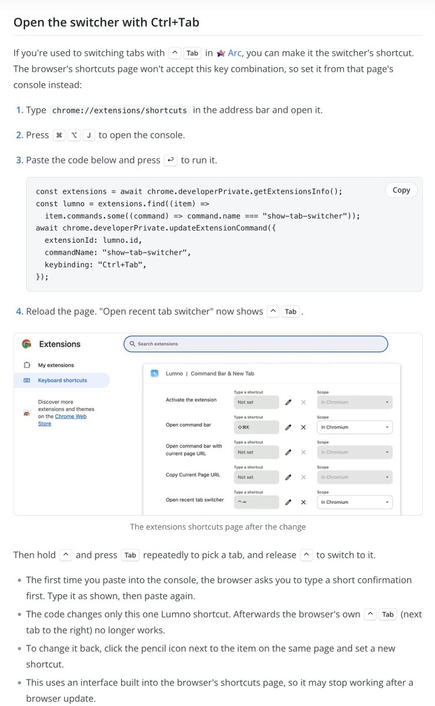

## 問題

在多個標籤頁間反覆工作時，依頁籤排列逐一尋找，未必符合剛才使用的順序。熟悉 Arc 切換方式的人，也可能希望在其他瀏覽器保留相同操作習慣。

## 做法

Kubai 於 2026-10-25 介紹 Lumno 的 Arc 式最近標籤切換器。示範在目前網頁上方疊出橫向縮圖列，候選項保留頁面預覽，選中項有外框；最後切換到對應網頁。

附圖文件說明：按住 Ctrl、重複按 Tab 選擇，放開 Ctrl 才切換。作者另提供在瀏覽器快捷鍵頁為 `show-tab-switcher` 設定 Ctrl+Tab 的方法，並註明會取代原本的相鄰頁籤切換，瀏覽器更新也可能使設定失效。本卡未執行該設定，當時的支援範圍不作現行相容性保證。

*2.284 秒：目前網頁上方顯示多個標籤縮圖，候選項中有外框標記。*

*作者附圖列出快捷鍵設定及「按住選擇、放開切換」的操作說明。*

[本地示範影片](01-source.mp4)（約 6.09 秒）。

## 為什麼有效（推論）

收錄者推論：最近使用順序可能縮短兩個工作頁之間的往返；縮圖則提供標題之外的辨識線索。原帖沒有比較查找時間或誤切換率。

## 借鑑要點

- **適合**：頁面數量多、常在少數工作頁之間往返的工具。
- **不適合**：以此取代所有依固定位置尋找頁面的操作。
- **移植時注意**：明確呈現選中項，區分預選與提交；定義取消、關頁及快捷鍵衝突時的行為，保留可恢復的設定入口。
