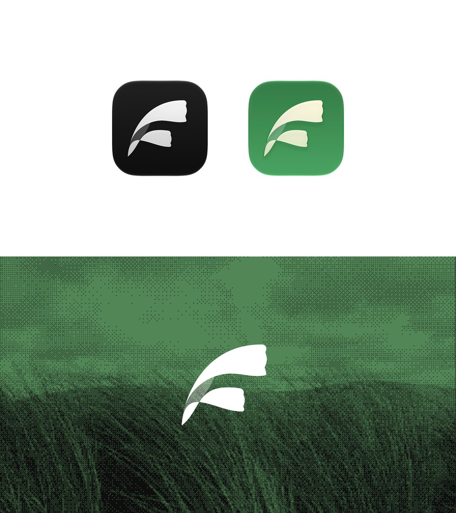

## 問題

聚合網站、Blog、Newsletter 與 RSS 的閱讀產品，需要一個能跨入口使用的簡單符號。這份案例可觀察形狀與配色，卻沒有足夠資料確認圖標的正式採用版本。

## 做法

Kubai 於 2026-10-28 發布蘆葦的 App 圖標，並描述其發現與分享資訊來源的用途。畫面可見兩片彎曲葉形組成的淺色符號，分別置於黑色和綠色圓角底板；下方在綠色點陣背景上重複使用同一符號。原文沒有解釋形狀的構成理念。

*黑底與綠底圖標共用雙葉狀符號，下方展示綠色紋理背景上的單色版本。*

## 為什麼有效（推論）

收錄者推論：葉形可能呼應「蘆葦」名稱，黑綠兩版則便於比較背景對輪廓的影響；這些聯想並非原作者明說的意義，也沒有辨識率數據支持。

## 借鑑要點

- **適合**：以少量自然形狀建立閱讀或內容服務的識別。
- **不適合**：未經確認便把葉形解釋為特定 RSS 功能或已上線標誌。
- **移植時注意**：縮小後檢查兩片葉形間隙與底板對比，區分贈稿、採用稿和後續產品 UI。

原帖：[圖標設計原作](https://x.com/Kubai087/status/2115443446400032916)。
