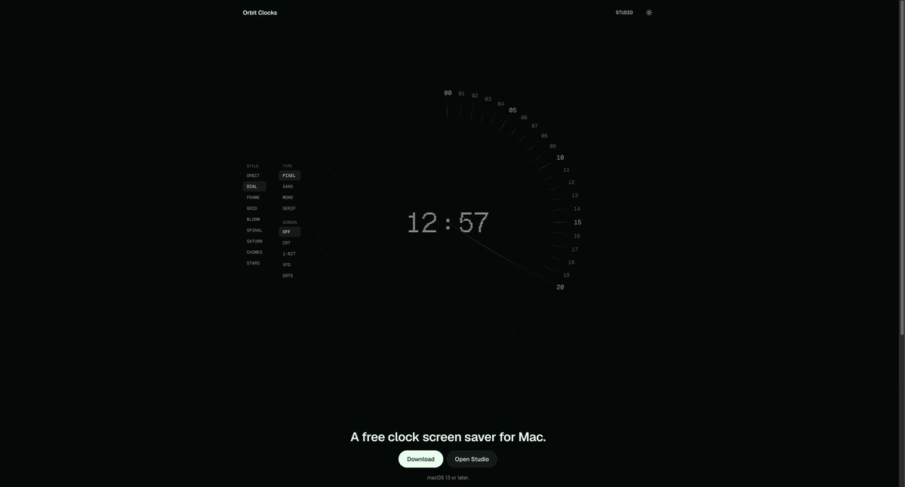

## 問題

使用者想讓待機畫面具有自己的風格，同時仍能讀取時間；單一固定時鐘樣式難以涵蓋不同偏好。

## 做法

*黑底上以中央數字與弧形刻度顯示時間，左側列出 STYLE、TYPE 與 SCREEN 分組選項。*

原作者陳述：dingyi 表示已發布 Mac 屏保與自訂工具，當時免費提供下載。Kubai 分享的附圖可見 Orbit Clocks 名稱、時鐘預覽、分組樣式選擇，以及下載與 Open Studio 入口。Kubai 觀點是它補足風格化鎖屏的需求；原作者稱之為屏保，因此本卡不將它寫成系統鎖屏替換工具。截圖上的系統版本提示也僅屬當時頁面資訊，未經安裝測試。

## 為什麼有效（推論）

收錄者推論：把造型、字體與畫面效果拆成不同選項，有助於逐項調整，而非只能選整套主題。中央預覽保留時間作為焦點；但靜態附圖不能確認切換是否即時、實際耗電或屏保啟動行為。

## 借鑑要點

- **適合**：時鐘、屏保等以單一焦點呈現的個人化工具。
- **不適合**：需要持續閱讀大量訊息的工作畫面。
- **移植時注意**：將外觀選項分組，另驗證遠距離可讀性與螢幕休眠；清楚區分屏保和鎖屏能力。

原帖：[Kubai 的評論與附圖](https://x.com/Kubai087/status/2113495146528698844)、[dingyi 的發布說明](https://x.com/dingyi/status/2113307285644791826)。
