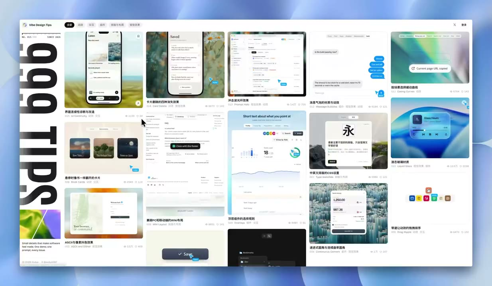
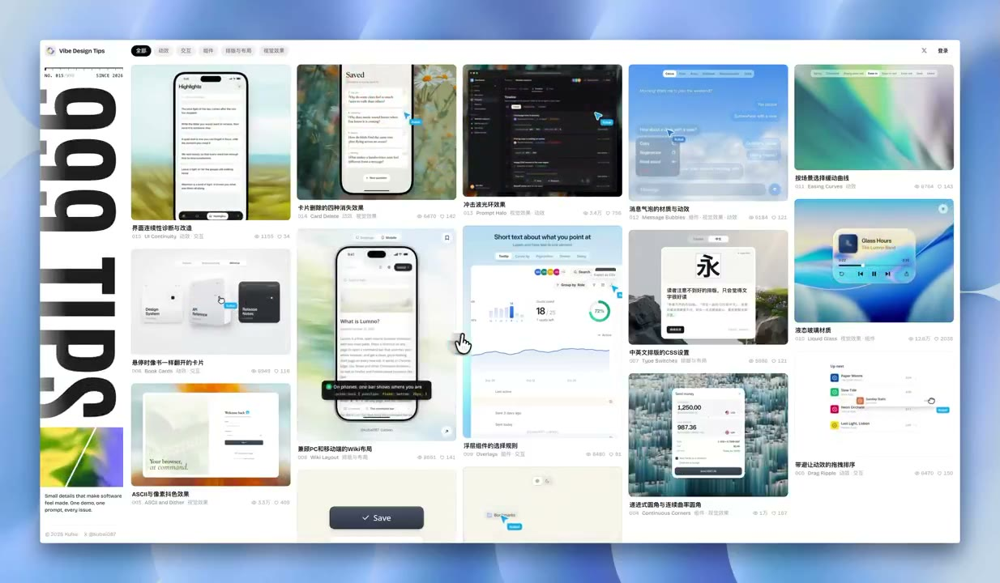
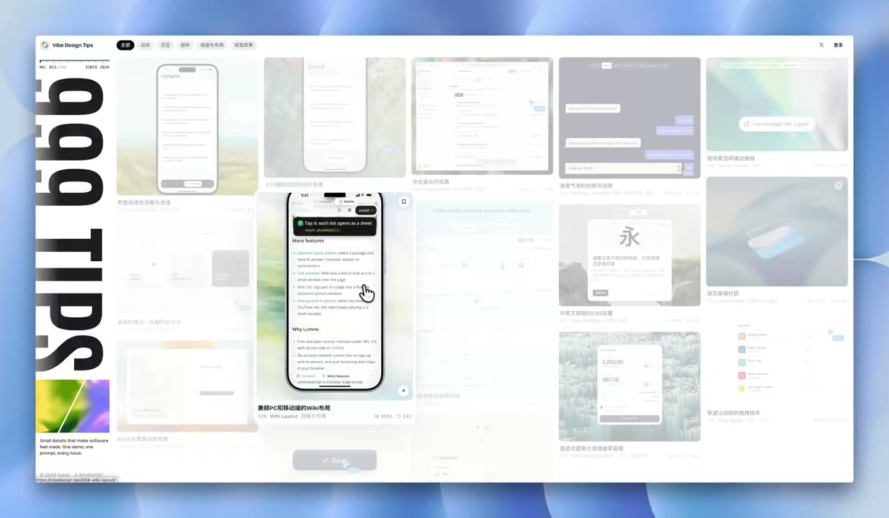

## 問題

設計優化教程分散在多篇貼文時，讀者需要先找到相似情境，再把做法交給 Agent。若入口只有文字清單，較難快速比較不同介面示例。

## 做法

Kubai 於 2026-11-11 預告把自己的教程整合成網頁，採雜誌風格，並計畫提供指令匯出與 AI Agent 閱讀方式。這是方向預告，不能據此認定匯出或 Agent 入口已交付。

影片左側放大型直排「999 TIPS」，右側用多欄縮圖排列手機頁面、表單、圖示與動效示例。部分畫面保留整體網格，部分則讓周圍縮圖淡化、突出一張預覽；視覺索引與單例閱讀共用同一個版面。

*0.607 秒：左側直排標題旁，多欄縮圖同時呈現不同設計示例。*

*5.463 秒：網格中可見手機頁面、表單與圖示案例，保留不同尺寸比例。*

*12.746 秒：周圍部分縮圖淡化，手機頁面預覽仍維持較強對比。*

[本地預告影片](01-source.mp4)

## 為什麼有效（推論）

收錄者推論：縮圖可支援按外觀尋找案例，再進入具體做法；若日後有結構化文字出口，也可能減少人工轉述。後者尚屬計畫，沒有實際 Agent 讀取結果。

## 借鑑要點

- **適合**：已有一批可視化案例、同時服務人與 Agent 的教程庫。
- **不適合**：主要靠長文論證、縮圖無法區分內容的資料集。
- **移植時注意**：縮圖旁補上問題與標題，保留文字搜尋和鍵盤入口；另定義匯出內容與來源欄位，避免只匯出外觀指令而丟失適用條件。
