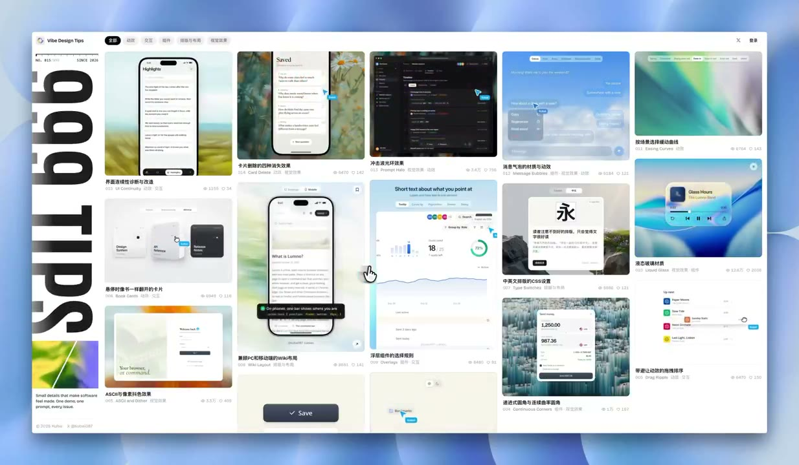
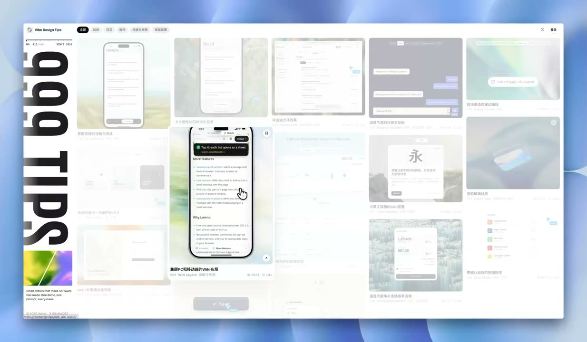
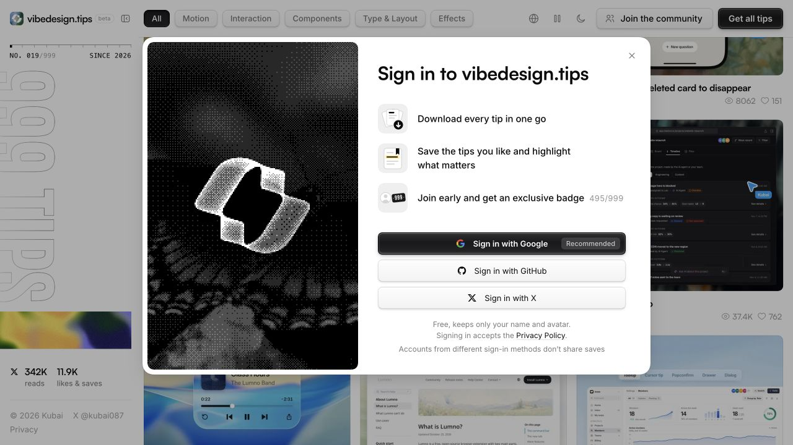
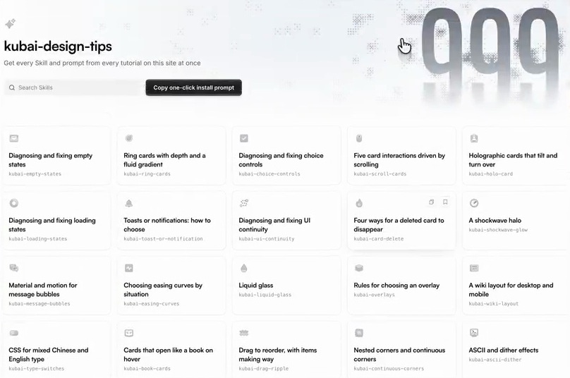
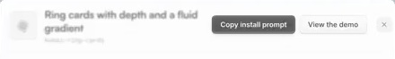
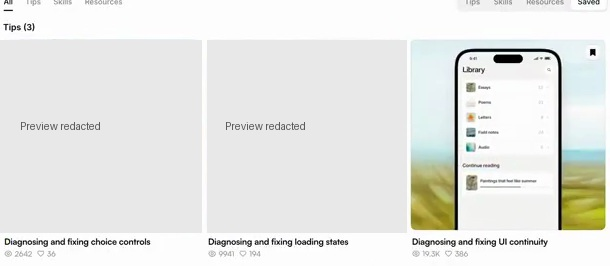
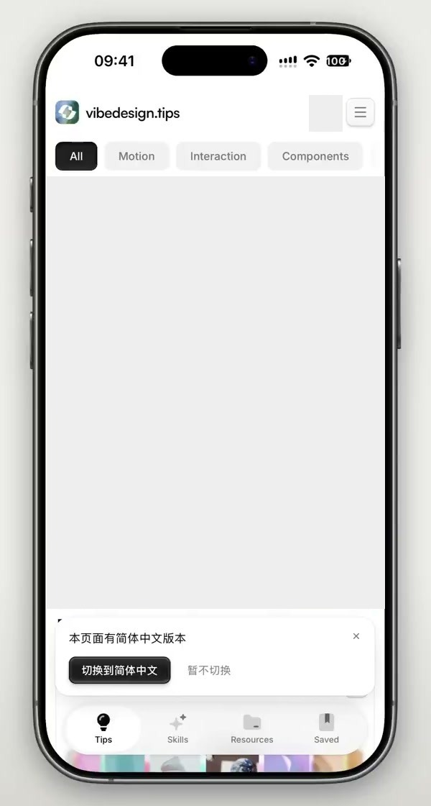
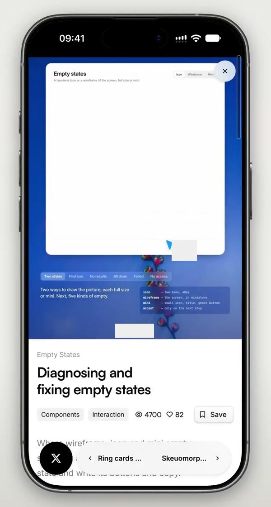
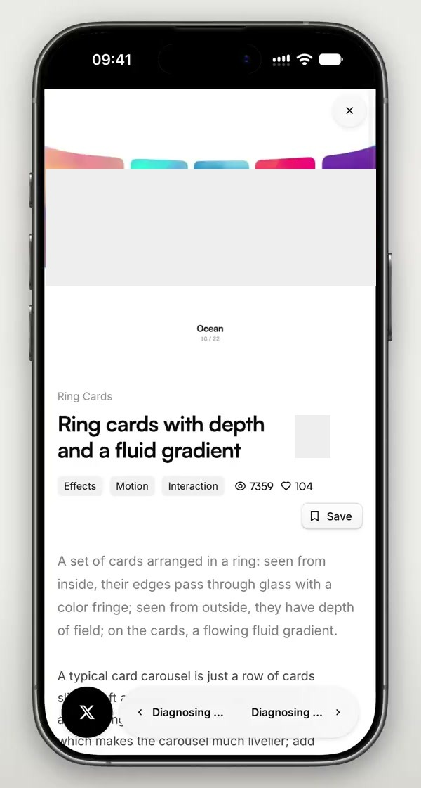
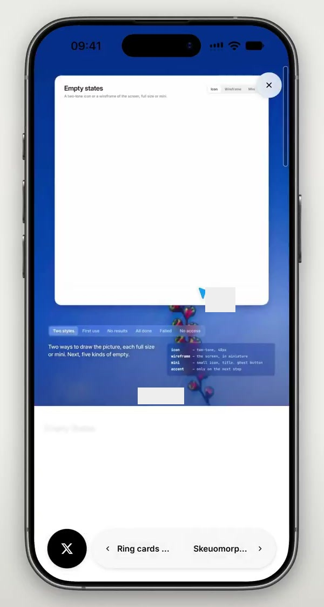

## 問題

設計優化教程分散在多篇貼文時，讀者需要先找到相似情境，再把做法交給 Agent。若入口只有文字清單，較難快速比較不同介面示例。

## 做法

Kubai 於 2026-11-11 預告把自己的教程整合成網頁，採雜誌風格，並計畫提供指令匯出與 AI Agent 閱讀方式。這是方向預告，不能據此認定匯出或 Agent 入口已交付。

影片左側放大型直排「999 TIPS」，右側用多欄縮圖排列手機頁面、表單、圖示與動效示例。部分畫面保留整體網格，部分則讓周圍縮圖淡化、突出一張預覽；視覺索引與單例閱讀共用同一個版面。

*0.607 秒：左側直排標題旁，多欄縮圖同時呈現不同設計示例。*

*5.463 秒：網格中可見手機頁面、表單與圖示案例，保留不同尺寸比例。*

*12.746 秒：周圍部分縮圖淡化，手機頁面預覽仍維持較強對比。*

[本地預告影片](01-source.mp4)

## 為什麼有效（推論）

收錄者推論：縮圖與分類可支援按外觀或問題尋找案例，再進入具體做法；將背景、規則與參數放在複製入口之前，可能減少只搬用效果而忽略適用條件的情況。本次沒有實際 Agent 讀取或實作結果。

## 借鑑要點

- **適合**：已有一批可視化案例、同時服務人與 Agent 的教程庫。
- **不適合**：主要靠長文論證、縮圖無法區分內容的資料集。
- **移植時注意**：縮圖旁補上問題與標題，保留文字搜尋和鍵盤入口；另定義匯出內容與來源欄位，避免只匯出外觀指令而丟失適用條件。

## 2026-11-18：官網實測補充

作者[當日社群說明](https://x.com/Kubai087/status/2123056851189395913)以註冊與支持教程為主，不單憑貼文判定功能。由 [X 個人資料](https://x.com/Kubai087)的網站欄位展開取得[官方網站](https://vibedesign.tips/)，再於瀏覽器實際觀察以下公開介面。前面的 11 月 11 日畫面保留為預告歷史；本卡改列 product 是因為現在可直接使用網站。

*官網以不等高三欄縮圖排列教程，標題與期號置於圖下，左側保留大型直排 999 TIPS。*

- 頂列提供 All、Motion、Interaction、Components、Type & Layout、Effects 分類，並有語言、自動播放與深色模式入口；本次只核對入口，未逐項驗證切換結果。側欄標示 NO. 019 / 999，公開索引列出 001–019。
- 點選教程開啟大幅閱讀面板，網址同時切到該期固定路徑。左側呈現示例，右側依 Background、Where it applies、How to decide、Design rules、Parameters、Summary 編排文字；右上提供文字大小、專注閱讀、X 原帖與關閉入口，文末可切換前後期。

*017 詳情文末將 Prompt 與 Skill 分成兩個收合列，分別附 Copy 與 Copy install prompt；本圖裁去示例中的人名與帳號。*

- [017 Loading States](https://vibedesign.tips/017-loading-states/)的公開頁已提供 Prompt 與 `kubai-loading-states` Skill。它們是交給 Agent 的文字入口；本次不保存完整指令、不安裝 Skill。點擊 Copy 後未取得剪貼簿內容，也未見可確認的成功狀態，因此只能確認入口與公開內容存在，不能宣稱複製成功或 Agent 已讀取。

*點擊 Get all tips 後出現登入面板，說明可一次下載全部教程，提供 Google、GitHub 與 X 登入方式。*

- Get all tips 的未登入流程止於登入面板；未登入、未下載，未驗證檔案格式或機器可讀端點。
- Join the community 開啟獨立付費社群面板，清楚區分「教程免費」與付費交流，說明社群不另提供課程。本次沒有加入或付款，也不收存付款聯絡 QR 圖。此處為網站當時的文案，不是免費政策的長期保證。

### 官方期號與來源對照（只作查證線索）

以下均為實際打開的官網詳情頁及其 View the post on X 回鏈；其他卡片與來源索引未在本次修改。

| 期號 | 官網詳情 | 官網直接回鏈 |
| --- | --- | --- |
| 003 | [ASCII and dither effects](https://vibedesign.tips/003-ascii-dither/) | [2115091203465290087](https://x.com/kubai087/status/2115091203465290087) |
| 006 | [Cards that open like a book on hover](https://vibedesign.tips/006-book-cards/) | [2116198373040759107](https://x.com/kubai087/status/2116198373040759107) |
| 013 | [A shockwave halo](https://vibedesign.tips/013-shockwave-glow/) | [2119359092334743735](https://x.com/kubai087/status/2119359092334743735) |
| 017 | [Diagnosing and fixing loading states](https://vibedesign.tips/017-loading-states/) | [2121449185014845794](https://x.com/kubai087/status/2121449185014845794) |
| 019 | [Five card interactions driven by scrolling](https://vibedesign.tips/019-scroll-cards/) | [2122492414598459820](https://x.com/kubai087/status/2122492414598459820) |

003 與 006 已有公開的背景、適用情境、判斷、規則、參數與 Prompt／Skill 區塊，可補充官網一手來源；這不代表舊 X 貼文全文已恢復。013 的官網明列期號，017 的官網已可讀取指令內容；採用者應保留查證日期與來源差異。

## 2026-11-19：發布來源與收藏彙總補充

回補[正式發布帖](https://x.com/Kubai087/status/2122917792903209141)，並將[社群說明帖](https://x.com/Kubai087/status/2123056851189395913)與本卡共用同一產品、同一教程查找與取用流程。兩帖亦出現在唯讀的點讚／收藏彙總 `MyKnowledgeBase/X/X-2026-11-19.md`，來源為點讚、收藏；不重複建卡。

作者稱網站支援登入、收藏、文字高亮與教程打包／抓取，另提供早期用戶銘牌。這些是發布文字，未在本輪驗證登入後功能；前文實際觀察到的登入門檻仍保留，不把「一鍵下載」公告當成未登入可成功下載的證據。

## 2026-11-22：正式版的分流與取用狀態

[正式發布帖](https://x.com/Kubai087/status/2124440619120759238)發布於 2026-11-22 09:51:28 UTC；以下影片觀察與當日未登入的公開網站觀察分開記錄。作者公告的多語言、打包下載與 Agent 執行能力，不等於本次已驗證交付結果。

### 做法（觀察）

*發布影片擷取：Skills 將教程改排為文字卡片，上方有搜尋與整包安裝指令入口；已裁去瀏覽器與作者側欄。*

- **查找分流**：Tips、Skills、Resources、Saved 共用頂部導覽；Skills 卡片同時顯示教程標題與 Skill 識別名。當日公開頁實際輸入 `loading` 後，清單收斂至 Diagnosing and fixing loading states，搜尋框保留輸入並出現 Clear search。只觀察搜尋結果，不複製完整指令或安裝。

*發布影片擷取：單項 Skill 面板在標題旁並列 Copy install prompt、View the demo 與關閉入口；指令正文全部裁除。*

- **由清單進入取用面板**：影片先展示 Skills 清單，再開啟單項面板；複製安裝指令與返回示例是分開的動作。影片後續回到清單。本卡按流程編排圖片，並非依擷取時刻排列；這只能證明錄製畫面具有這些狀態，不能證明安裝或剪貼簿成功。
- **資源分類**：當日公開 Resources 頁依 Component libraries、Design tools、Inspiration、Communities 分組，每項有名稱、短說明與連結。點選 Design tools 後，網址成為 `/resources/?type=tool`，選項呈選中狀態，內容只保留 Design tools 組。未逐一打開外部資源。

*發布影片擷取：Saved 顯示 All、Tips、Skills、Resources 分類及 Tips (3)；兩張可能含協作者或帳號資料的示例預覽已整塊遮蔽，保留標題與收藏標記。*

- **收藏有登入邊界**：影片中的 Saved 有三張教程卡片；本次未登入開啟 `/?view=saved`，則顯示 Sign in to use Saved、跨裝置同步提示與 Sign in 按鈕。這是兩種不同身分狀態，不能把作者影片當成本次完成收藏、同步或下載的證據。未登入、未取得會員資料、未測試打包下載。
- **引用帖不作功能證據**：[2124476440804831686](https://x.com/Kubai087/status/2124476440804831686)發布於同日 12:13:49 UTC；其附圖是 X 創作者收益資格進度，並非 Vibe Design 教程流程，不保存該圖，也不據其文字增加網站功能主張。

### 為什麼有效（推論）

按「看示例／取 Skill／找資源／回到收藏」分流，可讓同一批教程服務不同目的；單項面板把安裝入口與示例入口並列，可能減少閱讀與取用之間的往返。Saved 的未登入狀態先說明同步用途，再提供登入動作。這些是設計解讀，沒有轉換率、效率或 Agent 執行結果證據。

### 借鑑要點與查證界線

- **適合**：同一內容庫同時提供可視化案例、可安裝資產與外部參考。
- **不適合**：內容數量少、分流後每頁只剩少量項目的庫；此時可先用單頁分類。
- **移植時注意**：搜尋保留查詢與清除入口；標題連回示例，安裝另設明確按鈕；登入前交代收藏與同步的用途。不要以 Copy 按鈕存在推定複製或安裝成功。
- **當日系列查核**：公開索引逐項列出 001–022，最高為 022；官網載入的公開程式 `/_app/main-CQTjdGAg.js` 明列 `022` 對應 X `2124170395825873348`。未見 023 條目或對應 X 映射，並非只從發布總數推斷；不排除查核後更新。完整期號映射記於本次工作報告，不修改來源台帳。
- **缺口**：X 直接讀取回傳 403，兩則文字、日期與媒體關聯依本次提供的官方個人頁資料核對；影片與公開網站另行取得。原卡的複製、下載驗證缺口仍未消除。新素材僅保留三張已檢視的裁切影格，不保存本輪原始影片、引用附圖或完整指令；既有歷史素材未改動。

## 2026-11-23：手機閱讀與 PWA 公告補充

[手機閱讀更新帖](https://x.com/Kubai087/status/2124901875090968996)發布於 2026-11-23 16:24:20 UTC。貼文文字、日期與影片關聯依本次提供的官方個人頁資料核對；X 直接讀取仍回傳 403。以下將官方影片、公開網站觀察與作者聲明分開，不把手機外框當作原生 App 或 PWA 安裝成功證據。

### 做法（官方影片觀察）

*0 秒：分類列下方出現「本頁面有簡體中文版本」提示，可切換或暫不切換；底部保留 Tips、Skills、Resources、Saved，示例及帳號區已遮蔽。*

- 提示出現在內容上方、底部導覽之前，提供明確的接受與略過動作。這是影片中的狀態；本次以 zh-CN 瀏覽器語言開啟英文官網時未重現該提示，不推定所有語言都會觸發。
- 影片先切換頂層分區，再回到教程索引、開啟單篇與捲動正文；頂部分類採並列按鈕，底部主導覽在部分捲動狀態收縮為較短的浮動列。只能確認錄製中的狀態變化，不能量化與原生體驗的一致程度。

*20 秒：示例下接教程標題、分類與 Save，底部浮動列另放 X 原帖和前後篇；示例署名已遮蔽。*

*30 秒：閱讀內容已換成 Ring cards，標題與正文沿單欄向下排列，底部仍保留前後篇入口；示例局部已遮蔽。*

*35 秒：空狀態示例佔據上方區域，右上有關閉入口，底部前後篇仍可見；署名已遮蔽。*

- 影片可見由空狀態教程切到 Ring cards，再回到空狀態教程的閱讀狀態；不將剪輯中的狀態順序視為本次親自點擊成功。

### 公開網站觀察與查證界線

- **已觀察**：未登入的 Chromium 手機模擬視口 390×844 下，索引以單欄排列；頂部分類並列，底部四項導覽可見。直接打開 [022](https://vibedesign.tips/022-empty-states/) 可見示例、標題與正文，底部有 X、前後篇入口；公開連結分別指向 021 Ring cards 與 001 Skeuomorphic buttons。另一次自動點擊未匹配預期按鈕名稱而中止，未完成前後篇導航驗證。
- **作者聲明**：支持 PWA、依使用者語言提示、帶伸縮效果的原生式底部導覽、底部上下頁、等寬頂部選單，以及 Safari 狀態列取色改善（作者也註明未完美）。影片支持部分介面狀態存在，不支持所有裝置的結果。
- **設定證據**：[公開 manifest](https://vibedesign.tips/assets/site.webmanifest)宣告 `display: standalone`、`start_url: /`、192/512 圖示及 Skills／Resources／Saved 捷徑。這是設定存在，不是安裝、離線或捷徑啟動成功；本次未在 iPhone Safari／加入主畫面環境驗證，也未驗證狀態列取色。
- **當日系列查核**：官網實際載入 `/_app/main-CXMEUqWJ.js`，教程資料逐項明列 001–022 的 `issue`、`slug` 與 X ID；最高為 022 → `2124170395825873348`。未見 023+ 的期號條目或 X 映射，不以任意字串「023」搜尋命中作判定。完整 22 項映射在本次工作報告；未建立新系列或修改來源台帳。

### 為什麼有效（推論）與借鑑

頂層導覽負責切換內容種類，閱讀列負責原帖與前後篇，兩者隨情境替換，可能減少返回索引的往返。適合同系列連續閱讀；移植時應保留明確的關閉、返回及前後篇標題，避免浮動列遮住正文，並讓語言提示可以略過。這些是設計推論，沒有閱讀效率或留存數據。

本輪只保留四張裁切、遮蔽後的官方影片影格；不保存新原始影片、完整 Prompt 或帳號畫面。既有歷史影片及素材不變。未登入、不安裝、不驗證會員收藏；原有複製與下載缺口仍保留。
