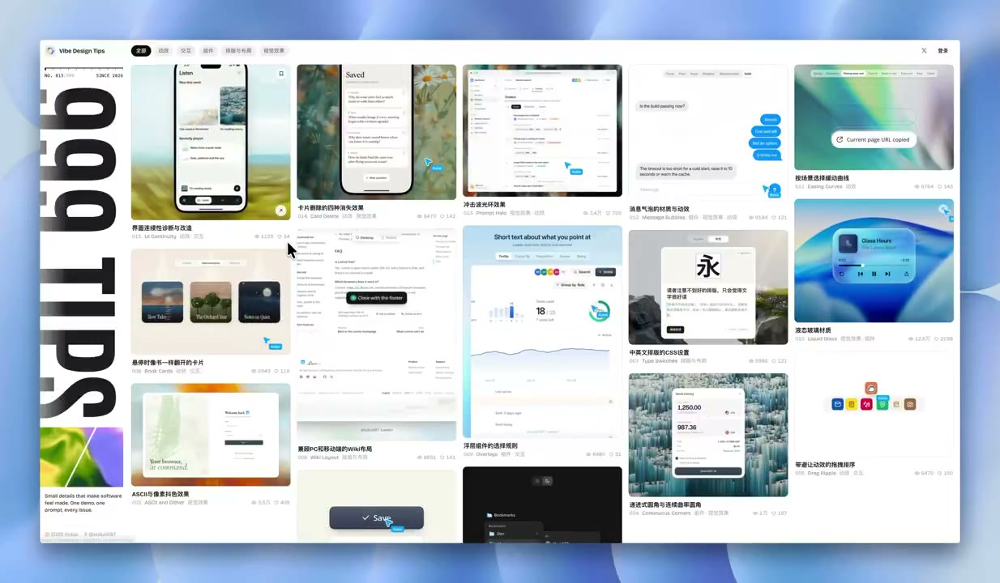
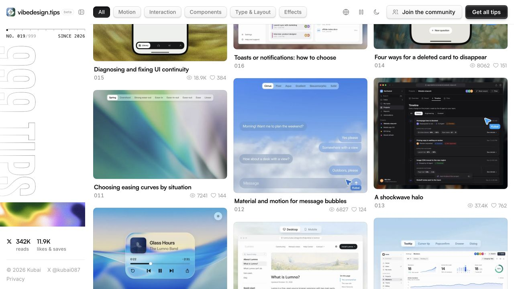
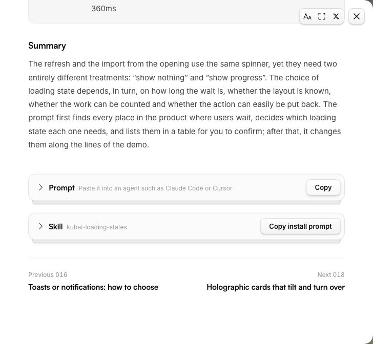

## 問題

設計優化教程分散在多篇貼文時，讀者需要先找到相似情境，再把做法交給 Agent。若入口只有文字清單，較難快速比較不同介面示例。

## 做法

Kubai 於 2026-11-11 預告把自己的教程整合成網頁，採雜誌風格，並計畫提供指令匯出與 AI Agent 閱讀方式。這是方向預告，不能據此認定匯出或 Agent 入口已交付。

影片左側放大型直排「999 TIPS」，右側用多欄縮圖排列手機頁面、表單、圖示與動效示例。部分畫面保留整體網格，部分則讓周圍縮圖淡化、突出一張預覽；視覺索引與單例閱讀共用同一個版面。

*0.607 秒：左側直排標題旁，多欄縮圖同時呈現不同設計示例。*

*5.463 秒：網格中可見手機頁面、表單與圖示案例，保留不同尺寸比例。*

*12.746 秒：周圍部分縮圖淡化，手機頁面預覽仍維持較強對比。*

[本地預告影片](01-source.mp4)

## 為什麼有效（推論）

收錄者推論：縮圖與分類可支援按外觀或問題尋找案例，再進入具體做法；將背景、規則與參數放在複製入口之前，可能減少只搬用效果而忽略適用條件的情況。本次沒有實際 Agent 讀取或實作結果。

## 借鑑要點

- **適合**：已有一批可視化案例、同時服務人與 Agent 的教程庫。
- **不適合**：主要靠長文論證、縮圖無法區分內容的資料集。
- **移植時注意**：縮圖旁補上問題與標題，保留文字搜尋和鍵盤入口；另定義匯出內容與來源欄位，避免只匯出外觀指令而丟失適用條件。

## 2026-11-18：官網實測補充

作者[當日社群說明](https://x.com/Kubai087/status/2123056851189395913)以註冊與支持教程為主，不單憑貼文判定功能。由 [X 個人資料](https://x.com/Kubai087)的網站欄位展開取得[官方網站](https://vibedesign.tips/)，再於瀏覽器實際觀察以下公開介面。前面的 11 月 11 日畫面保留為預告歷史；本卡改列 product 是因為現在可直接使用網站。

*官網以不等高三欄縮圖排列教程，標題與期號置於圖下，左側保留大型直排 999 TIPS。*

- 頂列提供 All、Motion、Interaction、Components、Type & Layout、Effects 分類，並有語言、自動播放與深色模式入口；本次只核對入口，未逐項驗證切換結果。側欄標示 NO. 019 / 999，公開索引列出 001–019。
- 點選教程開啟大幅閱讀面板，網址同時切到該期固定路徑。左側呈現示例，右側依 Background、Where it applies、How to decide、Design rules、Parameters、Summary 編排文字；右上提供文字大小、專注閱讀、X 原帖與關閉入口，文末可切換前後期。

*017 詳情文末將 Prompt 與 Skill 分成兩個收合列，分別附 Copy 與 Copy install prompt；本圖裁去示例中的人名與帳號。*

- [017 Loading States](https://vibedesign.tips/017-loading-states/)的公開頁已提供 Prompt 與 `kubai-loading-states` Skill。它們是交給 Agent 的文字入口；本次不保存完整指令、不安裝 Skill。點擊 Copy 後未取得剪貼簿內容，也未見可確認的成功狀態，因此只能確認入口與公開內容存在，不能宣稱複製成功或 Agent 已讀取。

*點擊 Get all tips 後出現登入面板，說明可一次下載全部教程，提供 Google、GitHub 與 X 登入方式。*

- Get all tips 的未登入流程止於登入面板；未登入、未下載，未驗證檔案格式或機器可讀端點。
- Join the community 開啟獨立付費社群面板，清楚區分「教程免費」與付費交流，說明社群不另提供課程。本次沒有加入或付款，也不收存付款聯絡 QR 圖。此處為網站當時的文案，不是免費政策的長期保證。

### 官方期號與來源對照（只作查證線索）

以下均為實際打開的官網詳情頁及其 View the post on X 回鏈；其他卡片與來源索引未在本次修改。

| 期號 | 官網詳情 | 官網直接回鏈 |
| --- | --- | --- |
| 003 | [ASCII and dither effects](https://vibedesign.tips/003-ascii-dither/) | [2115091203465290087](https://x.com/kubai087/status/2115091203465290087) |
| 006 | [Cards that open like a book on hover](https://vibedesign.tips/006-book-cards/) | [2116198373040759107](https://x.com/kubai087/status/2116198373040759107) |
| 013 | [A shockwave halo](https://vibedesign.tips/013-shockwave-glow/) | [2119359092334743735](https://x.com/kubai087/status/2119359092334743735) |
| 017 | [Diagnosing and fixing loading states](https://vibedesign.tips/017-loading-states/) | [2121449185014845794](https://x.com/kubai087/status/2121449185014845794) |
| 019 | [Five card interactions driven by scrolling](https://vibedesign.tips/019-scroll-cards/) | [2122492414598459820](https://x.com/kubai087/status/2122492414598459820) |

003 與 006 已有公開的背景、適用情境、判斷、規則、參數與 Prompt／Skill 區塊，可補充官網一手來源；這不代表舊 X 貼文全文已恢復。013 的官網明列期號，017 的官網已可讀取指令內容；採用者應保留查證日期與來源差異。
