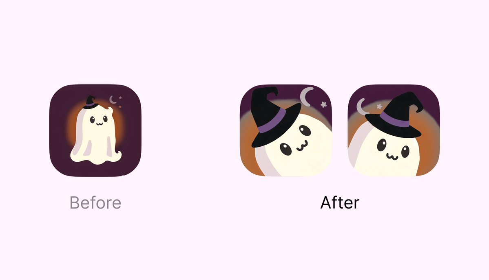

## 問題

AI 生成的吉祥物即使完整可愛，縮進 App 圖標後也可能主體太小、配件看不清。重做角色並非唯一選項，現有素材還可以重新分層與裁切。

## 做法

Kubai 於 2026-11-04 提出四步構圖法：先用 AI 拆圖層，再放大主角並沿對角線安排，營造從窗外探頭的感覺；接著放大角色配飾，最後利用剩餘空間放裝飾元素。這是作者的改作建議，原帖未公開拆圖工具、參數或實際可編輯檔。

附圖左側 Before 是居中的完整小幽靈，黑帽、月亮與星星只占少量空間；右側兩個 After 把臉部與帽子放大，身體被圖標邊界裁切，兩種版本的傾斜方向與月亮位置不同。可觀察的改動是主次比例與取景，不是角色造型全部重畫。

*左側是完整小角色，右側兩版放大臉與帽子，利用邊界裁切形成近距離取景。*

## 為什麼有效（推論）

收錄者推論：放大辨識部位，可能讓小尺寸下更容易看見表情與配飾；對角線也增加畫面方向感。作者稱改後較可用，沒有提供辨識率或商店成效數據。

## 借鑑要點

- **適合**：臉部特徵清楚、允許裁切的角色型圖標。
- **不適合**：全身輪廓或完整字標才是主要識別的品牌。
- **移植時注意**：先預覽小尺寸與不同圓角遮罩，再決定裁切幅度；拆層後補好邊緣，確保帽子、眼睛與月亮不互相遮擋，空間不足時寧可減少裝飾。
