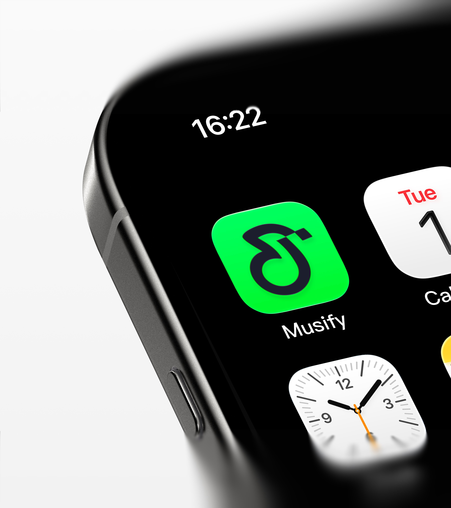
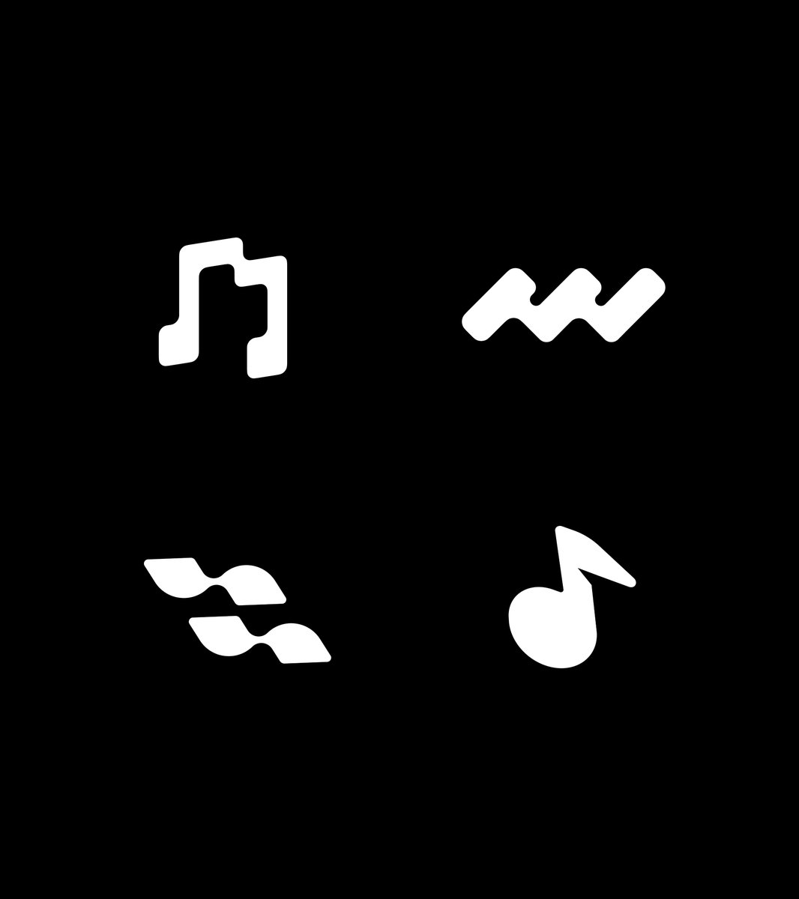

## 問題

本地音樂播放器如何在常見音符符號中形成自己的輪廓，同時能放進主畫面圖示與品牌字標？

## 做法

*白色音符標誌與 Musify 字標並排，背景使用綠色與藍紫色的光譜質感。*

*手機主畫面模型中，亮綠圓角方形承載深色音符，下方標為 Musify。*

*深色背景上單獨展示亮綠圖示，音符以厚實曲線、封閉內空間與右上階梯狀末端構成。*

*黑底排列四個白色音樂相關造形；來源未標明其為候選稿、演變步驟或最終套件。*

- 作者正文說明以八分音符為原型，對整體變形與傾斜以表現線條流暢，符尾末端做像素階梯處理，意圖帶出 Pop 感；這是作者的設計說明。
- 圖中把圓弧主體與方正尾端放在同一輪廓，保留單一高對比符號；品牌組合使用白色，App 圖示則用深色符號配綠底。
- 主畫面圖是展示模型，不能據此判定已安裝、已上線或實機辨識良好；四張均為靜態圖片，沒有動畫流程。

## 為什麼有效（推論）

- 音符能提供音樂類別線索，局部階梯與傾斜可能讓輪廓更有辨識度，而不必在圖示內放文字。
- 深淺反差與大面積留白可能有利於縮小後辨認；來源沒有可用性或辨識率測試，細小階梯也可能在小尺寸消失。

## 借鑑要點

- **適合**：需要讓常見類別符號帶有品牌差異的工具或媒體 App。
- **不適合**：直接複製既有品牌輪廓，或用展示大圖代替小尺寸驗收。
- **移植時注意**：先測單色輪廓，再測主畫面實際尺寸、深淺外觀與系統遮罩；保留核心內空間，確認末端階梯不會糊成雜點。

## 來源與核實

[設計原帖](https://x.com/Kubai087/status/2125378936158704001)發布於 **2026-11-25T00:00:00Z**，作者枯白 Kubai；正文指出開發者為 RobinJ（@robinjdev）。以指定官方頁面擷取資料核對全文、作者、時間及四張照片，全部下載並逐張檢視。部分帶尺寸參數的官方圖片網址回應 403，改用同一官方 CDN 的原始網址後取得，無圖片缺漏。

同頁[開發者回覆](https://x.com/robinjdev/status/2125461780000542873)發布於 **2026-11-25T05:29:12Z**，感謝設計並稱淺聽已上架 App Store；本次未獨立查證商店及此圖示的採用版本，故仍以 concept 記錄此設計展示，並不表示產品尚未上線。全庫依產品名、原帖 ID 查重，未找到同產品同流程案例。
