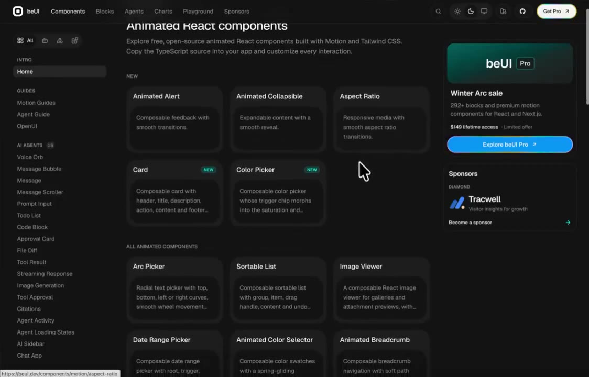

## 問題

尋找動效元件時，單一控制項、轉場範例與完整畫面的用途不同。只憑展示效果挑選，容易忽略要借鑑的是哪一層設計。

## 做法

Kubai 於 2026-10-31 推薦 @neropursue 的彙整帖。原帖列出九個資源連結，涵蓋 React 元件、免費動效、介面轉場、彈簧動畫與組合區塊。這是多個來源的清單，不能把所有作品歸給清單作者或 Kubai。

被引用影片依序展示不同網站，包含管理介面、動效元件目錄及完整畫面範例。原帖所稱可直接使用、免費或資源數量，均屬當時介紹，沒有在本卡核對版本、授權或整合結果。

*12.91 秒：深色目錄頁以卡片列出多種元件範例。*

*20.854 秒：另一網站以「完整畫面」為主題展示 AI 產品介面資源。*

[@neropursue 彙整帖的本地影片](01-source.mp4)（約 23.83 秒）。

## 為什麼有效（推論）

收錄者推論：同時比較元件與畫面層級，可以更清楚界定需要的是局部互動，還是整體資訊組織；這份清單本身不構成品質排名。

## 借鑑要點

- **適合**：先找候選範例，再回到原資源核對用途。
- **不適合**：將多個展示頁的不同風格直接拼成同一產品。
- **移植時注意**：先定義元件角色，確認鍵盤、觸控、減少動態效果及依賴條件，再評估能否納入現有設計系統。

原帖：[Kubai 推薦](https://x.com/Kubai087/status/2116378455571091744)、[原始資源清單及連結](https://x.com/neropursue/status/2116160644571345199)。
