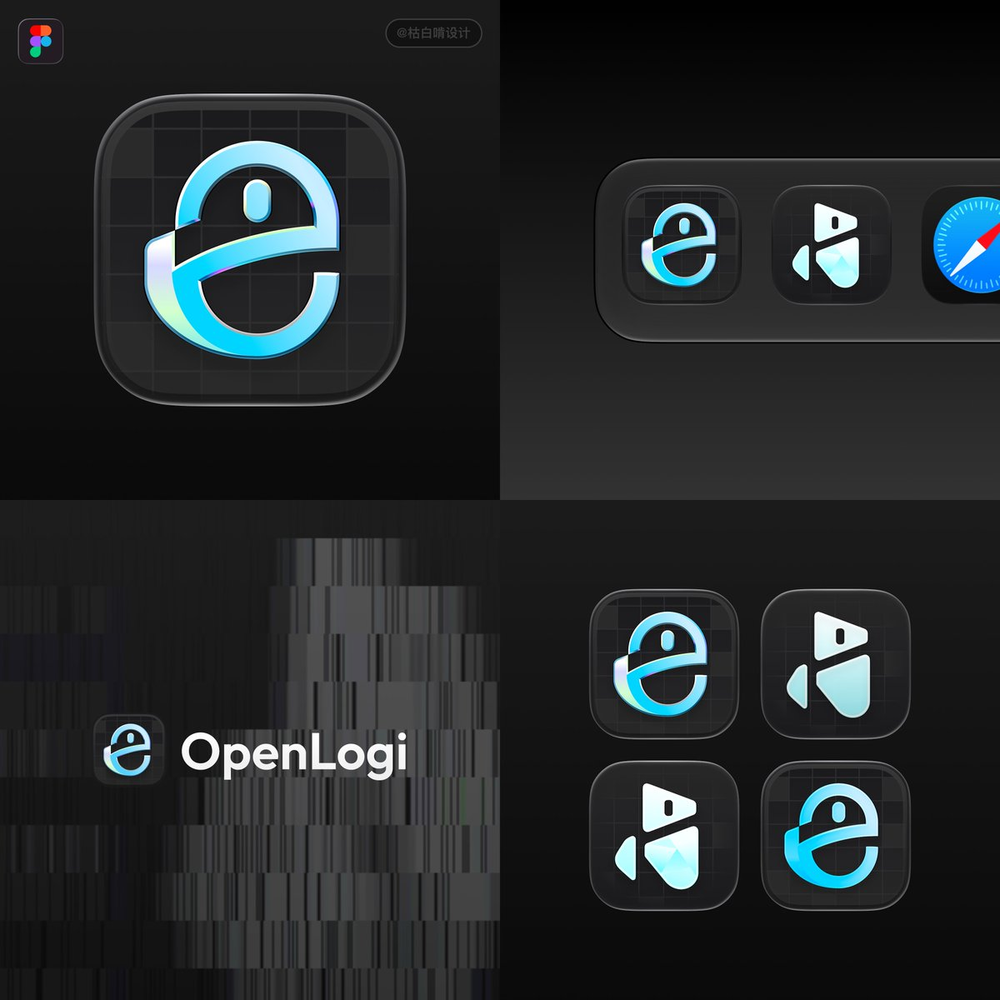

## 問題

周邊設定工具的圖標需要提示用途，同時在深色桌面與其他應用圖示之間保有清楚輪廓。

## 做法

*深灰圓角方形內置藍青色帶狀圖形，上方的小膠囊形狀帶出滑鼠滾輪意象。*

原作者陳述：Kubai 表示 OpenLogi 的 icon 由自己製作。展示圖把大圖標、名稱組合及 Dock 尺寸的並列情境放在同一張板上；背景網格較暗，主要輪廓以亮色漸層和細邊緣拉開層次。被引用的 realchendahuang 原帖介紹它是羅技周邊的開源設定工具；安裝包約三十多 MB、裝置適配與免費等說法均屬該帖當時的使用分享，本卡未重驗。

## 為什麼有效（推論）

收錄者推論：把滑鼠的滾輪與外殼曲線濃縮成單一符號，可提示工具類型，避免直接塞入完整硬體插畫。深色底上的亮色主體也可能有助於縮小後分辨，但圖標不能證明軟體相容性或操作品質。

## 借鑑要點

- **適合**：有明確硬體意象的桌面工具。
- **不適合**：需要一次表達多種無關裝置的圖標。
- **移植時注意**：保留輪廓與中心留白，再檢查小尺寸下網格及高光是否干擾主體。

原帖：[Kubai 的圖標署名](https://x.com/Kubai087/status/2116790156565107048)、[realchendahuang 的產品使用分享](https://x.com/realchendahuang/status/2116755063037469093)。
